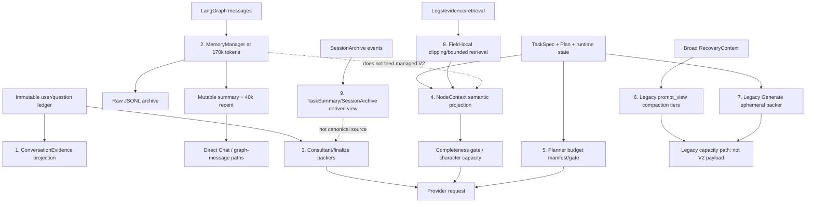

# BioMind Context, Memory, and Compression Contract Audit

Status: historical audit with current-contract amendment

Snapshot: `02d8232f147160927e2f65b979769811c3dd209f` plus the pre-existing dirty worktree on 2026-08-18. Production context code had no local diff.

## Current semantic projection amendment (2026-08-19)

Generic user requirements now have one canonical authority:
`TaskSpec.requirements[]`. Fresh rows preserve ordered, self-contained open
text and provenance without synthesizing semantic keys, categories, operators,
enforcement scopes, constraint handles, or Plan claims. NodeContext projects
the complete ordered list as `highlighted_constraints[{text, importance,
source_refs}]` to Planner, Plan Repair, Generate, and Recovery. The same list
is rendered before the steps in Human Plan Review.

The Controller no longer claims to prove arbitrary natural-language semantic
compliance. Planner reasoning plus human review own that semantic boundary.
Typed input/output/artifact/DAG/renderer/runtime/approval contracts, explicit
`failure_policy.*`, and `forbidden_behavior.runtime_install` remain
deterministic. Historical constraint handles and claims remain read-only
compatibility data.

## Verdict

BioMind does not have one compression subsystem. It has nine independent projection, packing, clipping, or summarization mechanisms with different owners, inputs, triggers, outputs, and consumers. They do not share a session semantic-history budget, a common disclosure state machine, or a frozen summary-checkpoint format.

The graph `MemoryManager` is only one mechanism. It compresses LangGraph `messages`; it does not compress the durable raw conversation ledger, TaskSpec, PlanState, or NodeContext V2 payload. Current managed V2 Planner, Generate, Recovery, and Supervisor do not consume its summary.

## Current compression architecture



Solid edges are current data flow. Dashed edges mark absent/non-authoritative reuse. Similar names such as “summary,” “budget,” and “compression” do not imply shared state or policy.

## Mechanism inventory

| # | Mechanism | Owner | Input | Trigger | Output | Current consumers | State |
|---:|---|---|---|---|---|---|---|
| 1 | immutable conversation projection | `StateContractStore`, BioMind controller | linked `user`/`consultant_question` objects | every Consultant/Triage reconstruction | ordered ConversationEvidence | Triage and Consultant V2 | IMPLEMENTED |
| 2 | graph message compression | `MemoryManager` | LangGraph `messages` | estimated tokens >= 85% of 200k | new System summary + retained messages; raw JSONL archive/index/audit | Direct Chat and graph-message compatibility; not managed V2 nodes | IMPLEMENTED but semantically disconnected from managed V2 |
| 3 | Consultant/finalize packing | Consultant controller/prompt manager | conversation evidence, TaskSpec, capabilities, feedback; finalize artifacts | Consultant normal/finalize calls and hard budget checks | one prompt or typed capacity/finalize error | Consultant provider path | IMPLEMENTED; legacy components partly dormant |
| 4 | NodeContext V2 projection/capacity | `agent_core/node_context.py` | canonical TaskSpec, PlanSnapshot/current step, runtime/evidence/feedback | each managed node call | complete LLMPayload or `CONTEXT_CAPACITY_EXCEEDED` | Consultant, Planner, Generate, Recovery, Supervisor | IMPLEMENTED |
| 5 | Planner budget manifest/gate | Planner controller | static, required, optional/compressible components | Planner call construction | budget decision and manifest | Planner | PARTIALLY_IMPLEMENTED; current V2 has `compressible_chars=0` |
| 6 | Recovery `prompt_view()` tiers | `RecoveryContext` diagnostics | broad durable RecoveryContext including filesystem evidence | legacy Execute capacity gate; candidate exceeds char budget | same categories with shorter strings/list tails or capacity error | legacy gate/compatibility, not Recovery V2 request | LEGACY |
| 7 | Generate ephemeral context packer | legacy Generate controller | graph/user/task/plan/feedback context | legacy Generate prompt construction | clipped/packed legacy prompt | compatibility only; current V2 uses NodeContext | LEGACY |
| 8 | field-local evidence and retrieval bounds | Supervisor, diagnostics, archive/Wiki/runtime helpers | streams, logs, attempts, retrieval hits, artifacts | each builder/query | excerpts, tails, bounded lists/references | relevant node-specific builders | IMPLEMENTED, distributed |
| 9 | SessionArchive and TaskSummary | memory archive/report layer | bounded persisted session events | archive/replay/report construction | bounded event view and deterministic <=10k report/cache | reporting/recovery helpers where called; explicitly not source of truth | IMPLEMENTED derived view |

Provider model context enforcement is an external boundary, not a tenth compressor.

## MemoryManager exact contract

Source: `memory_manager.py:109-221,328-445`; invocation: `bio_agents.py:12327-12375`.

| Parameter/behavior | Current value |
|---|---|
| maximum graph-message budget | 200,000 estimated tokens |
| compression trigger | 0.85, therefore 170,000 tokens |
| recent non-System retention target | 40,000 tokens |
| summary maximum | resolved configuration; current default behavior targets 900 words |
| trigger comparison | compress when `total >= threshold` |
| trigger locations | after profiled Consultant and Generate results only |
| compressed object | LangGraph `messages` list |
| never compressed by this class | immutable conversation ledger, TaskSpec, PlanState/Snapshot, NodeContext, provider trace |
| protected during split | first stable SystemMessage, prior compression summaries, protected plan messages, then newest non-System messages within 40k |
| archived raw form | JSONL file, indexed by `memory_index.json` |
| prompt replacement | `[Memory Compression #N]` SystemMessage at position zero plus retained messages |
| archive search | keyword-based `search_archives()`; no current production call site in `bio_agents.py` |

There is no separate soft and hard graph threshold beyond the 170k trigger and nominal 200k maximum. Compression is attempted at the trigger; failure/no archive candidate leaves the old messages. The 200k value is not a provider-enforced hard ceiling.

### Observed runtime compression

Only `session_1783096422` had local archives: seven compression records.

| Measure | Observed range |
|---|---:|
| estimated tokens before | 170,229-171,729 |
| estimated tokens after | 42,570-43,372 |
| generated summary chars | 7,303-9,630 |
| summary-prompt chars | approximately 489,616-496,528 |
| consecutive summary LCP | 70-114 chars |
| LCP ratio | 0.8%-1.56% |

Every compression calls the summarizer again over the newly archived segment and writes a new summary header with a sequence number and archive filename. It is not a deterministic or immutable checkpoint. If consumed at the beginning of a provider request, it is a strong prefix breaker.

Current managed V2 nodes construct fresh one-message prompts and do not read graph messages. Therefore:

- Planner/Generate/Recovery/Supervisor provider prefix impact: none from MemoryManager today;
- Direct Chat/legacy graph consumer impact: changing prefix from the first summary characters;
- durable raw user history impact: none;
- cache hit conclusion: still `NOT_OBSERVABLE` because structural change is not usage evidence.

## NodeContext V2 contract

Source: `agent_core/node_context.py:818-979,1026-1216`.

NodeContext projects semantic facts by node:

- Consultant/Planner get required task semantics;
- Generate/Recovery use identity/reference-driven current-step dependency closure plus the complete ordered open-text Highlighted Constraint List; Supervisor retains its post-execution structured QA projection;
- optional runtime, feedback, evidence, and allowed operations are node-specific;
- top-level JSON is deterministic/sorted, but alphabetic order often places dynamic state before stable TaskSpec.

Capacity behavior is fail-closed:

1. build the complete required semantic payload;
2. serialize it;
3. compare character count to `max_payload_chars` if supplied;
4. raise `CONTEXT_CAPACITY_EXCEEDED` rather than silently truncate a semantic list.

The ordinary caller-derived cap is `llm_context_limit_tokens * 4`; with the current 200k token setting this is approximately 800,000 LLMPayload characters. Static prompt, message envelope, tool schemas, and output reserve are outside that character count, so it is not identical to provider tokens.

State: **IMPLEMENTED completeness gate, not compression and not progressive disclosure**.

## Consultant and Planner budgets

### Consultant

Configured pools include approximately 100,000 tokens for history, 100,000 for skill material, and 8,192 output headroom. The current normal V2 call places ConversationEvidence in required NodeContext and leaves legacy graph-history packing components empty. Finalize uses separate artifact-first, lossless contract loading/repair prompts.

The important distinction is:

- a configured pool does not prove that graph history is consumed;
- a computed Wiki/memory packet does not prove it is serialized;
- current V2 hard-gates required material instead of summarizing the conversation ledger.

State: **IMPLEMENTED required-context gate; PARTIALLY_IMPLEMENTED legacy packer; no shared memory contract**.

### Planner

The Planner manifest carries a nominal 50,000-character target, 0.60 soft marker, 0.75 compression marker, 0.90 hard marker, and 8,192-token headroom. Current V2 required prompt construction reports no optional compressible region (`compressible_chars=0`), so the labels do not produce an actual progressive compaction sequence.

Planner sees canonical TaskSpec/runtime/feedback/capabilities, not raw transcript/candidates. Its effective behavior is a complete required projection plus hard capacity decision.

State: **PARTIALLY_IMPLEMENTED budget telemetry; MISSING semantic compaction ladder**.

## Recovery mechanisms

### Current Recovery V2

Current provider input is a NodeContext V2 current-step projection. It is one-shot. There is no “ask for category, append it, call again” loop. The broad durable RecoveryContext and filesystem evidence are not the provider payload.

State: **IMPLEMENTED one-shot projection; MISSING iterative progressive disclosure**.

### Legacy `RecoveryContext.prompt_view()`

`DiagnosticLimits.max_context_chars` defaults to 26,000 characters. `prompt_view()` tests raw form then tiers with approximate string/list limits:

| Tier | String cap | List tail | Categories removed? |
|---|---:|---:|---|
| 1 | 3,000 | 24 | no |
| 2 | 1,200 | 12 | no |
| 3 | 480 | 6 | no |
| 4 | 160 | 3 | no |

All semantic/evidence category keys remain. It is compression fallback driven only by serialized size, not evidence need. If nothing fits, it returns a typed capacity result. The current V2 call builds a different payload after/independent of this legacy gate depending on entry path.

State: **LEGACY compression fallback; not semantic progressive disclosure**.

### Position of a future 256k ceiling

A 256k Recovery value should be defined at the node/provider request policy layer as a **hard cumulative ceiling for one Recovery disclosure episode**. It should be distinct from:

- a small initial Recovery target;
- the global session semantic-history size;
- MemoryManager's graph-message trigger;
- raw RecoveryContext size;
- the provider model's ultimate context limit.

Changing legacy 26,000 characters to 256,000 would not create a disclosure protocol and must not be described as a global memory budget.

## Field-local clipping and derived summaries

These are independent bounded views, not a global compressor:

- Supervisor action <=4,000 chars, task context <=2,000, stdout <=6,000, stderr tail <=4,000;
- Recovery bounded evidence/attempt summaries and legacy diagnostic tiers;
- filesystem evidence preview limits and metadata-only denylist;
- SessionArchive large-field externalization and bounded event retrieval;
- TaskSummary up to 300 events and <=10,000 chars, explicitly not source of truth;
- Wiki digest/search hit formatting and caches;
- Consultant/Plan/Recovery summaries and plan prose projections.

TaskSummary is deterministic as a derived report, while MemoryManager summary is LLM-generated. Neither is the canonical semantic transcript.

## Immutable checkpoint audit

Required pattern:

```text
Turns 1-30 -> create once -> immutable semantic checkpoint
append Turns 31+
```

Current result: **MISSING**.

The conversation ledger and JSONL archives are immutable raw evidence, but there is no versioned, frozen, provider-ready semantic checkpoint with an authority hash and append-only tail. MemoryManager retains older summaries while adding a newly generated summary, which is not the same contract.

## Unified budget audit

| Budget concept | Exists globally? | Current reality |
|---|---|---|
| session semantic-history budget | no | no unified semantic transcript |
| node initial target | no common contract | each node/builder differs |
| node hard ceiling | no common contract | NodeContext chars, Planner telemetry, legacy Recovery chars |
| memory compression threshold | yes only for graph messages | 170k trigger, 40k recent |
| provider model limit | configured | usually 200k tokens; external boundary |
| output/headroom reserve | node-specific | e.g. 8,192 in Consultant/Planner paths |
| cumulative disclosure budget | no | iterative disclosure missing |

## Contract risks

1. `MemoryManager` name suggests global memory, but managed V2 nodes do not consume it.
2. character limits and provider token limits are mixed across layers.
3. summaries differ in authority/determinism but share generic names.
4. current-step projection prevents silent bloat but raises semantic dependence on TaskSpec/Plan integrity.
5. legacy Recovery filesystem evidence can mix `INTERNAL_OBSERVABILITY` with `TASK_EVIDENCE` before the V2 boundary.
6. sorted JSON gives determinism but places early volatile sections before stable task facts.
7. there is no frozen checkpoint that can serve as an explicitly versioned cacheable prefix.

## Baseline status summary

| Capability | Status |
|---|---|
| durable raw user/question ledger | IMPLEMENTED |
| graph-message raw archive | IMPLEMENTED |
| graph-message LLM summary | IMPLEMENTED |
| managed V2 consumption of graph summary | MISSING |
| complete current-step NodeContext projection | IMPLEMENTED |
| silent semantic truncation in NodeContext | intentionally absent |
| global semantic transcript | MISSING |
| immutable semantic summary checkpoint | MISSING |
| shared session/node/disclosure budget | MISSING |
| iterative Recovery disclosure | MISSING |
| legacy Recovery size compaction | LEGACY |
| provider cache metrics persistence | MISSING (`CACHE_METRICS_NOT_PERSISTED`) |
