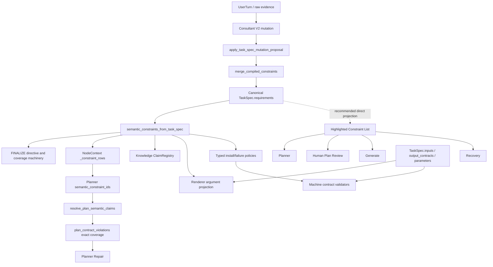
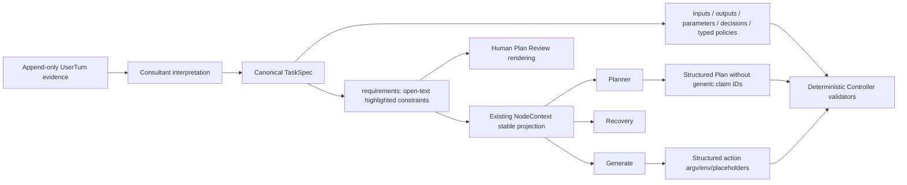

# BioMind Generic Semantic Constraint Retirement and Highlighted Constraint Migration Audit

- Audit date: **2026-08-18**
- Repository: `/public/home/liusiqi/03.毕设/Biomind_v1`
- Snapshot: branch **codex/save-current-work**, HEAD **77d71307b3269d2e16f1e556fcca5b00e5f10452** (`test(context): cover semantic history and stable prompt prefixes`)
- Audit mode: **Architecture Audit Only**. Read-only source, test, state-contract, prompt, and targeted Git-history inspection; no workflow or benchmark rerun.
- Factual baseline: `docs/audits/architecture/planner_constraint_provenance_projection_audit_20260818.md`. Its incident reconstruction is accepted here and is not repeated as a fresh root-cause audit.
- Working-tree boundary: the checkout was already substantially dirty. This document is the only file created by this audit; no pre-existing tracked or untracked content was changed.

## 1. Executive Conclusion

The recommended architecture is **Migration Option A: reuse `TaskSpec.requirements` as the single canonical Highlighted Constraint List, remove generic ontology/claim coverage from new plans, and retain only explicitly machine-verifiable structured contracts**. `highlighted_constraints` should be a projection label shown to models and humans, not a new persisted TaskSpec field.

The architectural cut is not “delete every function containing `semantic` or `constraint`.” Several of those functions also carry input/output binding, renderer argument projection, approval invalidation, runtime install policy, typed failure policy, artifact handles, or knowledge/evidence lineage. The safe cut is:

1. Open-world natural-language requirements remain canonical text rows in `TaskSpec.requirements`.
2. Generic rows no longer require `semantic_key`, category, operator, enforcement scope, constraint handle, `semantic_constraint_ids`, or exact `semantic_claims` coverage.
3. Planner, human Plan Review, Planner Repair, Generate, and Recovery receive the same ordered textual list from the same TaskSpec revision.
4. The Controller continues to validate structured inputs, outputs, artifacts, dependencies, renderer bindings, argv/env/placeholders, runtime evidence, exit codes, approval hashes, and the two currently implemented typed runtime-policy families.
5. No keyword/path matcher, natural-language Controller rule engine, or new Semantic Reviewer is introduced.

### Direct answers to Q1-Q8

| Question | Answer | Evidence class | Confidence |
| --- | --- | --- | --- |
| **Q1. Is a new canonical field required?** | **No. Reuse `TaskSpec.requirements`.** For generic rows, `value` is the authoritative constraint text, `strength`/`level` can supply display importance, and `source_ref` plus `provenance` supply source references. The name `highlighted_constraints` may be used only in prompt/review projections. | FACT about current schema; INFERENCE for the recommended product mapping | HIGH |
| **Q2. Which generic registry fields retire?** | For open-world text: `semantic_key`, category, generic operator, `enforcement_scope`, ontology aliases, generic `constraint_id` handles, step `semantic_constraint_ids`, and generic `semantic_claims` coverage retire as required semantics. `strength` is simplified to importance; provenance fields remain. Exact fields may remain temporarily in legacy readers and in explicitly typed machine-policy rows. | FACT plus migration recommendation | HIGH |
| **Q3. Which similarly named functions cannot simply be deleted?** | `normalize_requirement`, `merge_compiled_constraints`, `semantic_constraints_from_task_spec`, `project_task_spec_to_renderer`, `_knowledge_claim_registry`, `typed_task_plan_traceability`, `resolve_plan_proposal_handles`, shared NodeContext handle helpers, and plan approval/hash functions all have non-generic consumers or compatibility duties. `semantic_install_policy` and `evaluate_failure_policies` are direct deterministic machine-policy consumers and must be retained. | FACT | HIGH |
| **Q4. After removing `SEMANTIC_CONSTRAINT_UNCOVERED`, who performs semantic Plan Review?** | There is **no existing independent LLM semantic Plan Review node**. Under the minimal architecture, Planner performs semantic interpretation and self-check; the human Plan Review is shown the same Highlighted Constraint List and approves or sends feedback. Planner Repair only repairs a violation or human-requested delta; it is not an independent reviewer. If unattended independent semantic review is a product requirement, current architecture does not meet it and this audit does not authorize a new reviewer. | FACT | HIGH |
| **Q5. Can Planner, Generate, and Recovery see the same stable list?** | **Yes.** Existing `build_node_context` already gives all three a stable `semantic_history.task_spec` derived from one TaskSpec and separates current focus. Modify that existing projection to expose ordered requirement text rather than constraint handles. Human Plan Review should render the same canonical rows directly from TaskSpec. | FACT plus bounded change recommendation | HIGH |
| **Q6. What is `RUNTIME_GLOBAL_ENFORCEMENT`?** | **PARTIAL.** Arbitrary `runtime_global` prose is prompt-visible but has no generic deterministic enforcement. Exact typed policies such as `forbidden_behavior.runtime_install` and `failure_policy.*` are deterministically consumed by `semantic_install_policy` and `evaluate_failure_policies`. | FACT | HIGH |
| **Q7. What is the minimal migration surface?** | Simplify the generic branches in `normalize_requirement`, Consultant mutation translation/application, TaskSpec-to-context projection, constraint-row projection, Planner/Repair/Generate/Recovery prompts, Plan wire/claim resolution/coverage validation, Plan Review rendering, accepted handoff, generic FINALIZE coverage, and generic knowledge-claim registration. Keep legacy readers during a schema transition. | FACT-supported recommendation | HIGH |
| **Q8. What remains unchanged?** | Structured input/output contracts, artifact identities and handles, plan-step handles, DAG/dependency validation, plan-local artifacts, managed placeholders, renderer invocation binding, approval/CAS/snapshot lineage, Generate action schema, Execute, Supervisor evidence validation, Recovery routing/state, skill capability contracts, and typed runtime policies. | FACT-supported boundary | HIGH |

**Overall conclusion confidence: HIGH (approximately 0.97 for the current call graph and consumer classification; product-policy choices remain explicitly marked as recommendations).**

## 2. Product Decision Being Audited

The audited product decision is interpreted as the following contract:

- Natural-language constraints are open-world. A new wording must not require a pre-registered ontology category, alias, slot, operator, scope, or exact claim ID before it can survive Consultant output.
- The canonical state must carry an authoritative, ordered Highlighted Constraint List with source lineage and attention importance.
- Planner, Plan Review, Planner Repair, Generate, and Recovery must receive that list without semantic rewriting by the Controller.
- Models interpret natural-language meaning. The Controller validates only facts expressible as bounded structured contracts.
- The Controller must not create hidden keyword/path enforcement for arbitrary prose.
- Existing machine-verifiable contracts are not weakened merely because their current implementation uses words such as `semantic`, `constraint`, or `claim`.
- `highlighted_constraints` is a conceptual name. A new persisted field is justified only if no current canonical field can carry the contract without ambiguity or duplication.
- No new Semantic Reviewer, new agent, or new generic rule engine is part of this decision.

The previous incident audit established the factual motivation: a Consultant-produced `forbidden_inputs.demo_files` row crossed a route that did not apply the closed validator, was normalized to `required_behavior.*`, became plan-scoped, triggered `SEMANTIC_CONSTRAINT_UNCOVERED`, and then failed repair. The incident never reached Generate, Execute, or Recovery. This audit accepts that chain and evaluates how to retire the brittle generic mechanism without removing unrelated contracts.

**Evidence classification: FACT for the existing incident and architecture; PRODUCT DECISION for the target behavior.**

## 3. Current Semantic Constraint Lifecycle

The following matrix records whether each layer currently reads or writes the generic semantic fields. “Typed only” means the same field name is also used for a bounded machine contract and cannot be retired globally.

| Layer | Main symbols | `semantic_key` | category | operator | strength | scope | handle / ID | claim | free text | Current consequence |
| --- | --- | --- | --- | --- | --- | --- | --- | --- | --- | --- |
| Raw user ingress | `_persist_user_submission` | No | No | No | No | No | Evidence handle U1/U2 only | No | **Yes** | Original wording is append-only evidence, not yet a constraint row. |
| Consultant V2 prompt/output | `get_consultant_v2_prompt`; `_consultant_task_spec_mutation_proposal` | **Writes** | **Writes** | **Writes** | **Writes** | No direct prompt field | Evidence handles resolved to source refs | No | In `value` | `upsert_constraint` currently requires/encourages closed typed IR. |
| Consultant FINALIZE v2/v4 | `_consultant_finalize_contract_projection`; `consultant_finalize.py` | **Reads/writes/synthesizes** | **Derives** | **Reads/derives** | **Reads** | **Derives** | Directive/constraint IDs | Exact coverage objects | Splits source clauses | Creates synthetic `*.user_directive_<hash>` keys and coverage gaps. |
| TaskSpec mutation admission | `apply_task_spec_mutation_proposal` | Reads as nested data | Implicit | Reads | Reads | Later derived | May read constraint/requirement ID | No | Reads `value` | Operation shape is checked, but the V2 route does not require the closed constraint validator before merge. |
| TaskSpec normalization | `normalize_requirement`; `canonicalize_compiled_constraint` | **Canonicalizes or fabricates** | Derives from key | Defaults | Defaults | **Derives** | Creates/stabilizes IDs | No | Keeps `value`; optional `source_text` | Converts untyped rows into ontology-shaped rows. |
| Canonical TaskSpec | `canonical_current_task_spec` | Stored inside `requirements[]` | Not separate | Stored inside row | Stored inside row | Stored inside row | Requirement/constraint row IDs | No | **`requirements[].value`** | `requirements` is canonical; there is no canonical top-level `semantic_constraints` field. |
| Derived TaskSpec constraint view | `semantic_constraints_from_task_spec` | **Reads/creates** | Derives | Reads/defaults | Reads/defaults | Reads/derives | Creates stable `constraint_id` | No | Reads `value` | Recreates input/output/skill rows and generic requirement rows as one typed list. |
| Legacy Planner contract projection | `format_planner_task_contract_context` | Reads | Derives | Reads | Reads | Splits plan/global | Exposes plan constraint IDs | No | Reads value/source text | Duplicates requirements into `semantic_constraints` and `global_policies`. |
| NodeContext | `_constraint_rows`; `build_node_context` | Reads | No separate field | Reads | Reads | Reads | **Creates constraint handles** | Step references retained | Reads `value` | Stable full task history plus current-step focus, but generic semantics are handle-shaped. |
| Planner prompt | `get_planner_v2_prompt` | Indirect | Indirect | Indirect | Indirect | Indirect | **Requires exact handles** | Must not mint inline claims | Sees value | Must emit `steps[*].semantic_constraint_ids`. |
| Plan wire decode | `structured_plan_candidate_diagnostics` | No inline objects | No | No | No | No | Reads `semantic_constraint_ids` | Requires top-level `semantic_claims=[]`; rejects step inline claims | Checklist prose only | Treats semantic truth as TaskSpec-owned exact references. |
| Plan normalization/resolution | `resolve_plan_semantic_claims` | Resolves from TaskSpec | Derives | Reads | Reads | Reads | Resolves IDs | **Materializes claims** | No interpretation | Unknown IDs become `SEMANTIC_CONSTRAINT_REFERENCE_INVALID`. |
| Plan contract validation | `plan_contract_violations` | Exact comparison | Derives | Exact/implicit | Tests hard/required | Uses plan projection predicate | Indirect | **Requires exact coverage** | Does not interpret checklist prose | Missing plan-scoped coverage becomes `SEMANTIC_CONSTRAINT_UNCOVERED`. |
| Human Plan Review | `render_plan_review_content`; `plan_review` | Not displayed | No | No | No | No | Not displayed | Claims affect approval projection but are not shown as a list | **Constraint text not displayed** | Review is human plus deterministic validators, not an LLM semantic reviewer. |
| Planner Repair | `get_plan_repair_v2_prompt`; `resolve_plan_proposal_handles` | Indirect | Indirect | Indirect | Indirect | Indirect | **Requires constraint handles** | New step later resolves claims | Sees TaskSpec context | Repairs only actionable violations and allowed steps. |
| Generate | `build_node_context`; `get_generate_v2_prompt` | Indirect in history | Indirect | Indirect | Indirect | Focus includes global/hard rows | Handles | Approved-plan claims may appear | **Yes, via stable history** | Prompt does not explicitly name the list as mandatory. |
| Execute | `execute_logic`; `_knowledge_claim_registry`; `evaluate_failure_policies` | **Typed only plus generic registry** | Derives | Typed checks | Typed checks | No generic text interpreter | Claim IDs internal | Knowledge claims and runtime semantic claims | No generic interpretation | Typed failure policies and claim conflicts can block; arbitrary prose is not checked. |
| Supervisor | `_effective_declared_requirements`; `evaluate_requirements` | Normalization side effect | Indirect | Indirect | Level-based | No | No | No | Value presence only | A non-empty prose value is considered “present”; this is not semantic compliance review. |
| Recovery | `build_node_context`; `get_recovery_v2_prompt` | Indirect in history | Indirect | Indirect | Indirect | Focus can include global/hard rows | Handles | Recovery proposal may contain legacy claims | **Yes, via stable history** | Model can see the constraint but prompt does not explicitly require list preservation. |

The lifecycle demonstrates why a narrow deletion is required. Generic exact coverage is concentrated in Consultant FINALIZE classification, TaskSpec ontology normalization, NodeContext constraint handles, Plan references, and Plan coverage validation. Artifact/output/runtime consumers share adjacent infrastructure but do not require generic natural-language ontology.

**Evidence classification: FACT. Confidence: HIGH.**

## 4. Current Canonical Authorities

| Meaning | Current canonical authority | Derived or duplicate views | Audit conclusion |
| --- | --- | --- | --- |
| User wording and correction history | Raw submission object plus append-only UserTurn evidence | Consultant prompts, accepted handoff summary | Retain as provenance; do not use raw prompt as current state after supersession. |
| Current generic requirement meaning | `TaskSpec.requirements[]` returned by `canonical_current_task_spec` | `semantic_constraints_from_task_spec`, Planner contract `semantic_constraints`, NodeContext `constraints`, accepted handoff `hard_constraints` | `requirements` is the correct authority for the Highlighted Constraint List. |
| Inputs | `TaskSpec.inputs[]` | Synthetic `required_input.*` constraints; NodeContext artifact rows | Keep structured input authority; retire generic constraint duplication. |
| Outputs | `TaskSpec.output_contracts[]` | Synthetic `required_output.*` constraints; renderer semantic claims; plan ownership views | Keep output authority and deterministic producer validation. |
| Parameters | `TaskSpec.parameters` and effective typed fact projection | `required_behavior.*` aliases used by renderer projection | Keep structured parameter binding; stop treating all parameter binding as generic text semantics. |
| Selected skills/capability | selected skill IDs plus capability/skill contracts | Synthetic `required_skill.*` constraint rows | Keep capability contracts; retire generic plan constraint references for skill selection. |
| Unresolved user decisions | `TaskSpec.unresolved_questions` and accepted decisions | `needs_clarification`/ambiguous constraint rows | Prefer existing explicit unresolved-question state; keep legacy flags only for migration. |
| Plan | Controller-owned structured Plan/PlanSnapshot | rendered checklist, approval projection | Keep. Remove only generic claim fields from new Plan schema. |
| Runtime facts | ExecutionEvidence, runtime status, manifests, ValidationEvidence | runtime semantic claims in knowledge registry | Keep facts and typed validators; generic natural-language compliance is not inferred. |

`canonical_current_task_spec` writes only `schema_version`, `canonicalization_version`, `task_id`, `revision`, `goal`, `inputs`, `parameters`, `output_contracts`, `confirmed_decisions`, `unresolved_questions`, `requirements`, and `source_refs`, with optional raw-submission/capability fields. It does **not** write a top-level `semantic_constraints` collection. Consequently, adding `highlighted_constraints` would create a second canonical collection for meaning already present in `requirements`.

`task_semantic_hash` already includes `requirements`, so edits to highlighted text remain approval/staleness-sensitive without claim IDs. This is an important retained deterministic guarantee.

**Evidence classification: FACT. Confidence: HIGH.**

## 5. Semantic Duplication Inventory

| Copy | Representation | Persistence | Producer | Consumers | Future disposition |
| --- | --- | --- | --- | --- | --- |
| 1 | `TaskSpec.requirements[]` | Canonical TaskSpec | Consultant mutation / canonicalizer | All contract projections | **RETAIN as sole generic authority.** |
| 2 | `semantic_constraints_from_task_spec()` result | In-memory; sometimes embedded in other artifacts | TaskSpec projection | Planner context, NodeContext, renderer, policies, knowledge registry, FINALIZE | **SPLIT/SIMPLIFY:** no generic typed reconstruction; keep explicit structured-policy compatibility. |
| 3 | Planner contract `requirements`, `semantic_constraints`, `global_policies` | Prompt text | `format_planner_task_contract_context` | Legacy/detailed Planner prompt | **SIMPLIFY** to one highlighted list plus structured contracts. |
| 4 | NodeContext `task.constraints` and constraint handles | Invocation payload/binding trace | `_constraint_rows` | Planner, Repair, Generate, Recovery | **REPLACE IN EXISTING PROJECTION** with ordered text rows; no constraint handles. |
| 5 | `task_state.accepted_consultant_handoff.hard_constraints` | Durable task state | `_accepted_consultant_handoff_projection` | NodeContext semantic history | **RETIRE duplicate field** after legacy read window. Keep summary/capability/ambiguity handoff fields. |
| 6 | Plan `steps[*].semantic_constraint_ids` | Plan state/PlanSnapshot | Planner | resolver, validator, traceability | **RETIRE for new plans**; legacy reader only. |
| 7 | Plan `steps[*].semantic_claims` | Plan state/PlanSnapshot/approval projection | Controller resolution and renderer binding | validator, renderer, knowledge registry, hashes | **RETIRE generic step claims; RETAIN typed renderer invocation claims until separately migrated.** |
| 8 | Consultant FINALIZE `source_addressable_directives`, coverage gaps, deterministic constraints | Durable FINALIZE artifacts | Controller classifier/compiler | FINALIZE validation/replay | **RETIRE generic exact-coverage semantics; retain source lineage, transport, hashes, skill decisions, and replay records.** |
| 9 | Knowledge `ClaimRegistry` task-contract claims | Durable conflict store | `_knowledge_claim_registry` | Plan Review and Execute conflict guard | **SIMPLIFY** to structured facts/runtime claims; do not register arbitrary highlighted prose as exact propositions. |
| 10 | Legacy `constraint_bindings` / `active_constraints` | Legacy/effective-fact compatibility | fact migration/resolver | legacy conflict helpers | **DO NOT PROMOTE** to the new authority. |

The duplication is not merely storage overhead. Each copy currently changes shape: text becomes a key/operator/value tuple, then a constraint ID, then a handle, then a resolved claim, then a hash/coverage edge. Every conversion is another opportunity for category drift or identity mismatch.

**Evidence classification: FACT. Confidence: HIGH.**

## 6. TaskSpec Schema Audit

### Reuse decision

The existing `requirements[]` row can carry the target contract without a new canonical field:

| Highlight concept | Existing field(s) | Rule |
| --- | --- | --- |
| `text` | `requirements[].value` | Treat `value` as the canonical current wording. Do not rely on `source_text`, which is optional provenance excerpt and is frequently empty. |
| `importance` | `requirements[].strength` or `level` | Reuse a small attention vocabulary. Generic importance guides models/humans; it does not select a Controller enforcement layer. |
| `source_refs` | `source_ref`, `source_id`, `provenance[]`, TaskSpec `source_refs` | Preserve resolved evidence identities. Supporting evidence stays Controller-resolved. |
| stable row mutation identity | `requirement_id` | Retain as a record identity for upsert/remove and diffing. It must not encode semantic ontology. |
| current/superseded state | canonical current TaskSpec plus append-only audit history | Current TaskSpec contains only active rows; historical wording stays in evidence/audit objects. |

The principal incompatibility is `normalize_requirement`: when `semantic_key` is absent, it currently manufactures `required_input.*`, `forbidden_behavior.*`, `conditional_policy.*`, `preference.*`, or `required_behavior.*`. The recommended migration changes this function so a generic text row remains a generic text row. It may still normalize record identity, text, importance, provenance, and status.

Machine-verifiable rows require an explicit exception. Today `failure_policy.*` and `forbidden_behavior.runtime_install` are stored in `requirements` and consumed deterministically. During the minimal migration, these exact namespaced rows remain typed compatibility rows in the same collection. They are not evidence that arbitrary open-world text should retain a registry. A later dedicated structured policy field is a separate product/schema decision and is not required for this migration.

`constraint_bindings` is not a better authority. It is a legacy fact table read by effective-fact compatibility code, while `canonical_current_task_spec` deliberately writes only the compact canonical fields and drops that table. Promoting it would reverse the current canonical-state simplification.

**Recommended canonical invariant:** every generic Highlighted Constraint exists exactly once in `TaskSpec.requirements`; projections may rename the collection for presentation but must preserve ordering, wording, importance, and source identities byte-for-byte/canonically.

**Evidence classification: FACT for schema behavior; INFERENCE for the recommended invariant. Confidence: HIGH.**

## 7. Consultant Mutation Contract Audit

### Active V2 path

The current path is:

`get_consultant_v2_prompt` → model `task_spec_operations` → `_consultant_task_spec_mutation_proposal` → `apply_task_spec_mutation_proposal` → `merge_compiled_constraints` → `normalize_requirement` → canonical `requirements`.

The prompt example currently requires `semantic_key`, `category`, `operator`, `value`, and `strength`. Compact aliases in `_consultant_task_spec_mutation_proposal` can also synthesize a hashed semantic key. `apply_task_spec_mutation_proposal` correctly owns the closed operation allow-list, evidence-handle resolution boundary, revision update, and CAS-compatible canonicalization, but its `upsert_constraint` branch forwards the nested row to `merge_compiled_constraints`.

Recommended V2 change, using existing operations and fields:

- Keep operation name `upsert_constraint` for compatibility.
- Change the generic nested shape to require `value` (text) and optionally `strength`/`level`; do not require `semantic_key`, category, operator, or scope.
- Keep `supporting_evidence` on the operation and resolve it exactly as today.
- Assign or preserve a non-semantic `requirement_id` in Controller state for later removal/update.
- Change `remove_constraint` to prefer `requirement_id`; accept legacy semantic keys only in the migration reader.
- Keep `set_goal`, input/output operations, decisions, ambiguity, operation legality, revisions, and evidence binding unchanged.

### Versioned FINALIZE path

The FINALIZE subsystem is broader than generic constraints. It also owns immutable context IDs, base hashes, provider result classification, retry/repair bounds, work reservation, selected skills, evidence catalogs, durable artifacts, replay, and crash recovery. It must not be deleted wholesale.

Generic retirement candidates are specifically:

- `_consultant_finalize_contract_projection` clause splitting and prohibition classification.
- Synthetic `required_behavior.user_directive_*` / `forbidden_behavior.user_directive_*` creation.
- Coverage gaps that demand one exact semantic tuple per source directive.
- `finalize_coverage_audit` exact semantic match counts.
- V4 directive coverage classification/compilation whose only purpose is to create generic constraint registry entries.
- Prompt schemas and field-repair contracts requiring `semantic_constraints[].semantic_key/operator/strength` for open text.

Retained FINALIZE responsibilities are source-addressable provenance, immutable context/hash binding, ambiguity evidence, skill/capability resolution, provider transport, bounded repair, reservations/capacity, artifact integrity, replay, and terminal failure classification. If FINALIZE still produces a semantic delta, its generic output should be the same open-text requirement rows used by V2, not a second constraint ontology.

**Evidence classification: FACT for current paths and shared responsibilities; INFERENCE for the simplified wire. Confidence: HIGH.**

## 8. Planner Semantic Context Audit

Planner currently receives semantic meaning through overlapping paths:

1. `format_planner_task_contract_context` renders canonical inputs/outputs plus `requirements`, `semantic_constraints`, and `global_policies`.
2. `build_node_context` renders the TaskSpec as `semantic_history.task_spec`, including constraint handles.
3. accepted Consultant handoff can add another `hard_constraints` copy.
4. the Planner prompt instructs exact artifact and constraint handle use.

The recent NodeContext V2 continuity design already supplies the correct delivery mechanism: a stable history prefix for Planner, Planner Repair, Generate, and Recovery, with current feedback/failure isolated in `current_focus`. The migration should use that mechanism instead of inventing a second context service.

Recommended Planner projection:

```json
{
  "semantic_history": {
    "task_spec": {
      "goal": "...",
      "highlighted_constraints": [
        {
          "requirement_id": "...",
          "text": "exact TaskSpec requirements[].value",
          "importance": "required",
          "source_refs": ["U1"]
        }
      ],
      "inputs": [],
      "outputs": [],
      "confirmed_decisions": [],
      "unresolved_questions": []
    }
  }
}
```

This is a **projection shape**, not a proposal to persist a new `highlighted_constraints` field or add a new builder. `build_node_context` can derive it from existing rows. The Planner prompt should state that every highlighted item is authoritative, must be considered when choosing steps/tools/artifacts, and must be checked in the Planner-authored `validation_checklist`; it should no longer request constraint IDs.

`format_planner_task_contract_context` should be simplified for any remaining legacy prompt path so it presents the same list rather than another semantic registry. During migration, tests must prove the legacy and NodeContext projections have identical ordered highlight content for the same TaskSpec revision.

**Evidence classification: FACT plus bounded projection recommendation. Confidence: HIGH.**

## 9. Plan Review / Plan Repair Audit

### Current Plan Review owner

`plan_review` first runs deterministic Plan contract, renderer, output, knowledge-conflict, approval-staleness, and ambiguity gates. It then displays `render_plan_review_content` and asks the human to approve or provide feedback. `render_plan_review_content` shows plan identity, steps, artifacts, dependencies, renderer arguments, output ownership, and cross-step artifact questions. It does **not** show the canonical constraint list.

There is no independent LLM Plan Review prompt. Supervisor is post-execution evidence QA, not plan semantic review. Planner Repair is called only after a deterministic issue or human feedback and is limited to allowed steps; it does not independently decide whether arbitrary natural-language meaning is covered.

### Future semantic review contract

After `SEMANTIC_CONSTRAINT_UNCOVERED` is removed:

- Planner performs the first semantic interpretation and must include a self-check in the existing `validation_checklist`.
- `render_plan_review_content` must display the exact Highlighted Constraint List above the effective Plan so the human can compare them.
- Human rejection/feedback continues through the existing Consultant classification path: TaskSpec semantic changes become TaskSpec operations; plan-only feedback becomes Planner feedback.
- Planner Repair receives the same list from NodeContext and repairs only the requested/deterministically identified delta.
- The Controller continues to reject malformed Plan JSON, invalid artifact references, bad DAGs, missing structured outputs, renderer binding failures, and stale approvals.
- The Controller does not decide that prose is “covered.”

This changes the guarantee from deterministic exact-reference coverage to model self-check plus human semantic approval. That trade-off must be explicit; merely deleting the error without showing the list in Plan Review would leave no visible semantic review boundary.

**Evidence classification: FACT for current ownership; PRODUCT TRADE-OFF for the future guarantee. Confidence: HIGH.**

## 10. Semantic Claim and Plan Coverage Audit

Current new-plan wire behavior is internally deliberate but should be retired for generic text:

- top-level `semantic_claims` is a required Plan field but must equal `[]`;
- step-level inline `semantic_claims` is rejected;
- steps instead emit `semantic_constraint_ids` using NodeContext handles;
- `resolve_plan_semantic_claims` resolves those IDs against TaskSpec and writes internal step claims;
- `plan_contract_violations` compares exact `semantic_key` and `value` pairs and emits `SEMANTIC_CONSTRAINT_UNCOVERED` for plan-scoped rows;
- `_semantic_step`, `semantic_plan_hash`, PlanSnapshot, approval projection, and renderer/knowledge code persist or read claims.

| Claim/coverage branch | Generic natural-language future | Structured-contract future |
| --- | --- | --- |
| Plan top-level `semantic_claims` | Remove from new Plan schema after version bump; legacy reader accepts empty field. | No replacement needed. |
| `steps[*].semantic_constraint_ids` | Remove from new Plan schema/prompt. | Artifact, output, skill, and step references remain in their existing typed fields. |
| step generic `semantic_claims` | Stop resolving/storing. | Renderer invocation `semantic_claims` currently prove parameter/output bindings; retain until renamed or replaced by typed binding records. |
| `SEMANTIC_CONSTRAINT_REFERENCE_INVALID` | Retire for constraint IDs. | Unknown artifact/step/output handles remain deterministic errors. |
| `SEMANTIC_CONSTRAINT_UNCOVERED` | Retire. | Input/output/skill/artifact coverage stays in authoritative typed validators, not generic claims. |
| `typed_task_plan_traceability` constraint edges | Remove only `task_constraint_referenced_by_step`. | Retain input-consumed and output-produced edges. |
| approval projection `semantic_claims` | Remove generic claims. | Keep renderer invocation/bound-output data. |
| semantic Plan hash claim contribution | Remove generic claims from `_semantic_step`. | Keep action, purpose, inputs, outputs, dependencies, skills, success criteria, plan-local artifacts, renderer contracts. |

The field name collision matters: renderer projection creates `semantic_claims` when a typed TaskSpec role/value is demonstrably routed to a renderer argument, and output binding can add output claims. Those are not open-world prose interpretations. A future rename to `binding_proofs` could improve clarity, but it is not required for the minimal migration and should be deferred rather than implemented incidentally.

**Evidence classification: FACT. Confidence: HIGH.**

## 11. NodeContext Handle Dependency Audit

| Symbol | Current role | Other consumers | Decision |
| --- | --- | --- | --- |
| `_constraint_rows` | Converts derived constraints into handle-bearing rows | Current Planner/Repair/Generate/Recovery task views | **SIMPLIFY/retire generic handle branch.** Project ordered highlight text instead. |
| `_slug` | Builds readable handle components | Constraints, artifacts, plan steps, plan-local artifacts | **RETAIN.** Shared infrastructure. |
| `_unique_handle` | Ensures per-payload handle uniqueness | Constraints, artifacts, plan steps, plan-local artifacts | **RETAIN.** |
| `_declared_or_unique_handle` | Reuses declared semantic handle or generates one | Primarily artifact/step identity | **RETAIN.** |
| `SemanticHandleMap` | Resolves handles without exposing stable identities | Artifact, plan step, plan-local artifact, current constraint references | **RETAIN** for non-generic object types. |
| `_step_rows` | Projects plan steps and dependency/artifact fields | All downstream nodes | **RETAIN; remove only generic constraint references.** |
| `resolve_plan_proposal_handles` | Resolves constraint, artifact, output materialization, and replacement-step handles | Planner candidate and repair commit | **SIMPLIFY:** remove only `semantic_constraint_ids` branches; keep artifact/plan-step resolution. |
| `build_node_context` | Builds stable semantic history, focus, binding hashes, trace | Consultant, Planner, Repair, Generate, Recovery, Plan Review/Supervisor compatibility | **RETAIN and MODIFY_PROJECTION**, not replace. |

Constraint handles are therefore not an independent subsystem that can be deleted by removing `_unique_handle`. They are one object type using a shared safe-reference mechanism. The retirement boundary is object type `constraint`, not the handle framework.

NodeContext semantic nodes are currently `planner`, `planner_repair`, `generate`, and `recovery`. Consultant uses its own evidence/task view; Plan Review and Supervisor remain on existing contracts. This is sufficient for Q5 after `task_view.constraints` is replaced by a stable highlighted projection.

**Evidence classification: FACT. Confidence: HIGH.**

## 12. Generate Constraint Visibility Audit

Current Generate receives:

- `semantic_history.task_spec`, containing the full TaskSpec goal/constraints/inputs/outputs;
- `semantic_history.consultant_handoff`, which may duplicate hard constraints;
- one complete approved Plan view;
- accepted execution/recovery history;
- `current_focus.current_step`, dependency contracts, runtime, and current evidence.

For Generate and Recovery, `_select_current_step_closure` also places `runtime_global` and hard non-artifact constraints into the compatibility focus. Thus the list is currently visible, but its representation is handle/ontology-heavy and duplicated.

Future change:

- keep the stable full-task history and current-step focus policy unchanged;
- replace the generic constraint projection with the same ordered Highlighted Constraint List used by Planner;
- remove the handoff `hard_constraints` duplicate;
- add an explicit sentence to `get_generate_v2_prompt`: highlighted constraints are authoritative, must be honored in the proposed action, and cannot be weakened or reinterpreted as Controller metadata;
- do not require Generate to return claim IDs or compliance assertions;
- continue deriving structured artifact coverage solely from placeholders/typed fields.

This retains cache-friendly stable prefixes: changing runtime evidence does not rewrite the canonical list, while a TaskSpec requirement edit changes `task_semantic_hash` and correctly invalidates stale node responses/approvals.

**Evidence classification: FACT plus prompt recommendation. Confidence: HIGH.**

## 13. Recovery Constraint Visibility Audit

Recovery uses the same NodeContext semantic-history pattern. Its stable history contains TaskSpec, accepted handoff, approved Plan, accepted execution outcomes, and prior accepted recovery decisions; current failure/evidence is isolated in `current_focus`. Therefore no new recovery context channel is needed.

Future change:

- project the same canonical highlight rows as Planner and Generate;
- tell `get_recovery_v2_prompt` that recovery proposals must preserve every applicable highlighted constraint and may not silently waive or mutate TaskSpec meaning;
- retain existing evidence-handle citation rules;
- retain Recovery’s authority boundary: it diagnoses and proposes bounded recovery based on failure facts, but cannot change a hard/current TaskSpec requirement;
- use existing Consultant/user paths for a genuine requirement change or waiver;
- do not introduce generic deterministic prose checks in recovery middleware.

The previous baseline incident did not reach Recovery, so this section is a current-code visibility audit, not a claim that Recovery caused that failure.

**Evidence classification: FACT. Confidence: HIGH.**

## 14. runtime_global Enforcement Audit

**RUNTIME_GLOBAL_ENFORCEMENT = PARTIAL.**

| Constraint type | Prompt visibility | Deterministic consumer | Classification |
| --- | --- | --- | --- |
| Arbitrary `forbidden_behavior.*` or synthetic `*.user_directive_*` prose | Planner global policy and NodeContext history/focus | No general interpreter | **PROMPT_ONLY** |
| “Do not use tests/demo_ref.fa” represented as generic text | Planner/Generate/Recovery can see it | No generic path/argv rule | **PROMPT_ONLY** |
| `forbidden_behavior.runtime_install` with `operator=forbid` | Visible | `semantic_install_policy`; `_runtime_install_disallowed_by_task_spec` | **DETERMINISTIC** for this exact typed policy |
| `failure_policy.*` with `operator=on_condition`, typed condition, and block/stop value | Visible | `evaluate_failure_policies` in Execute | **DETERMINISTIC** when the typed observed condition is present |
| `runtime_constraint.*` generally | Visible and may enter ClaimRegistry | No universal runtime enforcement | **PARTIAL/PROMPT_ONLY**, depending on separate structured checks |
| Input/output/artifact/runtime environment contracts | Visible as structured data | Dedicated binding, preflight, manifest, placeholder, validation code | **DETERMINISTIC**, but these are not generic semantic constraints |

The current `runtime_global` label mostly controls projection and plan-coverage exclusion. It does not by itself create runtime enforcement. The architecture must not imply otherwise in prompts, docs, or tests.

Recommended migration:

- generic highlighted text has no Controller enforcement scope field;
- exact machine policies remain explicitly typed and documented as a bounded allow-list;
- no keyword-to-policy inference occurs after Consultant interpretation;
- if a future product wants deterministic prohibition of particular paths/commands, it must define a structured field and validator rather than parse highlighted prose.

**Evidence classification: FACT. Confidence: HIGH.**

## 15. Machine-Verifiable Contract Separation

| Domain | Canonical structured authority | Deterministic checks to retain | Must not depend on generic highlights |
| --- | --- | --- | --- |
| Inputs | `TaskSpec.inputs[]` | role/path identity, verification, existence/readability where required, artifact handle resolution | Yes |
| Outputs | `TaskSpec.output_contracts[]` | required output ownership, root/path policy, basename, producer/materialization, final validation | Yes |
| Plan structure | structured Plan schema | step/action/purpose fields, DAG, dependencies, allowed skill IDs, plan-local artifact declaration, materialization | Yes |
| Artifact dataflow | ArtifactRefKey/managed artifact ledgers | producer/consumer direction, placeholder resolution, plan-local closure, collision prevention | Yes |
| Renderer | renderer invocation schema and binding rules | required arguments, routed arguments, output binding, manifest lineage | Yes |
| Generate action | V2 action JSON | argv/env shape, placeholder atomicity, output references, allowed action types | Yes |
| Runtime | skill/runtime contracts, probes, manifests | environment/tool health, install ownership, action identity, return code, evidence | Yes |
| Failure policy | exact typed `failure_policy.*` compatibility rows | typed condition evaluation and block decision | Yes; never infer from prose |
| Install prohibition | exact typed `forbidden_behavior.runtime_install` compatibility row | install allow/deny | Yes; never infer from prose |
| Approval/state | task/plan semantic hashes, revisions, CAS, snapshots | stale response rejection, approval applicability, immutable snapshot verification | Yes |
| Natural-language behavior/preference/prohibition | `TaskSpec.requirements[]` open text | model interpretation and human review only | **No generic Controller semantic verdict** |

The current renderer path is a key example of why names alone are misleading. `project_task_spec_to_renderer` reads derived requirements to bind typed argument roles and emits `semantic_claims` for proven routing. The migration should make it read canonical structured inputs/outputs/parameters and any explicit typed policies directly. Deleting it would remove machine-verifiable argument binding; simplifying its generic requirement dependency is the correct action.

**Evidence classification: FACT. Confidence: HIGH.**

## 16. Retirement Candidate Call Graph



The retirement cut removes or simplifies the solid chain `S → N → P → X → V` for generic text and the generic portion of `S → F/K`. It does not remove `R`, direct highlighted projection, `RR` machine binding, `TP`, or `MC`.

Compatibility ordering matters:

1. Make canonical generic rows keyless/open-text and project highlights.
2. Update prompts and new Plan schema so no new constraint references are emitted.
3. Stop generic resolution/coverage and claim persistence for the new schema.
4. Keep legacy read/validation adapters long enough to load existing TaskSpec/Plan/FINALIZE artifacts.
5. Remove dormant registry branches only after repository/session compatibility policy permits it.

**Evidence classification: FACT-supported call graph and migration ordering. Confidence: HIGH.**

## 17. Function-Level Retirement Matrix

| File | Existing Symbol | Current Consumers | Generic semantic only? | Other contract consumers? | RETAIN / SIMPLIFY / RETIRE / DEFER | Proposed future responsibility |
| --- | --- | --- | --- | --- | --- | --- |
| `agent_core/task_spec.py` | `SEMANTIC_CONSTRAINT_CATEGORIES` / alias registries | key normalizer, validator, FINALIZE, tests | Mostly | Exact typed policy compatibility | **SIMPLIFY** | Remove as open-world admission gate; retain a small explicitly machine-policy namespace only while needed. |
| `agent_core/task_spec.py` | `semantic_constraint_enforcement_scope` | normalization, Planner projection, FINALIZE, tests | Mostly | Typed-policy compatibility | **SIMPLIFY** | No scope for generic text; serve legacy rows/typed policies during migration. |
| `agent_core/task_spec.py` | `constraint_requires_plan_projection` | Planner context and Plan coverage | Yes | None beyond old coverage | **RETIRE** | Legacy reader only, then remove. |
| `agent_core/task_spec.py` | `canonicalize_compiled_constraint` | validator and FINALIZE | Yes | Alias migration | **DEFER** | Legacy alias canonicalization only; do not apply to new generic rows. |
| `agent_core/task_spec.py` | `normalize_requirement` | all TaskSpec reads, Supervisor/effective contracts | No | Requirement identity, provenance, presence, structured compatibility | **SIMPLIFY** | Normalize text/importance/provenance without fabricating ontology for generic rows. |
| `agent_core/task_spec.py` | `validate_compiled_constraints` | FINALIZE, tests, legacy plan parser/repair | Mostly | Provenance validation and typed policies | **SIMPLIFY** | Validate open-text row shape/provenance; retain specialized typed-policy validation separately within the same function during transition. |
| `agent_core/task_spec.py` | `merge_compiled_constraints` | Consultant V2/FINALIZE, renderer tests | No | Currently creates structured input/output bindings | **SIMPLIFY** | Merge generic requirements as text; keep legacy input/output promotion only for old artifacts, because V2 has explicit input/output operations. |
| `agent_core/task_spec.py` | `apply_task_spec_mutation_proposal` | Consultant commit path | No | All TaskSpec operations, revisions, evidence, legality | **RETAIN** | Apply the simplified `upsert_constraint` row plus all structured operations. |
| `agent_core/task_spec.py` | `constraint_mutation_proposal` | FINALIZE/repair adapters | Mostly | Mutation ABI compatibility | **SIMPLIFY** | Build text-requirement upserts; legacy typed adapter only. |
| `agent_core/task_spec.py` | `semantic_constraints_from_task_spec` | NodeContext, Planner, renderer, policies, knowledge, FINALIZE | No | Synthesizes input/output/skill and serves typed policies | **SIMPLIFY** | Stop producing generic registry rows; keep a bounded structured-policy/legacy projection until consumers migrate to direct authorities. |
| `agent_core/task_spec.py` | `canonical_constraint_hash` | approval, convergence, Execute, FINALIZE | No | Semantic staleness/compatibility | **DEFER** | Prefer `task_semantic_hash`; keep compatibility field until old approvals/states are migrated. Do not hash claim IDs. |
| `agent_core/task_spec.py` | `apply_authorized_task_spec_constraint_repair` | Planner→TaskSpec repair path | Mostly | Revision/authorization checks | **SIMPLIFY** | Repair open-text requirement rows only when explicitly authorized; do not repair ontology slots. |
| `agent_core/task_spec.py` | `semantic_install_policy` | runtime install gate | No | Deterministic machine policy | **RETAIN** | Exact typed install policy only. |
| `agent_core/task_spec.py` | `evaluate_failure_policies` | Execute | No | Deterministic machine policy | **RETAIN** | Exact typed condition/action policy only. |
| `agent_core/task_spec.py` | `project_task_spec_to_renderer` | consultation state, Planner/renderer binding, tests | No | Required renderer arguments, inputs, outputs, parameters | **SIMPLIFY** | Read structured authorities directly; stop treating arbitrary highlights as renderer bindings. |
| `agent_core/task_spec.py` | `format_planner_task_contract_context` | legacy/detailed Planner paths | No | Inputs, outputs, parameters, decisions | **SIMPLIFY** | Render one Highlighted Constraint List plus structured contracts; no semantic/global duplication. |
| `agent_core/task_spec.py` | `effective_task_contract` | Supervisor, FINALIZE, QA gates | No | Active inputs/outputs/parameters/decisions | **SIMPLIFY** | Preserve structured facts and open-text requirements without generic ontology inflation. |
| `agent_core/node_context.py` | `_constraint_rows` | `build_node_context` | Yes | None | **RETIRE** | Replace its call site with direct highlighted-row projection; keep a legacy adapter only if old payload replay requires it. |
| `agent_core/node_context.py` | `_slug`, `_unique_handle`, `_declared_or_unique_handle` | constraint/artifact/step projections | No | Artifact, output, plan-step, plan-local handles | **RETAIN** | Continue non-generic handle creation. |
| `agent_core/node_context.py` | `build_node_context` | all managed nodes | No | Stable history/focus, hashes, staleness, evidence | **SIMPLIFY** | Reuse; project highlights instead of constraint handles. |
| `agent_core/node_context.py` | `resolve_plan_proposal_handles` | Planner/repair candidates | No | Artifacts, outputs, materializations, plan steps | **SIMPLIFY** | Retire only constraint-reference branches. |
| `agent_core/plan_contract.py` | `structured_plan_candidate_diagnostics` | strict Plan reader | No | Entire Plan wire validation | **SIMPLIFY** | Remove required top-level claims and step constraint-ID field in next schema; retain all other checks. |
| `agent_core/plan_contract.py` | `typed_task_plan_traceability` | plan validation/review | No | Input/output traceability | **SIMPLIFY** | Remove constraint-reference edges; retain typed artifact edges. |
| `agent_core/plan_tracker.py` | `_semantic_claims_validation` / `_semantic_claims_from_step_payload` | legacy Plan parsing/normalization | Mostly | Renderer/legacy compatibility | **DEFER** | Legacy reader only; stop accepting generic claims for new Plan schema. |
| `agent_core/plan_tracker.py` | `resolve_plan_semantic_claims` | plan normalization | Yes for TaskSpec constraints | None for artifacts | **RETIRE** | Skip for new schema; retain version-gated legacy reader. |
| `agent_core/plan_tracker.py` | `_semantic_step` / `semantic_plan_hash` | snapshots, approval, convergence | No | Entire Plan semantic identity | **SIMPLIFY** | Remove generic claims from hash payload; retain all executable structured fields. |
| `agent_core/plan_tracker.py` | `plan_contract_violations` | Planner validation/repair | No | action/success criteria and typed output/input/skill checks | **SIMPLIFY** | Remove generic claim validation/coverage branches; retain structured validators. |
| `agent_core/plan_tracker.py` | `render_structured_plan` | display/progress | No | Full structured Plan rendering | **SIMPLIFY** | Remove generic semantic-claims line. |
| `agent_core/plan_tracker.py` | `render_plan_review_content` | human approval | No | Plan/artifact/output review | **SIMPLIFY** | Add exact Highlighted Constraint List from TaskSpec; retain existing review data. |
| `agent_core/plan_tracker.py` | `build_approval_projection` / `build_approval_scope` | plan approval/currentness | No | All approval and renderer hashes | **SIMPLIFY** | Remove generic step claims; retain TaskSpec hash so highlighted changes invalidate approval. |
| `agent_core/plan_tracker.py` | `bind_renderer_output_contracts` | renderer plan binding | No | Output materialization and typed binding proof | **RETAIN** | Preserve; do not delete invocation claims without a replacement typed proof. |
| `bio_agents.py` | `_consultant_task_spec_mutation_proposal` | Consultant V2 | No | All mutation operations and evidence resolution | **SIMPLIFY** | Translate open-text upsert shape; keep operation/evidence controls. |
| `bio_agents.py` | `_accepted_consultant_handoff_projection` | task-state commit/NodeContext | No | Summary, skills, runtime requirements, ambiguity | **SIMPLIFY** | Stop copying `hard_constraints`; keep non-duplicated handoff fields. |
| `agent_core/node_context.py` | `_accepted_consultant_handoff_view` | semantic history | No | Handoff summary/capability fields | **SIMPLIFY** | Drop `hard_constraints` from allow-list after compatibility window. |
| `bio_agents.py` | `_consultant_finalize_contract_projection` | versioned FINALIZE | Mostly | Source lineage and effective structured contract | **SIMPLIFY** | Retire clause-to-ontology/coverage logic; retain source-addressable evidence and structured facts. |
| `bio_agents.py` | `_build_consultant_finalize_context` | versioned FINALIZE | No | hashes, skills, evidence, input audit, ambiguity | **SIMPLIFY** | Bind open-text requirements and retained structured contracts without generic coverage gaps. |
| `agent_core/consultant_finalize.py` | `finalize_coverage_audit` | FINALIZE v2 | Mostly | selected-skill equality and provenance | **SIMPLIFY** | Remove exact semantic coverage; retain non-semantic contract/hash/provenance checks where still used. |
| `agent_core/consultant_finalize.py` | `classify_directive_coverage` / `validate_directive_coverage` | FINALIZE v4 | Yes for generic directives | artifact integrity around results | **RETIRE** | Version-gated legacy replay only; no new generic directive classification. |
| `agent_core/consultant_finalize.py` | `canonicalize_finalize_constraints` / `compile_deterministic_coverage` | FINALIZE v4 | Mostly | typed policy compatibility | **SIMPLIFY** | Compile only explicit structured policy rows; generic text passes as requirements. |
| `bio_agents.py` | `_knowledge_claim_registry` | Plan Review, Execute, conflict store | No | typed inputs/outputs/skills/runtime/evidence claims | **SIMPLIFY** | Stop registering arbitrary highlighted prose and generic Plan claims; retain structured/evidence claims. |
| `prompts/manager.py` | Consultant/Planner/Repair/Generate/Recovery V2 prompt methods | managed model calls | No | Each node’s full wire/authority policy | **SIMPLIFY** | Project and explain highlights; remove exact generic keys/IDs while retaining all structured rules. |
| `supervisor.py` | `_effective_declared_requirements`, `SupervisorNode` | post-execution QA | No | evidence/artifact/scientific validation | **RETAIN** | Do not turn Supervisor into a semantic reviewer; avoid treating text presence as compliance evidence. |

**Evidence classification: FACT for consumers; INFERENCE for dispositions. Confidence: HIGH.**

## 18. Schema-Level Migration Matrix

| Schema / field | Current meaning | Future meaning | Action | Compatibility note |
| --- | --- | --- | --- | --- |
| `TaskSpec.requirements` | Canonical mixed requirement rows | Canonical generic Highlighted Constraint rows plus temporary explicit typed-policy rows | **RETAIN** | No new top-level field. |
| `requirements[].value` | Semantic value/path/text | Authoritative generic constraint text | **RETAIN / PROMOTE** | Do not rewrite wording in projections. |
| `requirements[].requirement_id` | Row identity, sometimes role-derived | Stable non-semantic mutation identity | **RETAIN** | Must not encode ontology semantics. |
| `requirements[].level` | required/conditional/recommended/etc. | Attention/requirement importance where applicable | **SIMPLIFY** | Align with `strength` or choose one canonical display source. |
| `requirements[].strength` | hard/required/preference/etc.; coverage input | Highlight importance for generic text; policy severity for typed rows | **SIMPLIFY** | No generic enforcement-scope implication. |
| `requirements[].semantic_key` | Closed ontology key | Absent for new generic rows; retained only for explicit machine policy/legacy | **RETIRE GENERIC** | Legacy reader remains version-gated. |
| `requirements[].category` | Consultant-declared/derived key prefix | None for generic text | **RETIRE** | Not canonical today as a separate required output field. |
| `requirements[].operator` | Exact comparison/forbid/require semantics | Absent for generic text; retained for typed policies | **RETIRE GENERIC** | Machine policies still require bounded operators. |
| `requirements[].enforcement_scope` / `scope` | plan/runtime_global/context_only | No generic field; structured validators own their layer | **RETIRE GENERIC** | Legacy replay only. |
| `requirements[].constraint_id` | Exact semantic claim identity | Not needed for new generic rows | **RETIRE GENERIC** | `requirement_id` supplies row mutation identity. |
| `requirements[].source_type` | Controller-bound source classification | Same provenance classification; never a semantic category | **RETAIN** | Continue validating it against resolved evidence/catalog identities where applicable. |
| `requirements[].source_ref` / `source_id` | Primary evidence identity | Same | **RETAIN** | Controller-resolved only. |
| `requirements[].provenance` | Source type/identity list | Same; supplies highlight source refs | **RETAIN** | Must not affect semantic hash when only provenance metadata changes, consistent with existing hash separation. |
| `requirements[].source_text` | Optional source excerpt | Optional audit excerpt, not canonical current text | **RETAIN AS PROVENANCE** | Highlight uses `value`. |
| `requirements[].needs_clarification` / `ambiguity` | Constraint-local ambiguity | Prefer canonical `unresolved_questions`; retain legacy flags during migration | **SIMPLIFY / DEFER** | Do not force ontology merely to represent ambiguity. |
| Consultant `supporting_evidence` | Visible evidence handles | Same | **RETAIN** | Resolve before commit exactly as today. |
| Consultant `semantic_constraints` FINALIZE array | Typed semantic delta | Open-text requirement delta or retired generic payload | **MIGRATE** | Keep versioned legacy schema for old artifacts. |
| Plan `semantic_claims` top-level | Required empty list | Absent in next Plan schema | **RETIRE** | Legacy reader accepts `[]`. |
| Plan `steps[].semantic_constraint_ids` | Exact TaskSpec constraint references | Absent | **RETIRE** | No natural-language replacement field in Plan. |
| Plan `steps[].semantic_claims` | Resolved generic claims and legacy inline claims | No generic claims | **RETIRE GENERIC** | Renderer binding proof must remain separate. |
| renderer invocation `semantic_claims` | Proven TaskSpec-role/argument/output mappings | Typed binding proof | **RETAIN / DEFER RENAME** | Do not conflate with generic claims. |
| accepted handoff `hard_constraints` | Durable duplicate of TaskSpec requirements | Absent | **RETIRE** | Legacy read only. |
| TaskSpec legacy `constraints`, `must_do`, `must_not_do` | Legacy aliases/prose lists | Migration input only | **DEFER/READ ONLY** | Do not make another authority. |
| `constraint_bindings` / `active_constraints` | Legacy fact-table projection | No promotion | **DEFER/READ ONLY** | Current canonicalizer deliberately omits them. |
| TaskSpec `inputs` / `output_contracts` / `parameters` | Structured machine contracts | Same | **RETAIN** | Remove synthetic generic duplicates where possible. |
| `task_semantic_hash` | Hash of canonical semantic TaskSpec fields including requirements | Same | **RETAIN** | Primary approval/staleness guarantee for highlight changes. |
| `canonical_constraint_hash` | Hash of derived typed constraints | Compatibility-only or hash of canonical requirement meaning without IDs | **DEFER** | Prefer eliminating duplicate approval hash after persisted-state migration. |

**Evidence classification: FACT plus migration recommendation. Confidence: HIGH.**

## 19. Prompt Projection Matrix

| Node / surface | Current projection | Required future projection | Prompt responsibility | Controller responsibility |
| --- | --- | --- | --- | --- |
| Consultant V2 | Closed `upsert_constraint` example with key/category/operator/strength | Open-text requirement `value` plus importance and supporting evidence | Preserve exact current intent and source; distinguish task change from plan-only feedback | Operation allow-list, evidence resolution, canonical commit |
| Consultant FINALIZE | Typed `semantic_constraints`, directive coverage, exact source tuples | Same open-text requirement rows or no generic delta if already canonical | Resolve genuine ambiguity only; no ontology invention | Context/hash/provenance/skill/replay integrity |
| Planner | Constraint handles and `semantic_constraint_ids` | Ordered authoritative Highlighted Constraint List; no generic IDs | Interpret every item, plan accordingly, self-check in checklist | Validate Plan wire and structured contracts only |
| Human Plan Review | Plan/artifact view without constraint list | Render exact Highlighted Constraint List next to effective Plan | Human compares Plan with list and approves/rejects | Stable projection, audit/revision/approval binding |
| Planner Repair | Candidate Plan plus constraint handles and violations | Same stable list plus candidate Plan and actionable structured/human violations | Preserve all highlights while repairing allowed steps | Limit scope, validate delta, resolve non-generic handles |
| Generate | List is indirectly visible in semantic history; prompt does not call it out | Same stable list, explicitly mandatory | Propose one action honoring list; do not claim compliance via IDs | Validate action/argv/env/placeholders/artifacts |
| Recovery | List indirectly visible; prompt focuses failure facts | Same stable list, explicitly non-waivable | Diagnose/repair without silently changing requirements | Evidence, recovery budget/state, allowed action/routing |
| Supervisor | No stable full-list semantic review; declared requirement presence and post-execution evidence | **No change in minimal architecture** | Scientific advisory over evidence only | Deterministic validation remains authoritative |

Stable-prefix rule: Planner, Repair, Generate, and Recovery must receive the same canonical highlight serialization for a given `task_semantic_hash`. Node-specific focus is appended separately. This preserves the context-cache behavior introduced by NodeContext V2.

**Evidence classification: FACT plus prompt recommendation. Confidence: HIGH.**

## 20. Regression-Test Migration Matrix

| Test file / representative tests | Current assertion family | Action | Future assertion |
| --- | --- | --- | --- |
| `tests/test_semantic_constraint_protocol.py::test_semantic_aliases_are_canonicalized_with_audit` and language/schema invariant tests | Closed aliases/categories/operators are required | **RETIRE/REPLACE** | Arbitrary natural-language text survives without registry entry or synthesized key. |
| `test_semantic_constraint_protocol.py` provenance tests | Source IDs/types are resolvable and cannot be forged | **KEEP/UPDATE** | Apply the same provenance guarantees to open-text requirements. |
| `test_semantic_constraint_protocol.py::test_failure_policy_and_install_policy_are_deterministic` | Exact typed policies block deterministically | **KEEP** | Still deterministic and explicitly separated from generic highlights. |
| `test_semantic_constraint_protocol.py::test_renderer_projection_emits_typed_behavior_claim` | Renderer proves a typed mapping | **UPDATE, NOT DELETE** | Prove renderer binding from structured inputs/outputs/parameters; no dependency on generic highlight ontology. |
| `test_semantic_constraint_protocol.py::test_inline_semantic_claim_json_stops_before_later_bracket_fields` | Legacy inline claim parser | **RETIRE after compatibility window** | New Plan reader has no generic claim field. |
| `tests/test_plan_contract_convergence_v2.py::test_13_constraints_receive_stable_ids` | Generic constraints receive exact IDs | **RETIRE/REPLACE** | Requirement row identity remains stable, but no semantic claim ID/handle is required. |
| `test_plan_contract_convergence_v2.py::test_29_unknown_constraint_reference_is_explicit` and `test_30_valid_constraint_reference_resolves_once` | constraint ID resolution | **RETIRE** | Artifact/step handle resolution tests remain. |
| `test_plan_contract_convergence_v2.py::test_30a_anonymous_hard_directive_is_runtime_global_not_plan_binding` and `test_30b_planner_context_projects_global_policy_without_claim_id` | scope classification controls claims | **REPLACE** | Arbitrary text is projected identically as a highlight with no scope/claim identity. |
| Plan contract strict JSON tests `test_01`-`test_10d` | Plan wire shape, exact JSON, required fields | **KEEP/UPDATE schema fixture** | Same strictness with generic claim fields removed. |
| Renderer projection/binding tests `test_17`-`test_24`, renderer controller/ownership suites | typed argument/output ownership | **KEEP** | Structured authority is unchanged. |
| `tests/test_node_context_semantic_continuity.py` stable-prefix tests | Planner/Generate/Repair/Recovery stable history | **KEEP/UPDATE** | Assert byte-identical ordered Highlighted Constraint List across nodes and retries. |
| `test_node_context_semantic_continuity.py::test_accepted_commit_builds_a_structured_handoff_snapshot` | handoff contains `hard_constraints` | **UPDATE** | Handoff omits duplicate constraints; TaskSpec highlight projection remains present. |
| `tests/test_node_context_v2.py::test_semantic_handle_round_trip_and_unknown_rejection` | all handle types | **KEEP with narrower fixtures** | Artifact/plan-step handles still round-trip; generic constraint handle case removed. |
| `tests/test_effective_context_projection.py` Planner/Generate/Recovery projection tests | effective constraints shared through old projection | **UPDATE** | Same canonical highlight text/source/importance at each node. |
| `tests/test_effective_user_facts.py::test_projection_keeps_hard_constraints_and_complete_paths_under_budget` | hard constraints survive budget projection | **UPDATE** | Complete highlighted text survives; structured paths remain complete; no ontology needed. |
| `tests/test_task_spec.py`, `tests/test_canonical_taskspec_v2.py` canonical/mutation tests | closed constraint delta and derived required-input rows | **UPDATE** | `requirements` is sole generic authority; explicit input/output operations remain canonical. |
| `tests/test_task_spec_semantic_ambiguity.py` | ambiguity identified by exact semantic key | **UPDATE** | ambiguity targets requirement ID/unresolved question and evidence, not ontology slot. |
| `tests/test_consultant_finalize_v4.py` directive classification/coverage tests | headings/aliases/polarity compile to exact constraints | **RETIRE/REPLACE** | Active requirement text/provenance is preserved without clause-to-ontology compilation. |
| FINALIZE capacity, reservation, artifact, crash/replay tests | immutable artifacts, hashes, token/work budgets, single dispatch, replay | **KEEP** | Transport/state guarantees remain independent of generic payload shape. |
| `tests/test_prompt_manager.py::test_detailed_planner_prompt_is_centralized` | prompt contains `semantic_constraint_ids` | **UPDATE** | Prompt contains authoritative Highlighted Constraint List rules and excludes generic IDs. |
| `tests/test_plan_contract_canary.py` | end-to-end typed constraint/claim lifecycle | **REPLACE mixed fixture** | Open text flows Consultant→TaskSpec→Planner/Generate/Recovery; machine outputs/artifacts remain deterministic. |
| `tests/test_state_contract_v2.py::test_task_semantic_change_is_stale_task` | semantic TaskSpec change invalidates snapshot | **KEEP** | Highlight text/importance change invalidates approval through `task_semantic_hash`; provenance-only change does not. |
| `tests/test_runtime_preflight.py::test_runtime_install_policy_context_blocks_install_when_requested` | typed install policy enforcement | **KEEP** | Same exact behavior. |
| Supervisor/evidence validation suites | post-execution machine evidence | **KEEP** | No semantic-review role expansion. |

Required new replacement cases, using existing test files rather than a new framework:

1. An arbitrary previously unseen multilingual constraint is accepted and persisted without a semantic key.
2. The exact same ordered text/importance/source list appears in Planner, Generate, and Recovery stable history.
3. Human Plan Review displays the same list.
4. New Plan JSON contains no generic claim/constraint-reference fields and still passes all structured validators.
5. Removing `SEMANTIC_CONSTRAINT_UNCOVERED` does not weaken input/output/artifact/renderer coverage.
6. A highlight text change makes an approved Plan stale; provenance-only enrichment does not.
7. Exact typed install/failure policies remain deterministic while arbitrary prose remains prompt-only.
8. Legacy TaskSpec/Plan/FINALIZE artifacts load under the declared compatibility version without generating new generic registry entries.

**Evidence classification: FACT for current tests; INFERENCE for migration actions. Confidence: HIGH.**

## 21. Git Provenance

| Commit | Date | Relevant change | Audit significance |
| --- | --- | --- | --- |
| `cf4cab4` `fix(constraints): compile user intent into typed semantic contracts` | 2026-08-08 | Added/expanded typed semantic TaskSpec, Plan claims, knowledge conflicts, prompts, and the semantic protocol test suite | Origin of the closed generic semantic architecture and exact claim behavior. |
| `21bfffe` `fix(state): enforce consultant-first canonical lifecycle` | 2026-08-12 | Added Consultant FINALIZE, NodeContext, canonical lifecycle, large TaskSpec/Plan changes, and state-contract tests | Introduced the versioned FINALIZE and handle/context surfaces that now require a branch-level migration. |
| `99f66a9` `fix(agent): unify output contracts and retire renderer execution path` | 2026-08-12 | Added `plan_contract.py`, output/renderer convergence, Plan V2 tests, and scope/coverage changes | Demonstrates that generic semantic fields are interleaved with machine output/renderer contracts; bulk deletion is unsafe. |
| `60c3158` `refactor(context): add semantic continuity to NodeContext V2` | 2026-08-18 | Added stable semantic history/current focus behavior across nodes | Supplies the preferred existing projection channel for the Highlighted Constraint List. |
| Current HEAD `77d7130` | 2026-08-18 snapshot | Tests semantic history and stable prompt prefixes | Audit boundary; conclusions include the current checkout’s committed state plus visible dirty-tree files, but no dirty files were modified here. |

Targeted `git log -S` searches tie `SEMANTIC_CONSTRAINT_UNCOVERED` and `semantic_constraints_from_task_spec` to `cf4cab4`, `21bfffe`, and `99f66a9`; `runtime_global` appears in `21bfffe` and `99f66a9`. This history supports an incremental compatibility migration rather than pretending the subsystem is isolated.

**Evidence classification: FACT. Confidence: HIGH.**

## 22. Deterministic Guarantee Trade-offs

| Guarantee | Current closed system | Recommended system | Result |
| --- | --- | --- | --- |
| Arbitrary wording survives Consultant | Only if mapped/admitted into ontology; incident shows failure | Stored directly as canonical requirement text | **Improves** |
| Planner emits exact nominal reference for each plan-scoped hard row | Deterministically checked | Not required | **Intentionally removed** |
| Controller proves natural-language meaning is satisfied | It proves exact tuple reference, not actual semantic satisfaction | No such claim; model/human interpret meaning | **More honest, less nominal automation** |
| Invalid generic constraint handle is rejected | Yes | Field absent | **Removed as unnecessary** |
| Structured inputs/outputs/artifacts/DAG are valid | Yes | Yes | **Retained** |
| Renderer arguments/output ownership are valid | Yes | Yes | **Retained** |
| Typed install/failure policies enforce | Yes for bounded exact keys | Yes | **Retained** |
| Task meaning change invalidates approval/node cache | Yes | Yes through `task_semantic_hash` including requirements | **Retained** |
| Provenance-only change avoids semantic invalidation | Existing semantic/record hash split supports this | Same | **Retained** |
| Semantic omission automatically triggers Planner Repair | Only when exact coverage is missing | No generic automatic trigger | **Removed; human feedback or structured violation triggers repair** |
| Independent automated semantic Plan Review | Does not exist today | Still does not exist in minimal architecture | **Unchanged limitation** |

The existing exact-claim gate is a deterministic guarantee about representation, not about meaning. A Planner can reference a constraint ID while still producing a semantically poor plan, and a correct plan can fail because an ID is missing or malformed. The recommended system trades this nominal exactness for open-world expressivity, stable visibility, and a human-verifiable review surface.

The trade is acceptable only if the Highlighted Constraint List is explicitly visible in Planner, human Plan Review, Generate, and Recovery. Removing coverage without that projection would be an incomplete migration.

**Evidence classification: FACT plus product trade-off. Confidence: HIGH.**

## 23. Migration Option A

### Reuse `TaskSpec.requirements`; compatibility-first branch retirement — **RECOMMENDED**

Design:

- `TaskSpec.requirements` is the sole canonical generic list.
- New generic rows require text (`value`), importance, and provenance, not ontology fields.
- Existing `build_node_context` projects them under the presentation label `highlighted_constraints`.
- Planner/Repair Plan schemas stop emitting constraint references.
- generic claim resolution/coverage and generic knowledge-claim registration are disabled for the new schema.
- Plan Review renders the list.
- Generate/Recovery prompts explicitly preserve it.
- typed machine policies and all structured contracts remain.
- legacy TaskSpec/Plan/FINALIZE readers remain version-gated until removal policy is satisfied.

Advantages:

- no new canonical field or synchronization logic;
- smallest change to canonical state and semantic hash behavior;
- reuses NodeContext V2 stable-prefix/caching work;
- preserves current evidence/provenance and mutation mechanisms;
- allows narrow branch retirement rather than dangerous symbol deletion.

Costs:

- `requirements` temporarily contains both open-text rows and a small set of typed machine-policy compatibility rows;
- several legacy functions retain misleading names during the transition;
- old persisted Plan/FINALIZE artifacts require explicit readers and tests.

Acceptance condition: a generic row with no `semantic_key` must reach Planner, Plan Review, Generate, and Recovery unchanged, while every structured machine test remains green.

**Recommendation confidence: HIGH.**

## 24. Migration Option B

### Add canonical `TaskSpec.highlighted_constraints` and migrate out of `requirements` — **NOT RECOMMENDED FOR THE MINIMAL CHANGE**

Design:

- add a new canonical field with `{text, importance, source_refs}` rows;
- either dual-write with `requirements` or migrate all generic rows into the new field;
- update canonicalization, hashes, storage, NodeContext, prompts, snapshots, migration readers, and tests.

Advantages:

- semantically explicit name;
- clean type separation if `requirements` is reserved only for machine-verifiable requirements.

Costs/risks:

- dual authority during migration or a broad schema rewrite;
- new synchronization and precedence questions;
- larger persisted-artifact and approval-hash migration;
- contradicts the audit preference to reuse an existing adequate canonical field;
- risks creating a third list alongside `requirements` and legacy `active_constraints`.

Option B becomes justified only if product owners decide that `requirements` must have a permanently incompatible machine-only schema. Current code does not establish that premise: `requirements[].value`, strength/level, and provenance already carry the needed text-list contract.

**Recommendation: reject for this migration. Confidence: HIGH.**

## 25. Migration Option C if justified

### Promote `constraint_bindings` / `active_constraints` or accepted handoff `hard_constraints` — **NOT JUSTIFIED**

These are the only plausible third-path reuse candidates, and both are inferior:

- `constraint_bindings`/`active_constraints` are legacy effective-fact projections. `canonical_current_task_spec` intentionally does not persist them in the compact current TaskSpec.
- accepted handoff `hard_constraints` is a derived, lossy duplicate of TaskSpec requirements and is already projected alongside TaskSpec in NodeContext.
- making either canonical would reintroduce authority ambiguity and complicate revision/hash behavior.

Therefore there is no justified Option C architecture. These fields should remain migration inputs or be retired as duplicates; they should not host the new list.

**Evidence classification: FACT-supported rejection. Confidence: HIGH.**

## 26. Recommended Minimal Architecture



Minimal rules:

1. **One generic authority:** active generic meaning exists once in `TaskSpec.requirements`.
2. **One downstream projection:** `build_node_context` serializes the same ordered rows for Planner, Repair, Generate, and Recovery; Plan Review renders those rows directly.
3. **No generic identity choreography:** no ontology key, scope, constraint handle, step claim ID, exact claim resolution, or generic coverage error.
4. **No Controller prose inference:** the Controller may validate row presence/shape/provenance, but not decide semantic compliance.
5. **Structured facts stay structured:** input/output/parameter/decision/artifact/runtime contracts never move into prose just to reduce field count.
6. **Typed policy exception is explicit:** exact install/failure policies remain bounded machine contracts, not an invitation to extend a generic registry.
7. **Review guarantee is explicit:** Planner self-check plus human list comparison; no implied independent LLM reviewer.
8. **Compatibility is versioned:** old plans/finalize artifacts load through legacy readers without producing new generic registry state.

This architecture adds no new functions by default. Existing normalization, projection, rendering, prompt, and compatibility functions are modified in place.

**Evidence classification: RECOMMENDATION. Confidence: HIGH.**

## 27. Exact Future Modification Boundary

| File | Existing Function | Change Type (RETAIN/SIMPLIFY/RETIRE_BRANCH/MODIFY_PROJECTION/DEFER) | Exact Future Change | Why | New Function Needed? |
| --- | --- | --- | --- | --- | --- |
| `agent_core/task_spec.py` | `normalize_requirement` | **SIMPLIFY** | Permit new generic rows without key/operator/scope; preserve `value`, importance, row ID, provenance, ambiguity/status. | Stops ontology fabrication at the canonical boundary. | No |
| `agent_core/task_spec.py` | `canonicalize_compiled_constraint` | **DEFER** | Invoke only for legacy or explicit typed-policy rows. | Maintains replay without gating open text. | No |
| `agent_core/task_spec.py` | `validate_compiled_constraints` | **SIMPLIFY** | Validate open-text shape/provenance; keep bounded typed-policy branch. | Preserves provenance safety without closed ontology. | No |
| `agent_core/task_spec.py` | `merge_compiled_constraints` | **SIMPLIFY** | Merge generic text into requirements; version-gate old input/output promotion. | V2 already has explicit input/output operations. | No |
| `agent_core/task_spec.py` | `apply_task_spec_mutation_proposal` | **RETAIN** | Adjust nested upsert/remove validation to text row and `requirement_id`; retain all operation/revision/evidence logic. | Correct canonical commit boundary. | No |
| `agent_core/task_spec.py` | `semantic_constraints_from_task_spec` | **RETIRE_BRANCH** | Stop returning generic requirements and synthetic input/output/skill rows to generic consumers; retain typed-policy/legacy projection temporarily. | Removes registry duplication without breaking policies in one step. | No |
| `agent_core/task_spec.py` | `semantic_constraint_enforcement_scope` | **RETIRE_BRANCH** | No generic-row classification; typed/legacy only. | `runtime_global` is not generic enforcement. | No |
| `agent_core/task_spec.py` | `constraint_requires_plan_projection` | **RETIRE_BRANCH** | Do not call for new schema; legacy Plan reader only. | Exact generic plan coverage is retired. | No |
| `agent_core/task_spec.py` | `canonical_constraint_hash` | **DEFER** | Stop making it an independent new-schema semantic authority; prefer existing `task_semantic_hash`, retain old-state comparison. | Avoids duplicate hash domains while preserving compatibility. | No |
| `agent_core/task_spec.py` | `project_task_spec_to_renderer` | **SIMPLIFY** | Bind from inputs/output_contracts/parameters/explicit typed rows, not arbitrary highlights. | Keeps renderer machine contract. | No |
| `agent_core/task_spec.py` | `format_planner_task_contract_context` | **MODIFY_PROJECTION** | Emit one ordered highlight list plus structured contracts; remove semantic/global duplicate lists. | Legacy Planner path must match NodeContext. | No |
| `agent_core/task_spec.py` | `effective_task_contract` | **MODIFY_PROJECTION** | Carry open text without synthesizing generic keys; retain active structured facts. | Used by Supervisor and FINALIZE. | No |
| `bio_agents.py` | `_consultant_task_spec_mutation_proposal` | **SIMPLIFY** | Translate `upsert_constraint` text/importance and evidence; stop key synthesis. | Consultant remains interpretation owner. | No |
| `prompts/manager.py` | `get_consultant_v2_prompt` | **MODIFY_PROJECTION** | Replace closed constraint example/requirements with open-text row shape. | Prevent model-side ontology dependency. | No |
| `bio_agents.py` | `_accepted_consultant_handoff_projection` | **RETIRE_BRANCH** | Stop deriving/copying `hard_constraints`; retain summary, skills, runtime, decisions, ambiguities. | Removes durable duplicate. | No |
| `agent_core/node_context.py` | `_accepted_consultant_handoff_view` | **RETIRE_BRANCH** | Drop `hard_constraints` allow-list entry after legacy window. | Removes prompt duplicate. | No |
| `agent_core/node_context.py` | `_constraint_rows` | **RETIRE_BRANCH** | Stop generic handle rows; legacy replay only. | Highlights need no semantic handle. | No |
| `agent_core/node_context.py` | `build_node_context` | **MODIFY_PROJECTION** | Derive `highlighted_constraints` presentation rows from `TaskSpec.requirements`; preserve stable history/focus and hashes. | Reuses cache-friendly infrastructure. | No |
| `agent_core/node_context.py` | `resolve_plan_proposal_handles` | **RETIRE_BRANCH** | Remove constraint-ID resolution in steps/replacements; keep artifacts/steps/materializations. | Shared function has machine consumers. | No |
| `prompts/manager.py` | `get_planner_v2_prompt` | **MODIFY_PROJECTION** | Remove constraint-handle/ID instructions; require interpretation and self-check of highlights. | New Planner contract. | No |
| `prompts/manager.py` | `get_plan_repair_v2_prompt` | **MODIFY_PROJECTION** | Remove `semantic_constraint_ids` from replacement shape; require highlight preservation. | Repair is not claim coverage. | No |
| `prompts/manager.py` | `get_generate_v2_prompt` | **MODIFY_PROJECTION** | Explicitly mark highlights authoritative/non-waivable; no compliance IDs. | Makes existing visibility actionable. | No |
| `prompts/manager.py` | `get_recovery_v2_prompt` | **MODIFY_PROJECTION** | Explicitly preserve highlights through recovery. | Prevent silent semantic waiver. | No |
| `agent_core/plan_contract.py` | Plan field constants and `structured_plan_candidate_diagnostics` | **SIMPLIFY** | Version-bump Plan wire; remove top-level claims and step constraint IDs while retaining strict JSON/typed fields. | New plans no longer carry generic references. | No |
| `agent_core/plan_contract.py` | `typed_task_plan_traceability` | **RETIRE_BRANCH** | Remove constraint-reference edges; keep input/output edges. | Maintains machine traceability. | No |
| `agent_core/plan_tracker.py` | `normalize_plan_step` | **SIMPLIFY** | New schema does not populate generic claims/IDs; legacy normalization remains version-gated. | Avoids breaking old PlanSnapshot reads. | No |
| `agent_core/plan_tracker.py` | `resolve_plan_semantic_claims` | **RETIRE_BRANCH** | Skip for new Plan version; legacy only. | Removes invalid-reference failure family. | No |
| `agent_core/plan_tracker.py` | `_semantic_step` / `semantic_plan_hash` | **SIMPLIFY** | Remove generic claims from hash input; retain executable plan semantics. | Approval remains deterministic. | No |
| `agent_core/plan_tracker.py` | `plan_contract_violations` | **RETIRE_BRANCH** | Remove generic claim schema/reference/coverage checks; retain action, criteria, artifact/output/renderer checks. | Cancels `SEMANTIC_CONSTRAINT_UNCOVERED` narrowly. | No |
| `agent_core/plan_tracker.py` | `render_structured_plan` | **SIMPLIFY** | Remove generic claim line. | Avoids presenting obsolete data. | No |
| `agent_core/plan_tracker.py` | `render_plan_review_content` | **MODIFY_PROJECTION** | Render exact Highlighted Constraint List from current TaskSpec before Plan steps. | Establishes visible semantic review. | No |
| `agent_core/plan_tracker.py` | `build_approval_projection` / `build_approval_scope` | **SIMPLIFY** | Remove generic step claims; keep TaskSpec projection/hash, structured Plan, renderer/output ownership. | Highlight edits still invalidate approval. | No |
| `bio_agents.py` | `_knowledge_claim_registry` | **RETIRE_BRANCH** | Do not register open-text requirements or generic Plan claims as exact propositions; retain structured/runtime/evidence claims. | Avoids false deterministic semantics. | No |
| `bio_agents.py` | `plan_review` | **SIMPLIFY** | Remove generic ambiguity/claim-conflict dependence where sourced only from open text; retain human review and structured gates. | Aligns owner boundary. | No |
| `bio_agents.py` | `execute_logic` | **RETAIN** | Keep typed failure policy, approval, evidence, and structured conflict gates; no generic prose enforcement. | Machine boundary. | No |
| `bio_agents.py` | `_consultant_finalize_contract_projection` | **RETIRE_BRANCH** | Remove clause splitting, polarity-to-category, synthetic keys, coverage gaps; keep source and structured contract projection. | Retires broad generic registry. | No |
| `bio_agents.py` | `_build_consultant_finalize_context` | **SIMPLIFY** | Bind open-text requirements/provenance and existing skills/evidence/hashes. | Preserve FINALIZE transport/state. | No |
| `agent_core/consultant_finalize.py` | `finalize_coverage_audit` | **RETIRE_BRANCH** | Remove exact generic semantic coverage counts; retain selected-skill/provenance/hash checks as applicable. | Exact coverage no longer a product requirement. | No |
| `agent_core/consultant_finalize.py` | `classify_directive_coverage`, `validate_directive_coverage`, `compile_deterministic_coverage` | **DEFER** | Stop use for fresh generic contexts; keep only versioned replay/typed-policy portions until old artifacts expire. | Large persisted protocol surface demands compatibility. | No |
| `supervisor.py` | `_effective_declared_requirements`, `SupervisorNode.run` | **RETAIN** | Do not add semantic highlight verdicts; ensure prose presence is not reported as semantic compliance. | Supervisor remains evidence QA. | No |
| Relevant tests | Existing semantic/plan/context/finalize suites | **SIMPLIFY** | Apply Section 20 KEEP/UPDATE/RETIRE/REPLACE matrix. | Proves boundary rather than only happy path. | No new framework |

No new function is required by default. A new helper would be justified only if unavoidable duplication appears during implementation; the first implementation attempt should modify existing projections in place.

**Evidence classification: RECOMMENDED FUTURE BOUNDARY. Confidence: HIGH.**

## 28. Explicit No-Change Areas

The future implementation must not change the following except for mechanical fixture/schema adjustments required by removal of generic Plan fields:

- `TaskSpec.inputs`, `TaskSpec.output_contracts`, canonical artifact identities, input/output normalization, and provenance.
- Artifact `semantic_handle` behavior. The word “semantic” here refers to safe model-facing object handles, not generic natural-language constraint ontology.
- plan-step handles, `SemanticHandleMap`, plan-local artifact handles, output materialization handles, and unknown-handle fail-closed behavior for those object types.
- structured Plan action/purpose/tool/inputs/outputs/dependencies/success criteria/skill IDs/risk fields.
- ArtifactRefKey and dependency/DAG validation.
- managed artifact ledger, placeholders, placeholder atomicity, output reconciliation, plan-local closure, and producer/consumer ownership.
- renderer invocation schemas, routed arguments, required binding checks, output binding, manifest lineage, and renderer output ownership.
- Generate’s V2 action ownership, action JSON schema, argv/env representation, runtime env variables, and prohibition on literal managed paths.
- runtime discovery/preflight, selected-skill runtime ownership, install execution boundary, manifests, action identities, attempts, and evidence.
- `semantic_install_policy` and `evaluate_failure_policies` behavior for their exact typed keys.
- plan/task revisions, `task_semantic_hash`, plan semantic hash for structured fields, CAS generations, immutable Task/Plan snapshots, approval applicability, and stale response rejection.
- Consultant evidence-handle resolution, operation allow-list, source/provenance validation, and distinction between task-semantic feedback and plan-only feedback.
- FINALIZE provider transport, response classification, retries, field repair bounds, capacity/reservation ledger, immutable artifacts, hashes, replay, and crash recovery.
- Supervisor’s post-execution deterministic evidence/artifact validation and its non-authority over routing.
- Recovery failure facts, budgets, state transitions, decision persistence, and routing boundaries.
- skill IDs, capability catalogs, skill contracts, and skill selection ownership.
- launch scripts, benchmark inputs, workflow runs, snpEff/Java/database behavior, and session artifacts. None are part of this architecture-only audit.

The following similarly named elements are explicitly **not** targets: artifact semantic handles, plan semantic hash as a concept, TaskSpec semantic hash, semantic-history cache structure, typed renderer binding proofs, and semantic evidence/knowledge records that describe concrete runtime facts.

**Evidence classification: SCOPE BOUNDARY. Confidence: HIGH.**

## 29. Open Questions

| Question | Why unresolved | Recommended default |
| --- | --- | --- |
| Should every generic `requirements` row be displayed, or only required/hard rows? | Product name says “Highlighted,” but existing requirements include preference/advisory/unknown levels. | Display all active rows with importance; do not silently drop soft constraints. |
| Which field is canonical for importance: `level` or `strength`? | Both exist and partially overlap. | Choose one in a later schema cleanup; for minimal migration derive display importance deterministically and test it. |
| Where should exact typed failure/install policies live long term? | They currently share `requirements` with generic rows. | Keep compatibility rows now; consider a dedicated structured policy contract only in a separate approved design. |
| How long must legacy TaskSpec/Plan/FINALIZE artifacts remain readable? | Repository contains durable versioned artifacts and replay tests, but no retirement date is specified here. | Version-gate readers and define an explicit supported-version window before physical deletion. |
| Does product require unattended independent semantic Plan Review? | Current architecture has Planner self-check plus human review, not a second LLM judge. | Treat human Plan Review as the semantic approval owner. If unattended review is required, create a separate design decision; do not smuggle a new agent into this migration. |
| Should Supervisor receive the full highlight list? | It currently validates post-execution evidence and does not interpret generic semantics. | No change in minimal architecture. Revisit only with an explicit semantic-execution-review requirement. |
| Should renderer `semantic_claims` be renamed? | Name collides with retired generic Plan claims, but payload proves structured bindings. | Defer rename; first decouple its inputs from generic requirements. |
| How should generic knowledge conflicts be handled? | Exact proposition comparison cannot interpret arbitrary text reliably. | Stop deterministic conflict registration for generic highlights; Consultant/human resolve meaning. Keep structured fact conflicts. |
| Should `canonical_constraint_hash` be removed or repurposed? | Persisted approvals and convergence records reference it, while `task_semantic_hash` already covers requirements. | Retain for compatibility, stop creating an independent new-schema authority, and migrate later. |
| Is `requirements[].value` always suitable as display text for historical rows? | Some historical rows store scalar/path values and rely on key/role for meaning. | For legacy rows only, render a deterministic compatibility label; all new generic rows must store complete self-contained text. |

None of these questions blocks the architectural conclusion that a new canonical `highlighted_constraints` field is unnecessary.

**Evidence classification: UNRESOLVED product/migration choices with bounded defaults.**

## 30. Confidence and Evidence Classification

| Conclusion | Classification | Confidence | Evidence basis |
| --- | --- | --- | --- |
| `TaskSpec.requirements` is the current canonical generic requirement store | **FACT** | HIGH | `canonical_current_task_spec`, canonical schema fields, derived-view call sites |
| Current top-level `semantic_constraints` is derived rather than canonical | **FACT** | HIGH | canonicalizer output and `semantic_constraints_from_task_spec` |
| New canonical highlight field is unnecessary | **INFERENCE / RECOMMENDATION** | HIGH | Existing text/importance/provenance fields and hash behavior |
| Generic constraint state is duplicated across at least TaskSpec, Planner projection, NodeContext, handoff, Plan, FINALIZE, and knowledge registry | **FACT** | HIGH | Direct source/call-site inventory |
| Constraint-specific handle branches can retire while shared handles remain | **FACT-supported recommendation** | HIGH | `_constraint_rows`, shared handle helpers, `resolve_plan_proposal_handles` |
| `SEMANTIC_CONSTRAINT_UNCOVERED` can be removed without removing structured output/artifact validation | **FACT-supported recommendation** | HIGH | `plan_contract_violations` branch separation and output/renderer validators |
| Plan Review has no independent LLM semantic reviewer | **FACT** | HIGH | `plan_review`, prompt inventory, Supervisor boundary |
| Generic `runtime_global` enforcement is prompt-only; overall classification is PARTIAL | **FACT** | HIGH | scope consumers, `semantic_install_policy`, `evaluate_failure_policies`, Execute path |
| Planner/Generate/Recovery can share one stable canonical list | **FACT-supported recommendation** | HIGH | NodeContext V2 semantic-history/current-focus design |
| FINALIZE generic coverage must be branch-retired rather than file-deleted | **FACT-supported recommendation** | HIGH | FINALIZE transport, reservation, replay, skill, evidence, and coverage consumers |
| Human review plus model interpretation is an adequate product replacement for exact claim coverage | **PRODUCT JUDGMENT** | MEDIUM | Depends on desired unattended-assurance level |
| Exact legacy-reader removal date | **UNRESOLVED** | LOW | No support-window policy supplied |

Final audit statement:

> The smallest coherent migration is to keep `TaskSpec.requirements` as the sole canonical open-text Highlighted Constraint List, project it unchanged through existing NodeContext and Plan Review surfaces, retire generic ontology/handle/claim coverage only in its dedicated branches, and preserve every structured machine-verifiable contract. No new canonical field, helper framework, Controller prose rule, or Semantic Reviewer is justified by the inspected code.

No implementation, test modification, workflow rerun, or Git commit was performed.
