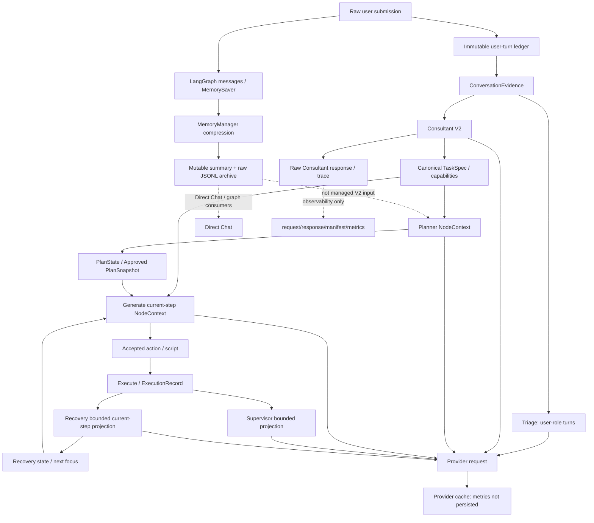

# BioMind Global Prompt / Context / Memory / Cache Lifecycle Audit

Status: audit only; no implementation

Repository: `/public/home/liusiqi/03.毕设/Biomind_v1`

Primary incident: `session_1786946788`

Audit snapshot: branch `codex/save-current-work`, HEAD `02d8232f147160927e2f65b979769811c3dd209f` (`docs(audit): document recovery progressive disclosure contract`) plus the pre-existing dirty worktree on 2026-08-18. The inspected production prompt/context files had no local diff. No provider, workflow, or production/test/run artifact was mutated.

## Executive verdict

BioMind has durable task history, but no unified, append-only `Session Semantic Transcript` that every LLM node can reuse. The current system has three materially different histories:

1. immutable raw user/Consultant-question turns in `StateContractStore`;
2. canonical TaskSpec, PlanState/PlanSnapshot, action, ExecutionRecord, artifact, and Recovery objects;
3. LangGraph `messages` and their `MemoryManager` summaries.

Current managed V2 prompts are node-specific projections over the first two categories. Planner and Generate do not receive the raw user transcript, raw Consultant responses, or graph memory summary. Therefore “saved” does not imply “LLM-visible.” A requirement can remain physically durable but become invisible downstream if Consultant/TaskSpec canonicalization omits it: `SEMANTIC_PROJECTION_LOSS`.

Provider cache efficiency is not measurable from persisted runs. Usage normalization and trace projections retain prompt/completion/total tokens but discard nested cached-token details. The only defensible result is:

```text
CACHE_METRICS_NOT_PERSISTED
Planner/Generate/Recovery/Supervisor hit ratio = NOT_OBSERVABLE
INSUFFICIENT_CACHE_EVIDENCE
```

Repeated text proves cache potential, not provider cache hits.

## Scope and real-session sample

Current code evidence: `bio_agents.py:6359-6504,12327-12375,19311-20128,21874-22555,24641-24760`; `agent_core/state_contract_store.py:115-216`; `agent_core/node_context.py:818-979,1026-1216`; `memory_manager.py:109-221,328-445`; `execution/profiling.py:126-210,1679-1768`; `supervisor.py:528-676`; and exact run requests/metrics.

| Session | Selection | Calls | Prompt | Completion | Mean prompt | Max call |
|---|---|---:|---:|---:|---:|---:|
| `session_1786946788` (A) | required incident; current trace | 13 | 100,967 | 6,033 | 7,766.69 | 10,674 Consultant |
| `session_1785398207` (B) | max prompt **and** max calls among 49 local metrics | 35 | 239,758 | 13,625 | 6,850.23 | 11,340 Generate |
| `session_1786694833` (C) | consecutive current Generate traces | 6 | 27,295 | 3,971 | 4,549.17 | 9,216 Consultant |
| union | 54 calls | 54 | 368,020 | 23,629 | 6,815.19 | 11,340 Generate |

None of the 53 local `plan_state.json` files had `conversation_evidence.user_turn_count > 1`; a real clarification session was `NOT_OBSERVED_IN_LOCAL_CORPUS`. The Session B selection separately used the 49 locally readable run-metrics records. Session C is used only for Generate prefix testing. Session B predates current `context_trace`; its exact sections/prefix are `NOT_OBSERVABLE`.

## Five evidence layers

| Layer | Current object | What it proves |
|---|---|---|
| Durable history | conversation objects, TaskSpec, Plan/Snapshot, action/execution/recovery, messages, archives, traces | saved somewhere |
| Semantic store | distributed; no single store | potentially reusable |
| Node projection | `build_node_context()` and node builders | selected for one node |
| Provider request | exact `context_trace/*/request.json` | model-visible serialization |
| Provider cache | provider usage cache details | actual hit/miss; not persisted |

## Current architecture



The stored `stable_system_prompt` has no current production provider consumer; it is dead prompt state, not a stable provider prefix.

## Lifecycle and authority

| Stage | Durable input | Actual provider-visible input | Durable output / canonical effect |
|---|---|---|---|
| submission | raw text | none | immutable submission + linked turn; graph HumanMessage |
| Triage | conversation ledger | concatenated user-role turns | route and trace |
| Consultant V2 | all user/questions, TaskSpec, feedback, capabilities | complete conversation evidence, TaskSpec, feedback, catalog | raw/typed proposal; accepted mutations become TaskSpec/capability state |
| Planner V2 | TaskSpec, input/runtime audit, feedback | TaskSpec-based NodeContext, audit, capabilities, preferences | candidate, validated PlanState, Approved Snapshot |
| Generate V2 | TaskSpec, Approved Snapshot, current step, runtime/feedback, skill docs | current step + dependencies + action/runtime/feedback + skills | accepted action, script, manifest |
| Execute | accepted action/runtime | no normal LLM call | command, runtime, streams, exit, outputs, ExecutionRecord |
| Supervisor | current step/execution | current closure, action <=4k, task <=2k, stdout <=6k, stderr tail <=4k | advisory review/controller state |
| Recovery V2 | broad durable state | fresh one-shot current-step closure and bounded evidence | decision, attempts, next route |

Execute facts are persisted through materialization/provenance records. Supervisor sees a bounded current attempt; Recovery sees selected current evidence and summaries; next Generate sees typed recovery/supervisor feedback and current progress; next Planner sees canonical audit/violations, not unbounded scripts/logs.

## Node visibility matrix

| Node | Raw User | Consultant | TaskSpec | Full Plan | Current Step | Execute Evidence | Memory Summary |
|---|---|---|---|---|---|---|---|
| Triage | FULL user turns | NONE | NONE | NONE | NONE | NONE | NONE |
| Consultant V2 | FULL conversation evidence | prior raw NONE | FULL | NONE | NONE | runtime audit when projected | NONE |
| Planner V2 | NONE | TaskSpec-derived | FULL | feedback, not raw prior candidates | task semantics | runtime/input audit | NONE |
| Generate V2 | NONE | TaskSpec-derived | RELEVANT closure | NONE | FULL + dependencies | bounded feedback/progress | NONE |
| Recovery V2 | NONE | TaskSpec-derived | RELEVANT closure | NONE | FULL + dependencies | bounded current/history | NONE |
| Supervisor | NONE | TaskSpec-derived | RELEVANT closure | NONE | FULL | bounded current attempt | NONE |
| Direct Chat | graph-dependent | graph-dependent | graph-dependent | graph-dependent | graph-dependent | graph-dependent | FULL when compressed |

The complete per-call/component table is `node_prompt_payload_matrix.tsv`.

### User and Consultant

`_persist_user_submission()` writes the complete submission and appends a linked immutable turn. `read_conversation_evidence()` reconstructs chronological `user` and `consultant_question` roles. This is a complete user/question ledger, not a full task-event transcript. Graph compression neither deletes nor rewrites it.

Consultant V2 sees the full conversation evidence once, canonical TaskSpec, feedback, and capability catalog; its graph-message list is explicitly empty. Session A first Consultant request was 36,012 chars / 9,216 provider tokens. Its structured payload was about 2,071 chars: task 60, conversation 1,413, feedback 319, allowed operations 217, plus overhead. Later requests were 40,666, 39,129, 39,393, and 38,956 chars.

Session A persisted five raw Consultant responses: 8,348 chars / 2,063 offline `cl100k_base` tokens. The accepted final response was 1,017 / 212; rejected/intermediate responses were 7,330 / 1,851. Planner did not receive those raw responses; accepted effects reached it through TaskSpec, selected capabilities, and feedback.

Wiki/archive retrieval and `memory_packet_context` can be computed by legacy helpers, but normal Consultant/Planner/Generate V2 serialization does not include those strings. A local variable is not visibility evidence.

### Planner

Planner raw-user visibility is **NONE**; raw Consultant visibility is **NONE**. It sees complete canonical task semantics, runtime/input audit, capabilities, preferences, and pending typed feedback.

Session A first Planner request was 27,239 chars / 8,177 tokens:

| Component | Chars |
|---|---:|
| static framing | 4,288 |
| LLMPayload total | 19,524 |
| payload task | 5,249 |
| payload runtime/input audit | 10,889 |
| payload allowed operations | 51 |
| payload other/JSON overhead | 3,335 |
| semantic capabilities | 3,137 |
| user preferences | 290 |

The four later requests were each 28,033 chars / 8,510 tokens. The first repair changed runtime audit; the last three were byte-identical. Raw prior candidates were not appended. The accepted candidate was 5,170 / 1,246 offline tokens; all candidates 11,047 / 2,514; rejected candidates 5,876 / 1,268.

### Generate

Generate raw-user and raw-Consultant visibility are **NONE**. It sees TaskSpec through current-step semantic closure, the current Approved Plan step plus direct dependencies/artifact references, runtime/progress/action contract, recovery/supervisor feedback, and selected skill instructions. This is **CURRENT STEP + DEPENDENCIES**, not full Plan.

Session A request was 11,005 chars / 2,885 tokens. Its payload was about 5,110 chars: task closure 3,828, current step 980, runtime 156, feedback 2, allowed operations 65, plus overhead. The dependency is:

```text
raw user -> Consultant canonicalization -> TaskSpec -> current-step closure -> Generate
```

If canonicalization omits a fact, Generate has no raw-history fallback.

### Recovery and Supervisor

Recovery cannot directly access a unified semantic transcript. The controller reads broad state, but the provider gets a fresh one-shot NodeContext: current TaskSpec/step/dependencies, runtime/progress/diagnosis, current execution/validation/completion, recent bounded attempts/conflicts, and allowed operations. It gets no raw turns, raw Consultant history, full Plan, or graph summary. Deterministic diagnosis or application-level decision replay can avoid the provider.

This reuses the established baseline in `recovery_progressive_disclosure_contract.md`: legacy `prompt_view()` differs from V2 provider payload; there is no iterative disclosure; full Plan/raw conversation are absent; trace files can inflate only the legacy filesystem/capacity path.

Supervisor deterministically validates first. Its optional advisory LLM gets current-step closure, bounded action/task/streams/runtime. It gets no raw user, Consultant transcript, full Plan, or graph summary. Session A request was 14,346 chars / 3,964 tokens.

## Physical ordering and prefix stability

Sorted top-level NodeContext keys make stable TaskSpec appear after dynamic fields:

```text
Consultant: static/capability -> conversation -> TaskSpec -> feedback/current
Planner:    static -> allowed_operations -> runtime/input audit -> TaskSpec -> capabilities/preferences
Generate:   static -> allowed -> current_step -> feedback -> runtime -> TaskSpec closure -> skills
Recovery:   static -> current/evidence/progress/runtime -> TaskSpec closure
Supervisor: static -> current/evidence/runtime -> TaskSpec closure
```

The architecture is mixed, often `CURRENT -> STABLE`, not `STABLE HISTORY -> CURRENT FOCUS`.

For each adjacent same-node pair below, `LCP ratio = common-prefix characters / min(previous request characters, current request characters)`.

| Calls | Node | Request chars | LCP chars | Ratio | First divergence |
|---|---|---:|---:|---:|---|
| A 0003 -> 0005 | Planner | 27,239 -> 28,033 | 9,477 | 34.792% | `runtime.input_audit`, verification/healthcheck shape |
| A 0005 -> 0007 | Planner | 28,033 -> 28,033 | 28,033 | 100% | none |
| A 0007 -> 0009 | Planner | 28,033 -> 28,033 | 28,033 | 100% | none |
| A 0009 -> 0011 | Planner | 28,033 -> 28,033 | 28,033 | 100% | none |
| A 0002 -> 0004 | Consultant | 36,012 -> 40,666 | 4,367 | 12.127% | capability catalog populated |
| A 0004 -> 0006 | Consultant | 40,666 -> 39,129 | 37,753 | 96.483% | feedback reconciliation reason |
| A 0006 -> 0008 | Consultant | 39,129 -> 39,393 | 37,510 | 95.862% | feedback insertion/order |
| A 0008 -> 0010 | Consultant | 39,393 -> 38,956 | 37,797 | 97.025% | feedback fact/operation |
| C 0004 -> 0005 | Generate | 10,782 -> 12,251 | 2,905 | 26.943% | `feedback.recovery_action` inserted before stable sections |

The Generate LCP was 693 offline tokenizer tokens. Top breakers are early feedback/recovery actions; runtime audit timestamps/healthchecks; capability-catalog population; changing violations/operations; current step/attempt/progress; and, for graph consumers, mutable summary header/text. Sorted JSON prevents order randomness but is not cache-aware semantic ordering.

## Provider cache and real size

`execution/profiling._normalize_usage()` projects only `prompt_tokens`, `completion_tokens`, and `total_tokens`. ContextLineage and protected direct/finalize projections likewise omit nested cache details. The installed compatible SDK can represent `prompt_tokens_details.cached_tokens`, but the artifacts cannot prove DeepSeek supplied it. Local loss is confirmed; provider-origin presence is `NOT_OBSERVABLE`.

All rows in `provider_cache_inventory.tsv` therefore use `CACHE_METRICS_NOT_PERSISTED`, never zero. Planner, Generate, Recovery, and Supervisor hit ratios are all `NOT_OBSERVABLE`. Recovery decision replay, stable-prompt disk cache, Wiki digest cache, and runtime caches are application caches, not provider prefix-cache evidence.

Selected-node prompt distribution:

| Node | Calls | Mean | Max |
|---|---:|---:|---:|
| Triage | 3 | 943.33 | 964 |
| Consultant | 8 | 8,312.25 | 10,674 |
| Planner | 8 | 7,380.00 | 8,510 |
| Generate | 14 | 8,663.36 | 11,340 |
| Execute compatibility LLM | 2 | 8,622.50 | 9,293 |
| Supervisor | 19 | 5,322.11 | 9,398 |

Topology differs in legacy Session B, so this is workload inventory, not a single-version benchmark.

## Offline full-history experiment

No API call was made. Provider totals remain authoritative; `cl100k_base` is only a reproducible structural estimate.

| Session A content | Chars | Offline tokens |
|---|---:|---:|
| raw user | 1,294 | 664 |
| canonical TaskSpec | 11,562 | 3,815 |
| accepted Consultant | 1,017 | 212 |
| all Consultant outputs | 8,348 | 2,063 |
| rejected Consultant | 7,330 | 1,851 |
| accepted Planner candidate | 5,170 | 1,246 |
| all Planner candidates | 11,047 | 2,514 |
| rejected Planner candidates | 5,876 | 1,268 |
| Approved PlanSpec | 21,851 | 6,670 |
| Approved PlanSnapshot | 19,172 | 6,032 |
| `plan.md` | 9,842 | 3,398 |
| accepted Generate raw | 931 | 307 |
| execution outcome projection | 268 | 69 |

All 13 enumerated primary user requirements were represented by TaskSpec/current plan. Raw wording would add 664 tokens while mostly duplicating canonical semantics in this session; that does not prove raw wording lacks safety value elsewhere.

Current Session C Generate calls were 10,782/12,251 chars and 2,846/3,310 provider tokens, sharing 2,905 chars / 693 offline tokens (26.94%). A hypothetical stable prefix of raw user + accepted Consultant + Approved PlanSpec + accepted action/outcome was 25,603 chars / 7,976 offline tokens. Prepending it unchanged produced approximately 10,537/10,942 offline-token requests and 28,508-char / 8,669-token LCP (78.31%).

That improves structural reuse but makes the first call pay about 8k more tokens and duplicates task/plan/action facts. Without cache usage, whether later savings offset the first call is **`INSUFFICIENT_CACHE_EVIDENCE`**.

## Memory, summaries, and semantic authority

`MemoryManager` runs after profiled Consultant and Generate nodes only. At 85% of its default 200,000 graph-message tokens (170,000), it archives older messages, generates a new summary, inserts `[Memory Compression #N]` first, and retains protected/stable System messages plus up to 40,000 recent non-System tokens. It does not compress the immutable user ledger, TaskSpec, PlanState, NodeContext, or provider requests.

Seven local compression events, all for `session_1783096422`, went from about 170,229-171,729 tokens to 42,570-43,372. Summary text was 7,303-9,630 chars; consecutive summaries shared only 70-114 chars (0.8%-1.56%). Managed V2 nodes do not consume it, so it does not break their prefix. Direct Chat/graph consumers do: changing compression number, archive filename, and LLM summary appear first.

There is no frozen “turns 1-30 checkpoint then append 31+” summary: immutable semantic checkpoint summary is **`MISSING`**. Raw JSONL archives are immutable evidence, not frozen provider summaries. TaskSummary, Wiki digest, plan prose, recovery summaries, and field excerpts are separate derived systems.

No unified transcript exists. Facts are distributed among immutable turns, TaskSpec/effective facts, consultation/capability state, PlanState/Snapshot, action/materialization, ExecutionRecord/artifacts, RecoveryState, graph memory/archive, and observability trace. See `semantic_history_authority_matrix.tsv`.

Classification:

- `SEMANTIC_HISTORY`: raw user turns; accepted consultation delta; canonical TaskSpec; Approved Plan checkpoint; accepted action/outcome; Recovery decision.
- `TASK_EVIDENCE`: runtime/input audit; actual command/exit/log excerpts; outputs/artifact/validation facts; relevant prior-attempt summaries.
- `INTERNAL_OBSERVABILITY`: request/response/manifest, context trace, envelopes, metrics/profiling, CoT/debug, internal/compression audit.

Current code has no global type system enforcing these classes. Broad legacy Recovery filesystem collection can ingest traces, although current V2 does not serialize them as normal provider sections.

Stable-history eligibility:

| Class | Contents |
|---|---|
| `ELIGIBLE_STABLE_HISTORY` | immutable user turns; accepted semantic delta; TaskSpec/Approved Plan checkpoint; accepted action/outcome and Recovery summaries |
| `CURRENT_ONLY` | current step, live runtime, pending feedback, current evidence, mutable artifact reconciliation |
| `AUDIT_ONLY` | rejected candidates, provider envelopes, traces, debug/CoT, profiler internals |

Rejected Consultant/Planner candidates add 3,119 offline tokens in Session A and can contradict canonical state; retain for audit, not default semantic history.

## Context budgets and strategies

There is no unified session-semantic-history budget. Independent limits include provider/context default 200k tokens; MemoryManager 170k trigger/40k recent; Consultant 100k history + 100k skill pool and 8,192 headroom; Planner legacy 50k-character budget markers but current V2 `compressible_chars=0`; NodeContext required-payload cap normally 200k*4 = 800k chars with explicit `CONTEXT_CAPACITY_EXCEEDED`; legacy Generate 200k chars; legacy Recovery 26k-character tier compaction; and field-local clipping.

A future Recovery 256k belongs at the node/provider projection hard-ceiling layer for one disclosure episode. It is not a global session-history limit or default first request.

| Strategy | Fidelity | Size | Cache potential | Risks |
|---|---|---|---|---|
| current projection | good if canonicalization is complete | smallest | mixed | projection loss |
| full stable history | highest raw recoverability | much larger | structurally high after first call | first-call cost, duplication, stale conflict, attention noise |
| hybrid checkpoint + focus + on-demand | potentially high | controllable | potentially stable | authority/version/disclosure complexity |

No strategy wins on real provider cost because cached-token usage is unavailable.

## Required answers

1. Original history: immutable `raw_user_submission` plus linked `StateContractStore` conversation evidence; graph/user-query copies are not authority.
2. Compression damage: no durable raw-turn deletion; only graph messages are summarized and raw removed messages archived.
3. Consultant: full ordered user/question evidence, TaskSpec, feedback, capabilities; no previous raw Consultant responses.
4. Planner raw user: `NONE`.
5. Planner Consultant: no raw output; only accepted TaskSpec/capability/feedback effects.
6. Generate raw user: `NONE`.
7. Generate Consultant: no raw output; TaskSpec-derived facts only.
8. Generate Plan: current step plus direct dependency/artifact closure, not full Plan.
9. Recovery global history: no; current-step canonical projection and bounded evidence only.
10. Supervisor: current TaskSpec/step, bounded action/task/streams/runtime; no raw conversation/full Plan/graph summary.
11. Independent systems: nine—conversation projection; graph MemoryManager; Consultant/finalize packing; NodeContext projection/capacity; Planner budget gate; legacy Recovery compaction; legacy Generate packing; field-local evidence/retrieval clipping; SessionArchive/TaskSummary derived context.
12. MemoryManager target: LangGraph `messages` only.
13. Summary consumers: Direct Chat/graph compatibility; not managed V2 Planner/Generate/Recovery/Supervisor. `search_archives()` has no production consumer in `bio_agents.py`.
14. Unified Session Semantic Transcript: `MISSING`.
15. Distributed stores: turns, TaskSpec, consultation, Plan/Snapshot, action/materialization, execution/artifacts, Recovery state, graph memory, traces.
16. Projection risk: yes, `SEMANTIC_PROJECTION_LOSS` if TaskSpec omits a durable fact.
17. Most canonical-dependent: Planner, Generate, Recovery, Supervisor; the last three also depend on current-step closure.
18. Prompt tokens: selected calls mean 6,815.19; max 11,340. Session A mean 7,766.69/max 10,674.
19. Cache hit/miss saved: no; `CACHE_METRICS_NOT_PERSISTED`; provider-origin presence `NOT_OBSERVABLE`.
20. Planner hit ratio: `NOT_OBSERVABLE`.
21. Generate hit ratio: `NOT_OBSERVABLE`.
22. Recovery/Supervisor ratio: `NOT_OBSERVABLE`.
23. Earliest breakers: capability changes; runtime verification/healthchecks; feedback/recovery insertion; current attempt/progress; mutable summary.
24. Summary cache effect: none on managed V2 because not consumed; severe potential on graph consumers because regenerated summary is first and LCP was 70-114 chars.
25. Raw user long-term cost: Session A 1,294 chars / 664 offline tokens.
26. Accepted Consultant cost: 1,017 / 212.
27. Approved Plan cost: PlanSpec 21,851 / 6,670; Snapshot 19,172 / 6,032; prose 9,842 / 3,398. Choose one authority, not all.
28. All Consultant/rejected Plans: not default semantic history; `AUDIT_ONLY`.
29. Full history vs projection: current Generate 2,846/3,310 provider tokens with 26.94% structural LCP; hypothetical history about 10,537/10,942 offline tokens with 78.31% LCP. Net result `INSUFFICIENT_CACHE_EVIDENCE`.
30. Stable history prefix + focus suffix: absent globally.
31. Physical order: mixed; dynamic current/runtime/feedback often precede stable TaskSpec after static policy.
32. `SEMANTIC_HISTORY`: raw user, accepted consultation delta, TaskSpec, Approved Plan, accepted action/outcome, Recovery decision.
33. `TASK_EVIDENCE`: runtime/audit, command/exit/log excerpts, outputs/artifacts/validation, relevant attempts.
34. `INTERNAL_OBSERVABILITY`: provider traces/envelopes, context trace, metrics/profiling, CoT/debug, state/compression audits.
35. Existing baseline: do not re-audit current Recovery V2 versus legacy `prompt_view()`, absence of iterative disclosure/full Plan/raw conversation, legacy trace pollution, prior managed-artifact/runtime propagation findings, or the durable-versus-visible distinction here unless cited code changes.

## Bottom line

Current BioMind optimizes managed prompts by canonical projection, not a shared stable semantic prefix. This reduces size but makes fidelity conditional on canonicalization. Stable history has measurable prefix potential and measurable token/duplication cost, but actual cache usage is missing. It is not possible to claim that either shorter projection or full stable history + cache is cheaper for the real workload.

Final cache verdict: **`INSUFFICIENT_CACHE_EVIDENCE`**.
