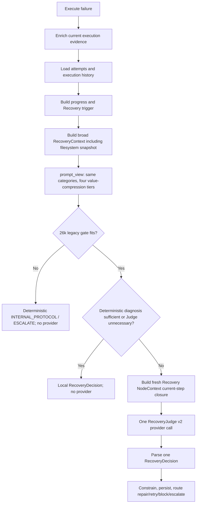
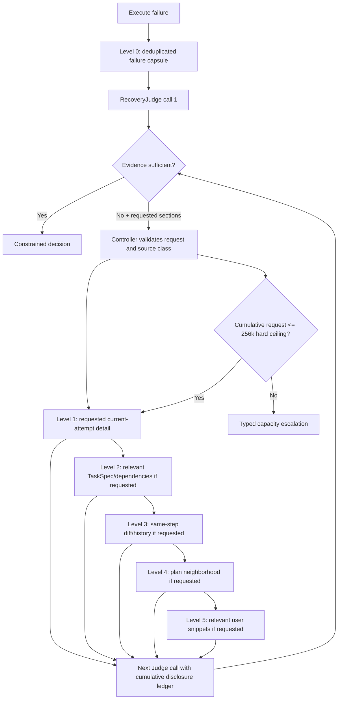

# BioMind Recovery Progressive Disclosure Context Contract Audit

Status: audit only; no implementation

Repository: `/public/home/liusiqi/03.毕设/Biomind_v1`

Incident reference: `session_1786946788`

Audit snapshot: branch `codex/save-current-work`, HEAD `358c31d1b6ef8a159315e7f0ec01aa37345bd196` (`docs(audit): record runtime and recovery context contract`) plus the pre-existing dirty worktree on 2026-08-17. The cited production Recovery files had no local diff. No snpEff run, provider API, checkpoint, benchmark state, production code, or test was changed.

## Executive verdict

The requested progressive-disclosure contract is **MISSING** in current production and has never existed end to end in the inspected history.

Batch 9B briefly implemented a meaningful but narrower feature: deterministic Level 1–3 category selection and pre-call escalation. It did not call the model at a small level, accept a requested evidence category, expand only that category, and call again. NodeContext v2 later removed those levels. Current production has two one-shot Recovery paths; the Execute path additionally retains `RecoveryContext.prompt_view()` as a legacy capacity gate.

The current four `prompt_view()` tiers are **Case B — compression fallback**:

> This is compression fallback, not semantic progressive disclosure.

Every tier contains the same semantic sections and all the same evidence categories; only string/list values are shortened. The only tier-selection trigger is serialized size. Evidence insufficiency does not expand a tier.

The most precise A–E classification is:

- **A for the requested protocol:** true iterative progressive disclosure was never implemented.
- **B-like historical partial:** Batch 9B category tiers existed from 2026-08-05 to the 2026-08-12 v2 migration, but they were pre-call selection rather than iterative disclosure.
- **C for retained legacy code:** `_legacy_error_recovery_middleware()` still contains retry-tier skill/RAG/external-hint expansion, but its docstring says it is deprecated and not registered in the active graph (`agent_core/middleware.py:404-416,720-750`).
- **E for current topology:** Execute recovery and post-review recovery coexist; neither supports request-more expansion.

The C-path deserves explicit separation. `_recovery_tier()` maps retry 0/1/2+ to tiers 0/1/2 (`agent_core/middleware.py:323-328`). In the dead middleware, tier 0 skips RAG, tier 1 adds active-skill and RAG advice, and tier 2 adds an external-search policy hint. That is progressive retrieval across separate recovery attempts, not progressive disclosure of Controller-owned RecoveryContext sections. It cannot establish the requested current-step → runtime → history → Plan → conversation contract and is not reachable from the production Execute registration.

## Five context concepts

| Concept | Current meaning | Incident evidence |
|---|---|---|
| A. Raw evidence collection | Controller reads current execution evidence, persisted scripts/logs/traces, runtime contracts, PlanState, TaskSpec projections, history, selected skill context, and a bounded filesystem snapshot. | `agent_core/diagnostics.py:610-715,826-900,1153-1343` |
| B. Durable `RecoveryContext` | Broad replay object containing semantic state, execution, validation, progress, runtime, artifacts, history, skill policy, and deterministic diagnosis. | `agent_core/diagnostics.py:132-174`; persisted incident context canonical size 519,517 chars |
| C. First provider candidate | Execute first evaluates a `prompt_view()` gate, then, only if an LLM is needed, creates a separate NodeContext v2 payload. Post-review creates NodeContext directly. | `agent_core/middleware.py:1602-1707`; `bio_agents.py:4015-4175` |
| D. Expanded provider candidate | Does not exist. There is no second/third semantic candidate selected after provider feedback. | No request fields/loop in `prompts/templates.py:340-399`, `agent_core/recovery.py:1154-1201,1578-1601`, or either caller |
| E. Actual provider request | Exactly one Human message built from `PromptManager.get_recovery_v2_prompt(context.llm_payload.to_dict())`, if deterministic diagnosis/cache/capacity routing does not avoid it. | `agent_core/middleware.py:83-150`; incident had no `context_trace/recovery*` and zero Recovery provider calls |

Raw size must never be used to infer provider visibility. In the Java incident, 519,517 characters were collected, 638 characters of capacity error were returned locally, and zero Recovery provider characters crossed the API boundary.

## Current actual flow



`bio_agents.py:27488` installs `error_recovery_middleware` around Execute. The main middleware sequence is `agent_core/middleware.py:1512-1884`. The provider helper is `agent_core/middleware.py:83-150`.

There is also a post-Supervisor/CompletionGate path at `bio_agents.py:4015-4175`. It keeps `RecoveryContext` as durable evidence but explicitly does not send the legacy load-all/compact view. It constructs a one-shot Recovery NodeContext with current-step semantic closure, runtime/feedback, bounded evidence, allowed operations, and a character cap derived from the configured LLM context token limit. This second path also has no disclosure loop.

## Current Execute-stage contract

| Stage | Input | Output | LLM? | Reads history? | Can expand? | Disclosure level? |
|---|---|---|---|---|---|---|
| Execute | Approved/materialized action | `execution_evidence`/failure result | no | no | no | no |
| Evidence enrichment | Current attempt plus persisted paths | Command, line, script context, stream tails, expected/actual runtime, manifest/action facts | no | no | no | no |
| History/progress | Recovery attempts plus execution records | Related summaries, fingerprints, repetition/progress | no | yes | no | no |
| Broad context construction | State, PlanState, evidence, history, task root, skill policy | Durable `RecoveryContext` | no | yes | no | no |
| Legacy projection | Full durable context and one `max_context_chars` | First fitting compressed view or capacity error | no | already embedded | only shrinks for size | four compression settings, not disclosure levels |
| Deterministic diagnosis | Projected diagnosis and trigger | Local decision when sufficient | no | indirectly | no | no |
| NodeContext provider projection | Canonical TaskSpec, current step, progress/diagnosis runtime, one execution evidence row | One semantic-closure LLMPayload | no | summaries only | no | one-shot |
| RecoveryJudge invocation | One prompt/Human message | One RecoveryDecision JSON | yes | only projected summaries | no | one call |
| Policy/application | Decision, progress, budgets | Retry/patch/block/escalate state transition | no | yes | may create a later execution attempt, not a context expansion | no |

## What `prompt_view()` actually does

`RecoveryContext.prompt_view()` is at `agent_core/diagnostics.py:244-389`. Its own docstring says it remains for legacy diagnostic callers and that RecoveryJudge v2 receives a Controller-built LLMPayload.

Five semantic sections are copied without tier-dependent category removal:

```text
task_spec_summary
effective_user_facts
current_step
action_contract
allowed_actions
```

Every evidence tier also includes all of:

```text
execution, validation, completion, progress, runtime, manifest, artifacts,
recent_attempts, already_tried_strategies, recovery_decision, log_references,
bounded_log_excerpt, conflicts, skill_policy, diagnosis
```

| Level | Included sections | Newly disclosed sections | Compression | Provider may be called? |
|---|---|---|---|---|
| Raw-if-fit | All durable fields | none | none | only after other middleware conditions; this view still is not the v2 payload |
| `3000/24` | All semantic plus all evidence categories | none | strings 3,000; list tails 24 | not because this tier was selected; it only passes the local gate |
| `1200/12` | same | none | strings 1,200; list tails 12 | same |
| `480/6` | same | none | strings 480; list tails 6 | same |
| `160/3` | same | none | strings 160; list tails 3 | same |
| Capacity result | identity plus typed error; no usable semantic projection | none | not a partial request | no; deterministic escalation |

The function recursively limits strings and list tails but never caps dictionary key count (`agent_core/diagnostics.py:260-281`). It walks tiers only because a previous serialized candidate exceeded `max_context_chars`. There is no failure-class or `missing_evidence` trigger.

## Ask-for-more protocol audit

The response schema contains `evidence_sufficient` and `missing_evidence`, but no `requested_context`, `requested_sections`, disclosure level, continuation token, or expansion request (`prompts/templates.py:373-394`; `agent_core/recovery.py:1154-1201`). The prompt instructs the Judge to preserve missing evidence and choose `ESCALATE` if evidence is insufficient (`prompts/templates.py:345-355`). The parser validates one decision and forbids executable repair content (`agent_core/recovery.py:1578-1601`).

Therefore:

1. The model can state that runtime facts are missing in free text/`missing_evidence`.
2. The Controller cannot interpret that as “append only runtime and call again.”
3. Current code requires semantic closure before the first call.
4. A legacy gate failure becomes `CONTEXT_CAPACITY_EXCEEDED` and escalation, not partial disclosure.
5. A subsequent diagnostic probe or repaired execution is a new evidence-producing workflow attempt, not another disclosure turn for the same Judgment.

## Current priority and target-level comparison

Current code does not declare a reusable Level 0–5 enum. The following maps observable behavior onto the audit reference model.

| Target level | Intended content | Current behavior | Verdict |
|---|---|---|---|
| Level 0 — failure capsule | Step, code/class, exit, command, focused line/streams, diagnosis, expected vs actual | Facts are usually available inside broad execution evidence, but there is no independently constructed or first-sent capsule. Execute evaluates the capacity of all categories before using diagnosis. | MISSING as a disclosure level; PARTIAL as collected facts |
| Level 1 — current attempt | Full action, inputs/outputs, runtime/artifact bindings, observed outputs, skill constraints | Collected broadly and passed one-shot when present. It is not requested after a smaller call. | PARTIAL |
| Level 2 — current-task relevant facts | TaskSpec hard/relevant facts and dependency outputs | NodeContext v2 performs current-step dependency closure and sends it on the first call (`agent_core/node_context.py:818-979,1134-1189`). | IMPLEMENTED as relevance projection; not progressive |
| Level 3 — same-step history | Previous attempt/command/error/decision/diff | Broad context defaults to up to three related summaries. Execute v2 passes progress fingerprints/repetition, while post-review can pass recent attempt summaries. No detailed diff expansion exists. | PARTIAL, default summary rather than on-demand |
| Level 4 — plan neighborhood | Current, predecessors, successors, artifact flow, approvals | Recovery NodeContext sends current step and direct dependency contracts. It never adds full `plan`; successors are absent. `plan.md` may be raw filesystem preview in the legacy gate. | PARTIAL |
| Level 5 — relevant user history | Relevant original snippets, clarifications, unresolved ambiguity | Canonical TaskSpec goal/constraints enter first. Raw conversation/clarification expansion and relevance gate are absent; `cot_session*.md` can bypass the intended order through filesystem scanning. | MISSING |

The current practical categories are:

- **mandatory-first:** NodeContext task/current step/dependency closure, runtime/evidence rows, allowed operations;
- **mandatory-all in the legacy gate:** all `prompt_view()` semantic and evidence category keys, whether useful for the failure class or not;
- **optional by data availability:** actual executable, focused line, observed outputs, prior summaries;
- **fallback:** none implemented as a provider expansion tier;
- **never in Recovery NodeContext:** full Plan and raw conversation transcript.

### Current-step details

- `current_step` is a mandatory semantic section in every `prompt_view()` candidate and a mandatory first-call NodeContext section. In the Java incident its canonical durable section was 672 characters.
- The current generated action enters both `action_contract` and nested execution evidence, creating duplication.
- `failed_command` is enriched from actual Execute evidence/script trace when provenance is populated; it is not supposed to rely on a speculative Generate candidate.
- stdout/stderr are current-attempt paths/tails, but copies can also appear in bounded excerpts and filesystem rows. Previous-attempt summaries are separate.
- `actual_environment` can contain actual env and `resolved_executables`; absence is possible if the executor did not persist them. Expected runtime is a different source.
- observed outputs enter execution reconciliation, validation, and filesystem/artifact views, again with possible duplicates.

These facts have high operational relevance, but “high priority” is not enforced by an initial small provider payload. They compete with mandatory-all legacy gate categories.

## Historical sources and visibility

| Source | Default collected? | Default LLM-visible? | Disclosure trigger | Current necessity |
|---|---|---|---|---|
| Current execution/attempt | yes | yes if provider reached | none; first call | necessary |
| Previous attempts | related summaries, up to three | partial: progress fingerprints in Execute; summaries in post-review | none | useful after ambiguity/repetition, but currently default summaries |
| Previous Recovery decisions | one prior decision plus summaries when present | partial/path-dependent | none | useful for no-repeat policy |
| Full Plan history | no as a semantic provider section | no | unsupported | should be on-demand only |
| Consultant canonical handoff | indirectly through TaskSpec/facts | canonical projection only | none | relevant facts can be necessary |
| Consultant provider traces | yes through filesystem snapshot | no in v2 provider; yes to legacy capacity gate | none | not task evidence |
| Planner provider traces | may be scanned before file cap | no in v2 provider; yes to legacy capacity gate | none | not task evidence |
| LLM trace manifests/requests/responses | yes when small JSON and within scan cap | no in v2 provider; yes to legacy capacity gate | none | observability only |
| Raw conversation | not reconstructed as a Recovery section | no | unsupported | should be last/relevance-gated |
| `cot_session*.md` | may be previewed | no in v2 provider; yes to legacy gate | none | observability only |
| Run events/JSONL | metadata-only in snapshot | no | none | observability only |
| Artifact history | bounded selected facts | partial | none | failure-class dependent |

Recovery does not literally carry all historical state to the current v2 provider. The raw context becomes huge because the filesystem scanner independently previews many large, near-duplicate internal provider request/manifest JSON files and because current facts are duplicated across execution, action, logs, progress, and artifacts.

## Internal observability versus task evidence

The scanner's stated purpose is bounded metadata and small text previews without running tools (`agent_core/diagnostics.py:826-900`). That is useful for task outputs, unexpected artifacts, logs, reports, scripts, and validation evidence. Provider request envelopes and manifests do not match that purpose for scientific execution recovery.

The scanner traverses the whole task root plus evidence/script roots. It classifies rows by content-like labels such as `artifact_snapshot`/`tool_log`; there is no `TASK_EVIDENCE` versus `INTERNAL_OBSERVABILITY` source class. The suppression rule is basename/suffix based (`agent_core/diagnostics.py:499-510,863-879`):

- `plan_state.json`, `run_metrics.json`, `run_metrics.md`, and `recovery_trace.md` are explicitly metadata-only;
- every `.jsonl` is metadata-only;
- `context_trace/consultant-.../request.json` and `manifest.json` have generic basenames not in `_INTERNAL_STATE_FILES`, so they receive previews.

In `session_1786946788`, five Consultant request rows plus five manifests contributed 398,053 of 519,517 canonical characters. They did not reach a v2 provider, but they inflated the legacy capacity gate and prevented the already-sufficient deterministic diagnosis from being consumed.

Git history refutes the hypothesis that a scanner was added later as a bypass around an earlier progressive design. Commit `21243aa` introduced broad `RecoveryContext`, the scanner, the denylist, and shrink-to-fit `prompt_view()` together. Batch 9B later overlaid category levels; it did not remove the structural raw scanner side channel.

Filesystem evidence is currently **always collected and immediately included in every legacy compression candidate**, but **not directly visible in the current v2 provider payload**. It is neither a Level 0/1 provider guarantee nor a late-disclosed fallback.

## Capacity and 256k audit

### Where 26,000 applies

`DiagnosticLimits.max_context_chars=26_000` is a Python character count intended to leave room inside a nominal 32k prompt (`agent_core/diagnostics.py:95-106`). It applies to:

- Execute middleware's legacy `prompt_view()` capacity gate;
- compatibility/legacy callers of `prompt_view()` and the old `get_recovery_judge_prompt()` route.

It is not the direct cap for post-review NodeContext v2. That path passes `max_payload_chars = llm_context_limit_tokens * 4`; `_invoke_recovery_v2` itself currently does not pass a `max_payload_chars` argument. NodeContext capacity is also a character count of LLMPayload JSON, not provider tokens (`agent_core/node_context.py:1205-1213`). Provider prompt instructions, output reserve, and message envelope are separate.

### Incident simulation: `26000 -> 256000`

Using the persisted incident `recovery/recovery_context.json` and current `RecoveryContext.from_mapping()`:

| Measure | Result |
|---|---:|
| Persisted file | 540,854 bytes |
| Canonical `to_dict()` serialization | 519,517 chars |
| `prompt_view(26000)` | 638-char capacity result |
| Baseline first evidence tier with 26,000 in limits metadata | 119,253 chars |
| `prompt_view(256000)` returned view | 119,254 chars |

The one-character difference is the longer serialized `max_context_chars` value in `limits`. At 256,000, the first `3000/24` candidate passes immediately. No smaller candidate is preferred.

But active-path provider semantics are crucial:

- In this Java incident, the actual Recovery provider request would still be **0 characters**. The larger gate would pass; the deterministic Java mismatch diagnosis was complete; middleware would decide locally without calling RecoveryJudge.
- In an ambiguous Execute incident, 119,254 characters would pass the gate, but the provider would receive a separately built NodeContext payload, not that `prompt_view()` object.
- Only a legacy caller that directly embeds `prompt_view()` into `get_recovery_judge_prompt()` would send about 119,254 context characters plus prompt wrapper.
- Post-review does not use this 26k setting.

Thus blindly changing 26,000 to 256,000 neither implements small-first disclosure nor accurately predicts active-provider size. It merely weakens one legacy gate.

### Initial target versus hard ceiling

Current `RecoveryContext` has only one `max_context_chars`. It cannot express both:

```text
preferred initial disclosure target
hard maximum cumulative disclosure ceiling
```

NodeContext similarly builds one complete required view and either accepts or raises capacity. There is no disclosure state, cumulative budget, monotonic section ledger, or independent 256k ceiling. A future 256k value must be a hard ceiling over a disclosure episode, not a default first-call target.

## Java incident as a concrete counterexample

The incident's approximately 665-character failure capsule needed only current command/exit, the class-file 65-versus-52 error, expected Java 21, actual `/usr/bin/java`/Java 8, and the deterministic mismatch diagnosis. Current code nonetheless built 519,517 characters because broad context construction unconditionally scanned semantic state, execution/runtime, history, skill data, and task-root filesystem evidence regardless of failure class.

The deepest legal tier remained 42,898 characters because the 160/3 compactor still retained:

- 18,771 characters of identity plus complete semantic sections;
- 23,715 characters of mandatory compacted evidence values;
- 412 characters of keys/separators/limits.

There was no path that first sent the 665-character capsule. Capacity was evaluated before deterministic diagnosis. The missing unit is not another compression ratio; it is a first-class capsule plus evidence-driven, category-addressed expansion protocol.

## Temporary/mock fixtures

The audit used a temporary `/tmp` script, `PYTHONDONTWRITEBYTECODE=1`, current production builders, and a local fake LLM. It did not use a real API or write task/run state. Import-time logging created two local audit-process log files; both were immediately removed. The repository production/test diff remained unchanged.

| Fixture | First v2 LLMPayload sections | Payload chars | char/4 estimate | Full prompt chars | Provider called? | Expansion result |
|---|---|---:|---:|---:|---|---|
| A — Level 0 sufficient | task, current_step, dependency_contracts, runtime, evidence, allowed_operations | 1,222 | 306 | 4,649 | no in middleware semantics | complete deterministic diagnosis bypasses Judge; no capsule provider call |
| B — runtime missing | same | 1,172 | 293 | 4,615 | one mock call | mock returned insufficient + missing runtime; no second call |
| C — previous attempt needed | same | 1,177 | 295 | 4,628 | candidate can be called once | first call already contains progress fingerprints; no detailed-history request path |
| D — Plan needed | same | 1,156 | 289 | 4,583 | candidate can be called once | current step/dependency contracts first; full Plan never added |
| E — original context needed | same | 1,172 | 293 | 4,615 | candidate can be called once | canonical task facts first; no conversation expansion |

The `_invoke_recovery_v2` mock for Fixture B made exactly one call with a 4,064-character prompt. Its valid response set `evidence_sufficient=false` and `missing_evidence=["actual runtime executable"]`; no Controller second call occurred. Static caller inspection confirms that the enclosing middleware parses and routes that decision rather than looping.

A separate small legacy `RecoveryContext` fixture fit as a 1,438-character raw view and included its `recent_attempts` on that very first view. This confirms default inclusion rather than same-step-history-on-demand.

The numbers demonstrate projection behavior, not a model-quality benchmark. Differences between direct prompt construction and `_invoke_recovery_v2` reflect canonical TaskSpec normalization in the helper.

## Intended progressive flow for comparison

The following is the requested target model. Git did not reveal a production implementation of this loop.



Internal provider traces, request envelopes, CoT/debug files, run metrics, recovery traces, and unrelated historical prompts are excluded before disclosure eligibility.

## Architecture gap table

| Concern | Intended | Current | Status |
|---|---|---|---|
| Current-step-first | current step/failure before other state | current step is mandatory first-call, but broad legacy gate precedes it | PARTIAL |
| Failure capsule | independent minimal first provider view | facts exist but no capsule/view/state | MISSING |
| Runtime-on-demand | append runtime only when requested | runtime collected/provided one-shot | MISSING |
| Artifact-on-demand | artifact failure selects relevant ledger/files only | broad filesystem always scanned for legacy gate | MISSING |
| Previous-attempt-on-demand | add same-step diff only after need | summaries/fingerprints default; no detail request | MISSING |
| Plan-on-demand | add bounded neighborhood after plan suspicion | current/dependencies first; full Plan never; plan.md may be raw preview | PARTIAL |
| Conversation-last | relevant snippets only after canonical insufficiency | raw conversation absent; CoT Markdown can enter legacy scan | MISSING |
| Evidence request protocol | typed requested sections + continuation | only missing_evidence + terminal ESCALATE | MISSING |
| Internal traces excluded | observability ineligible as task evidence | generic request/manifest JSON previewed | MISSING |
| Initial budget vs hard ceiling | two independent controls | one max_context_chars / one-shot payload cap | MISSING |
| 256k hard ceiling compatibility | cumulative cap, not default size | larger value accepts first broad compression tier | PARTIAL |
| No duplicated facts | one authority/reference per fact | action/runtime/log/path facts repeat across sections | MISSING |
| Failure-class-specific selection | runtime/artifact/semantic profiles | same broad RecoveryContext for all classes | MISSING |

## Required answers

1. **Was progressive disclosure ever truly implemented?** No, not as the specified provider-feedback loop. Batch 9B implemented deterministic one-call Level 1–3 pre-disclosure, a historical partial that was later removed.
2. **Does current production code still contain it?** No Batch 9B level/assembly code remains. A deprecated, unregistered retry-tier middleware still contains skill/RAG/external-hint expansion; current-step NodeContext relevance projection and legacy value compaction also remain. None implements the requested iterative section protocol.
3. **Does the current Execute failure path use it?** No. It uses broad collection, a compression-based capacity gate, deterministic routing, and at most one separately built NodeContext provider call.
4. **What are the four `3000/24 -> 160/3` tiers?** Compression fallback over the same category set, not semantic progressive disclosure.
5. **What does Recovery see on the first round?** If a provider is needed, v2 sees canonical relevant TaskSpec facts, current step, dependency contracts, runtime/progress/diagnosis supplied by the caller, one or more bounded evidence rows, and allowed operations. In deterministic/capacity cases there is no provider round at all.
6. **Do current step, command, stderr, and runtime have truly highest priority?** They are operationally present/mandatory when available, and current step is semantically mandatory, but there is no isolated highest-priority capsule. The legacy gate includes every evidence category, so the priority is not enforced as small-first disclosure.
7. **When does TaskSpec enter?** Broad context construction and the first NodeContext provider candidate; NodeContext applies current-step dependency/relevance closure.
8. **When does Plan enter?** Current step and dependencies enter the first v2 candidate. Full Plan never enters a Recovery NodeContext; `plan.md` can enter the legacy filesystem gate as an unstructured preview.
9. **When do previous attempts enter?** Broad context defaults to up to three related summaries. Execute v2 exposes progress/fingerprint summaries on the first call; post-review can expose recent summaries. There is no on-demand expansion.
10. **When do conversation/original snippets enter?** Canonical goal/constraints enter first. Raw conversation/clarification snippets do not have a Recovery expansion path; `cot_session` may accidentally enter the legacy filesystem gate without relevance filtering.
11. **When does filesystem snapshot enter?** During every broad `build_recovery_context()` call before diagnosis/provider choice; all rows enter every legacy compression candidate.
12. **Why does internal `context_trace` enter?** The scanner traverses the task root, `.json` is previewable, and generic `request.json`/`manifest.json` basenames are not denylisted.
13. **Is there a task-evidence/internal-observability classification?** No. Current classification is path/suffix/basename/content-like metadata, not source authority.
14. **Can Recovery LLM request more context?** It can report `missing_evidence`, but that is a terminal sufficiency statement under the current prompt, not a disclosure command.
15. **Can Controller expand only the requested section?** No. There is no typed section request, disclosure ledger, targeted projector, or second-call loop.
16. **What triggers current expansion?** Active `prompt_view()` only moves to a more compressed candidate when size exceeds the limit—the opposite direction from evidence expansion. Active NodeContext has no expansion. Historical Batch 9B pre-call level raises were failure/conflict driven, not model-request driven. Only the dead legacy middleware expands skill/RAG/external hints by retry count.
17. **If only 26,000 becomes 256,000, how many characters are sent in this incident's first Recovery round?** **Zero actual provider characters.** The local first tier would pass at 119,254 characters, but the complete deterministic Java diagnosis would avoid RecoveryJudge. An ambiguous Execute case would get a fresh NodeContext, not that 119,254-character view. A legacy direct caller would embed about 119,254 context characters plus wrapper.
18. **Can current architecture distinguish initial target from 256k hard ceiling?** No. It has one `max_context_chars` for legacy view and one-shot NodeContext caps, with no cumulative disclosure state.
19. **Why does a few-hundred-character Java failure yield a 42,898-character minimum candidate?** Broad all-class collection plus mandatory complete semantics, every evidence category, internal trace previews, and duplicate facts. Even 160/3 preserves 18,771 semantic, 23,715 evidence, and 412 structural characters.
20. **Largest three gaps?** No typed ask-more/second-call protocol; no independent failure capsule/disclosure-state/hard-ceiling model; no source classification excluding internal observability (with deduplication as a closely coupled fourth gap).
21. **What should never enter scientific Execute Recovery by default?** Provider request/response envelopes and manifests, system/developer prompts, CoT/debug/session traces, recovery's own traces/decisions as raw files, run metrics, full unrelated conversation, full unrelated Plan/history, secrets/environment dumps, repository/Git/source-tree crawls, and unrelated prior-task messages.
22. **What may future audits read from the persistent baseline?** The two current one-shot provider boundaries; `prompt_view()`'s legacy-gate role and compression semantics; NodeContext current-step closure and no full Plan; absence of request-more schema/loop; filesystem scanner/denylist behavior and missing source classification; character-not-token capacity semantics; one-budget inability to represent initial target versus hard ceiling. Future incident audits should only remeasure incident sizes, contents, actual calls, and failure-class facts.

## Repair boundary — do not implement in this audit

A narrow future repair should stay within five boundaries:

1. **Current-first:** define a deduplicated Level 0 failure capsule from authoritative current execution, step, command/line, focused streams, expected/actual fact, outputs, and deterministic diagnosis.
2. **Evidence-driven expansion:** extend the Recovery response with Controller-validated section requests; permit monotonic, targeted additions for current attempt, relevant TaskSpec/dependencies, same-step diff, plan neighborhood, then relevant user snippets. Every new call records why each section was added.
3. **256k hard ceiling:** separate a small initial target, per-expansion allowance, output/headroom reserve, and cumulative 256k character/token-aware ceiling. Crossing the hard ceiling is typed escalation, not silent truncation.
4. **Internal trace exclusion:** classify sources before scanning. `INTERNAL_OBSERVABILITY` is ineligible for scientific evidence by default; explicit audit/debug tooling may inspect it outside the Judge payload.
5. **No duplicated facts:** keep one authority and source-addressable references for command, streams, runtime, action, and artifacts. Expand a reference once rather than copying it across sections.

This boundary does not require a new Recovery agent, Planner, Artifact Ledger, semantic reviewer, model, or snpEff-specific branch. Raising `26000` to `256000` alone is explicitly not the repair.
