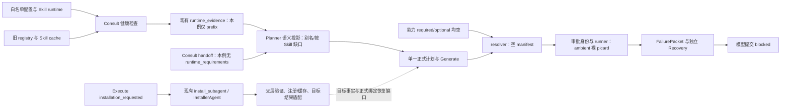

# BioMind 环境发现、工具注册与安装恢复补充审计

审计日期：2026-09-17。范围：用户附件 Q1–Q11、原 `session_1789628497` 原始证据、当前磁盘源码、限定只读软件探测和隔离现状见证。

**本轮完成审计，生产修复/软件安装/真实 WGS 均未实施。** 没有恢复原会话，没有调用真实模型/API，没有修改现役 Skill、提示词或环境配置。实施方案见同目录 [IMPLEMENTATION_PLAN.md](IMPLEMENTATION_PLAN.md)，14 类验收场景见 [ACCEPTANCE_MATRIX.md](ACCEPTANCE_MATRIX.md)，22项发现的类别、版本、期望边界、函数、绝对证据路径、已验/未验范围见 [FINDINGS.tsv](FINDINGS.tsv)。

## 结论与优先级

本次直接阻塞的上游问题是：**Consult 已发现 `bio_wgs` 前缀，却没有形成 Picard/Java/子命令级证据；参考准备能力明确声明空 runtime 范围，最终动作合法地产生空 bindings 并按 ambient 环境查找裸 `picard`。** `default_env` 不是执行承诺。修一个终端 PATH 或只加一条 Picard 路径不足以接通完整动作和恢复链。

安装器没有被删除：现有 `install_subagent` 路由和 `InstallerAgent` 仍存在。问题是当前科学生成协议、安装职责、授权范围、安装结果与目标环境验证、正式绑定/恢复之间没有形成可靠闭环。隔离见证还揭示了跳过审阅、取消回到生成、旧 Skill 成功掩盖目标失败等未在原事故触发的风险。

另有独立交付问题：global blocked 后步骤仍 running；最终 CLI 仍显示泛化的旧执行原因和后来已成功读取的取证错误；内部报告存在却不显示其路径。旧报告保护正确，不能通过覆盖旧文件解决诊断可达性。

**恢复参考准备前必须先补齐产物验收。** 原批准脚本在只有 FAI 成功，或全部命令失败但残留一个 BWA 文件时，仍可发出完整 bundle 的 `created`。本轮替身见证证实的是错误成功声明和通用目录存在检查，未执行 Supervisor/CommitStep，不能扩大为“框架已经提交了坏索引”。

## 版本、工作区与证据边界

| 项 | 值 |
|---|---|
| 仓库 | `/public/home/liusiqi/03.毕设/Biomind_v1` |
| 分支 | `refactor/consultant-controller-authority` |
| 完整 BASE / 启动 HEAD | `4ea823511328ed4035ec2a99ddf09a3419bb288a` |
| 启动工作区 | 541 项既有 staged/unstaged/untracked 状态条目，其中暂存文件数 0；逐项见 baseline 和 initial_status |
| 本轮版本定义 | 上述 HEAD **加当前工作树**；不把 HEAD 内容当作实际加载源码 |
| 原事故证据根 | `/public/home/liusiqi/03.毕设/benchmarks/biomind_agent_benchmark/runs/task_outputs/session_1789628497` |
| 本轮仓库交付根 | `/public/home/liusiqi/03.毕设/Biomind_v1/docs/audits/environment_install_recovery_20260917` |
| 外部导出根 | `/public/home/liusiqi/03.毕设/biomind_audit_exports/environment_install_recovery_20260917` |

启动快照是 `/public/home/liusiqi/03.毕设/Biomind_v1/docs/audits/environment_install_recovery_20260917/evidence/baseline.json`，含完整状态及相关源码 SHA-256；`initial_status.txt` 保存全部 Git 状态。审计过程中检测到并行修改 `agent_core/step_effects.py`、`workspace_attestation.py`、`semantic_completion.py`、`bio_agents.py`，见 `evidence/concurrent_change_checkpoint.json`。本审计没有写这些文件；相关结论按附件中的收尾源码身份复核。09:17Z收尾快照还记录 `agent_core/plan_tracker.py` 的候选资源分配修改；对照diff仅涉及 `_rewrite_plan_resource_bindings_after_allocation/_prepare_atomic_plan_objects`，未改本轮批准函数、旧advance路径或bundle验收。审计结论以各证据捕获时间/哈希为界，不声称同步了此后并行工作。审计期间另一个独立文档审计提交推进HEAD至 `e90a70158142da04dcaf588517a3a1e2f64c2a02`，本轮将在其后仅提交本目录。最终 Git/导出回执记录最终 HEAD、审计 commit 和仅审计路径的提交范围，不能把外部修改归为本轮实施。

当前审计进程、当前磁盘文件、历史请求中的文本与历史已加载代码是四种不同证据。沙箱可见 `/proc` 中未发现可核对的原 BioMind 活进程，这不证明宿主机没有该进程；原会话 PATH 没有可回溯快照。本轮软件帮助成功不能反推事故时同版本已经可用。历史证据未保存的部分标记 UNKNOWN，不以文件 mtime 或当前存在替代。

## 事故事实校准

| 类别 | 回核结果 | 边界 |
|---|---|---|
| 直接失败与上游缺口 | `prepare_reference` 的 `approved.py` 裸命令查找未找到 picard；`runtime_env_manifest.json#/bindings=[]`；Skill `default_env=bio_wgs`；历史 Consult 仅有 prefix 事实 | 原因是发现粒度、投影和能力契约共同未形成正式选用，不能只说 PATH 错或整机没装 |
| 阻塞传播因素 | 冻结计划把 FAI/BWA/dictionary 作为一个参考 bundle；两个 mapping 步骤依赖 bundle | 科学消费者可细分，但本轮不能拆原冻结计划或承诺 mapping 可继续 |
| 独立状态与交付问题 | `input_check=passed`；`prepare_reference=running`；全局 blocked；后续 pending；交付 conflict、内部归档 complete | running 是持久化步骤状态，不证明进程仍运行；旧报告不能当新报告 |
| 后续风险 | 当前 Java/子命令可用性差异；安装授权/路由风险；部分索引误发 created | 均独立标记；不声称原会话已经发生或真实科学验收通过 |

仅 `input_check` 有正式提交。历史发生的是一次固定 Python helper 入口错误、随后两次 Generate 格式候选被拒、一次修正后 input_check 执行成功，再到 Picard 查找失败；第二轮 Recovery 内另有一次提案漏 `schema_version` 后修正。第二轮最终 `blocked` 来自模型的明确提案 `MISSING_REQUIRED_CAPABILITY_DICTIONARY_TOOL`，不是恢复预算耗尽。这些不同类别不能合成“同一问题反复修不好”。详细 request/attempt/response 对照见 [incident_science.md](notes/incident_science.md) 与 `evidence/incident_witness.json`。

## Q1：四项配置由谁加载和使用？

四项 `.env` 声明与附件一致：BIO_SOFTWARE_ROOT=`/public/home/liusiqi/03.毕设/agent_shim`；BIO_SOURCE_INSTALL_DIR=`/public/home/liusiqi/03.毕设/source_tools`；ANACONDA_ROOT=`/public/home/liusiqi/anaconda3`；BIOMIND_SKILLS_DIR=`/public/home/liusiqi/03.毕设/Biomind_v1/skills`。审计的非 login 子进程中四项未设置；原 BioMind 进程有效值未取得。历史 Consult 的实际环境路径已单独证实，不能以审计进程值替代它。

`/public/home/liusiqi/03.毕设/Biomind_v1/config/__init__.py:5` 先载入 settings；`config/settings.py:79` 依代码根、启动 cwd 顺序读 `.env`，后者非空值覆盖已有进程值；随后 config.py 补缺并固化常量；startup 再执行同类环境加载。cwd 因此影响配置。SkillManager 对根目录 resolve；PackageManager 的 BIO 根路径处理与之不一致，相对值仍受 cwd 影响。

BIO_SOFTWARE_ROOT 服务旧 PackageManager registry 和 bin_shims；source 根服务源码安装工作目录及限定只读搜索；Anaconda 根服务管理器和命名环境候选；Skills 根服务当前 loader。没有任何一项直接等价于 worker 激活环境。实际追踪为：**文件声明 → 审计进程未设/原进程未知 → 历史 Consult 使用 bio_wgs prefix → action 最终采用空科学 runtime**。配置根、真实 shim/源码/Conda 关联、加载顺序和具体消费者详见 [runtime.md](notes/runtime.md) 的 Q1 表；只白名单留证，未导出 `.env` 或无关凭据。

## Q2：registry 和 install_agent 是现役还是死代码？

是仍在注册和调用链中的旧实现加现役 typed 适配层，不能宣告已退役，也不能据此认定所有产品分支可达。`/public/home/liusiqi/03.毕设/Biomind_v1/agent_core/workflow/runtime_graph.py:99` 把 Execute 的 `installation_requested` 送到 install_subagent；`early_nodes.py:1162` 的 TypedInstallSubagent 包装安装结果；InstallerAgent 内图仍负责生成/执行/注册。当前 Generate 脚本协议与这一执行入口之间存在不一致。

旧 software registry、Skill runtime registry/cache、新 task runtime_evidence 和 action manifest 各有消费者：前两者的“有记录/成功”不会自动变成后两者的所选工具事实。不能再增平行注册中心。注册路径、读写方、迁移证据、安装成功后的父层复检及缺口详见 [install_skills.md](notes/install_skills.md)。局部见证 `registration_without_verification` 说明内图可仅凭注册标签宣告完成；它不等同父层从未验证。

## Q3：哪些 Skill 安装限制实际生效？

真实 SkillManager 枚举得到 **88 个当前可选 Skills**；catalog revision 为 `skill-catalog-9d30c7eba6d17008`。完整逐 Skill 版本、路径、规则语义、作用阶段、继承及排除副本见 [skills_policy_matrix.md](evidence/skills_policy_matrix.md)，机器索引为 `skills_inventory.json`。实际历史规则摘录单独保存在 `skills_historical_rule_quotes.json`，不能把当下磁盘全文自动视为当时输入。

当前 mapping 的禁安装规则确实进入历史 Consult、Generate 和 Recovery 请求。它限制科学执行，且文本作用域存在过宽之处；但 Recovery 最终文字仍提出等待已验证工具或授权安装，因此**不能说连询问用户都被全局封死**。更具体的断点是当前脚本输出协议没有对应安装动作，且安装 work order 会带入科学 Skill 文本，可能让安装角色继承其禁止规则。规则应按角色/阶段修改，不是全部删除，也不是允许所有科学 Skill 自行安装。

六类语义分别处理：科学 action 完全不得安装但允许委派（矩阵D）、条件许可/不得未经授权（A及公共审批）、限定安装目标/来源（L）、只含安装SOP/示例（S/M/E）、不涉及安装（N）、broad禁令与角色/元数据冲突（C）。对 `never install` 未擅自推导“所有角色绝对禁止且不能询问”；没有找到全局封死询问的有效规则。当前实际工单截前4000字后，mapping禁安装句仍在（约第2078字），见 `skills_context_witness.json`；这证明当前串入风险，本事故没有installer request，不能说它已触发。历史mapping正文hash与当前不同、该禁令句相同；GATK正文hash相同。

## Q4：环境事实具体在哪里断开？

历史 `plan_state.json#/task_state/runtime_evidence/records/0` 在 07:03:59Z 记录 mapping 检查 succeeded，但仅给出 `runtime.environment.prefix`。`_verified_runtime_paths` 未得到 Picard 或 Java 的 RESOLVED 输出；finalize 补环境 prefix。GATK 的两条检查是 execution_error/UNKNOWN。

当前 `/public/home/liusiqi/03.毕设/Biomind_v1/agent_core/node_context.py:1561` 的 `_compact_planner_runtime_projection` 只识别 selected_environment/environment/conda_env 等别名，没有识别生产者的 env/checked_env/declared_env 和 resolved_runtime_paths，且不是按 Skill 完整投影。历史 handoff 没有 runtime_requirements；Planner/Generate/Recovery 实际请求能看到继承 Skill 的 bio_wgs 文本，但没看到已验绝对 prefix。该结论有真实 request 对照，不是由旧设计文档推测回归。

更具体地，三次 Planner 实际请求的 `/messages/1/content` 中 `semantic_history.runtime` 仅为 `{"runtime_ready":true}`，而持久化 GATK 证据仍是 execution_error/UNKNOWN。一个全局正布尔值遮蔽另一 Skill 的未知状态；不能把此值当完整分析环境已就绪。精确片段和配置白名单见 `evidence/runtime_history_and_config.json`。

`/public/home/liusiqi/03.毕设/Biomind_v1/skills/genomics/wgs-short-read-mapping/SKILL.md:104` 的 prepare_reference required/optional 均为空。`agent_core/action_runtime.py:475` 只消费能力要求与明确选择的 optional；`bio_agents.py` 的 Generate 解析和 Execute 重解析遵守它。最终 `build_exact_action_environment` 只合并已验证 action.env 与当前基础环境。见证即使给 registry 同时提供 prefix 和 Picard 路径，真实 resolver 仍返回空 bindings。这是精确范围保护按不完整能力契约运行，修复应补契约和事实，不破坏保护。当前生产调用还没有传 `requested_optional_ids`，因此只把工具加进 optional 列表仍不会被选用；如采用 optional，须接通明确选择载体及审批清单。

## Q5：发现和健康检查能区分哪些状态？

新 runtime_evidence 有 AVAILABLE/UNAVAILABLE/UNKNOWN/AMBIGUOUS、scope/过期边界；冲突候选和失效路径已有独立拒绝。旧 PackageManager 的粗健康检查及 broad 异常归类、无硬输出上限的 capture_output 不能覆盖用户要求的详细诊断。prefix 存在、顶层帮助启动、具体子命令/Java 兼容和科学结果有效必须分开。

搜索应限定用户给定位置、Skill 声明、既有注册和配置根的合理候选，记录已查/未查和停止条件。一次 PATH 未命中只证明这次 PATH；探测错误保持 UNKNOWN；在明确范围内排除候选后才能说缺少可用依赖。不能无限扫描整盘，也不能靠 registry 状态省略验收。

现有 Skill 检查被包装成声明环境，再由 PackageManager 前置其 bin 运行，故“Consult 用了 ambient 导致完全没检查 bio_wgs”不成立；但它仍继承其他 ambient 值（例如 JAVA_HOME）。两个动作不同 Java 的真实 runner 合成入口见证通过，只证明已有 runner 能隔离注入值，未证明当前科学 capability 已完整选择依赖。有限真实帮助探测、wrapper/Java、缓存与未验证边界见 [runtime.md](notes/runtime.md)。本轮未做真实科学小样。

新增两项精确现状见证：真实 Skill→PackageManager 命令在没有 bwa/bwa-mem2 的受控 PATH 下仍 rc=0（`bwa | head` 缺少正确失败传播）；现有严格 RuntimeInspectionAdapter 对 WGS 这条括号/管道健康命令先报 `RUNTIME_INSPECTION_SYNTAX_UNSUPPORTED`，早于验证 producer 输出。这要求给固定验证操作明确可接受的输入/输出契约，不能绕开只读适配器限制。

| 当前有限探测 | 观察 | 可作出的结论 |
|---|---|---|
| bio_wgs 的显式 Picard 2.20.4，CreateSequenceDictionary / MarkDuplicates | 输出对应USAGE，rc=1，完整结束 | 两个子命令可启动/识别，非科学验收；非零帮助码不是安装失败 |
| bio_wgs samtools | 版本1.3.1；不同子命令对 `--help` 的支持不同 | 顶层版本成功不能证明当前计划每个子命令可用；coverage输出 unrecognized command，需精确表达统计方案 |
| bio_gatk 直接 gatk HaplotypeCaller | 默认python指向Graal入口，launcher异常，rc=255 | 当前入口链失败阶段在解释器启动；不能简单归因为Java版本不兼容 |
| 同一GATK明确使用 `/usr/bin/python3` + bio_gatk/bin 的Java | GATK4.6.2.0、HaplotypeCaller及后续相关子命令帮助完整结束rc=0 | 显式解释器/环境组合可启动；需要进入正式绑定才对任务有效，未做实际calling |
| 某些首次异步帮助检查 | 已输出版本/usage且子进程已有rc，等待被记timeout | 保留为探测完成性异常，不能据此判软件启动失败；独立复核见runtime附件 |

Conda history还提供事故前注册记录：bio_wgs于2026-07-04登记Picard2.20.4/OpenJDK11.0.1/BWA0.7.19/samtools1.3.1；bio_gatk于2026-07-03登记GATK4.6.2.0，7月10日改Java21.0.8。见 `runtime_install_metadata.json`。这些支持事故前曾安装，不证明历史字节不变、PATH或科学可用。

每条原始argv、cwd、时间、白名单env、上限及rc见 `runtime_probe_results.json`、`runtime_gatk_followup_results.json`；复核结论以runtime附件为准。没有把任何帮助结果当成参考生成、MarkDuplicates或calling小样通过。

## Q6：Recovery 能否优先修复已有环境选择？

本次最终 blocked 是模型主动提交。它知道 Skill 文本的 bio_wgs，能读取 failure、step、Skill 和证据；没有任意 shell 或安装权限，也未拿到已验 Picard/Java 事实。现有 RuntimeEvidenceRecovery 可复用，但 `_scope` 要求动作尚未派发，`create_request` 拒绝空 required；本例已经运行失败且能力为空，不能直接套用 prelaunch 修复。

可实施路线是：命令未命中 → 定义“尚未绑定/探测未知”而非“整机没装” → 有界只读检查候选 → 写现有证据 → 释放旧执行所有权后进入正式重生成/必要的计划修订 → 新动作/新 attempt → 原 CommitStep。不要取消尚未派发保护来重写运行过的动作。改科学实现或能力契约必须重新核对计划批准。

动作批准身份已经涵盖脚本、能力、runtime/artifact/policy manifest 和 cwd，见 `/public/home/liusiqi/03.毕设/Biomind_v1/agent_core/action_runtime.py:1119`。本轮九项局部身份见证证实相关变化会使批准失效；同时路径级预检本身不检测原地换版本。详细限制见 [approval.md](notes/approval.md)。复用现有等待、拒绝、取消和 blocked 语义，不另建审批或状态体系。

## Q7：真正缺依赖时能否经授权安装并恢复？

现有入口能执行安装，但尚不能保证附件要求的完整链：具体安装方案及授权身份没有贯穿所有分支；安装内部可能绕过代码审阅；typed 适配器可把旧 Skill 的 ok 当目标能力成功。科学计划已批准不能代替安装操作批准。当前 Generate 两种输出分支对 install_tool 的描述不同；managed/schema2 Execute 又跳过旧 `_ensure_skill_runtime_ready` 安装预检。仍保留的 `_redirect_install_command` 通过识别科学脚本中的安装命令进入安装器，不能视为合规主动需求入口。

隔离现有代码路径证实四个行为：注册未验证就内图 success；无 strict 合同时 conda run 前缀安装绕过 reviewer；quit 文本回 generate；混合成功/失败 runtime_status 被判 capability_available。证据：`/public/home/liusiqi/03.毕设/Biomind_v1/docs/audits/environment_install_recovery_20260917/evidence/install_witness.json`。这些是局部现状证据，完整安装成功→验证→注册/缓存更新→正式绑定→原步骤恢复未运行。

下一轮应先形成可批准的工具/版本/目标/来源/命令/影响/验证方案，复用仍有效的相同范围授权；拒绝同案不重复问，手动安装或另给环境触发重验；目标或版本范围改变重新判断。安装成功回执只证明安装阶段，健康检查和注册失败分别保留，不重复安装掩盖后续失败。不得重跑已提交 input_check。

还需修两处具体断点：父层 `_verify_skill_runtime(sid,use_cache=False)` 未传本次 target_env，`get_runtime_requirements` 优先 default_env，可验证到旧环境；隔离loader夹具已证实。安装source仍有 `_mark_plan_current_done→advance_plan_after_verified_step` 直接设置passed/推进的旧路径，静态持久化调用链未见科学CommitStep门禁；本轮未运行其完整持久化闭环，作为严重未触发风险，不能说安装成功已具备科学完成保护。

## Q8：失败与人工处理的交接可操作吗？

现有观察文本能带回命令结果，但没有可靠覆盖执行/求解/构建/注册/验证全部阶段及可恢复请求身份；取消处理也有缺口。必须保留命令、实际目标环境、rc、关键 stderr、已知变化/残留，不把网络、权限、求解、版本问题统称未安装。复用既有停止报告和证据位置，无需新报告流水线。

本机已存在相关环境候选，当前首选是验证和正式绑定；没有充分依据推荐现在重装或升级。未执行源连通性、包求解、目标变更影响验证，因此本报告**不提供声称已验证的下载/安装命令**。下一轮若确需安装，先补版本要求、目标归属/可写性、可用来源和健康命令；手动完成后在 BioMind 提交同一安装请求的完成/环境位置事件，由系统重验再恢复。当前完整人工完成事件闭环仍是待补项，不能把“用户说装好了”当验收。具体缺项和命令建议边界见 [install_skills.md](notes/install_skills.md)。

## Q9：科学依赖与产物验收是否正确？

冻结计划要求参考 FAI、BWA 索引和 dictionary；mapping 需要 BWA-MEM、samtools sort/flagstat/coverage、Picard MarkDuplicates 和 BAM 索引（Picard CREATE_INDEX，必要时 samtools index）；calling 及过滤/统计的实际子命令和消费者逐项见 [incident_science.md](notes/incident_science.md)。没有运行过的后续步骤只能以正式计划和现役 Skill 为证，不可伪称已有执行脚本证明其实际调用。

dictionary 是一种能力；官方 samtools dict 提供候选实现，但本机版本、参数、参考 SN/LN/M5/UR 等字段和下游一致性仍需验证。替代 dictionary 不能替代 MarkDuplicates，也不能静默更换科学方法。[Samtools 官方说明](https://www.htslib.org/doc/samtools-dict.html)

bundle 便于提交和来源管理，却把暂时不需要 dictionary 的消费者一起阻塞。推荐先保留 bundle、补每项必需产物/命令/一致性验收；只有确认独立执行/复用有收益后，才正式修订计划，按真实消费者拆成有限依赖组。不是强拆所有小文件，更不是本轮调整冻结计划。`incident_witness.json#/partial_index_witness` 两种替身场景均重现原脚本错误 created，必须在重启相应步骤前处理。旧文件复用需要来源及验收证据。

## Q10：终态、报告和 CLI 反映最终事实吗？

尚未完全反映。原全局 blocked、步骤 running、后续 pending 与唯一已提交 input_check 均已从 plan_state 回核；`managed_stop` 的步骤状态同步受特定 candidate scope 分支限制。当前 CLI 对原终止诊断回放仍显示 EXECUTION_FAILED 的“原因未定位”、已被后续 evidence_read 解决的 INSPECTION_REF_KIND_MISMATCH；具体 Picard 结论和内部报告绝对路径没有成为清晰的当前原因/下一步。

旧目标文件保护产生交付 conflict，而内部归档 complete。两者要分别呈现，保留旧报告并给本次新报告可达路径；不能用旧 9 月 8 日报告解释新事故。停止收尾消费失败阶段和现有证据，不等待 variant 统计成功。证据回放见 `incident_witness.json#/cli_witness`，源码断点见 [incident_science.md](notes/incident_science.md)。

## Q11：协议和耗时应如何单独修复？

历史固定 Python helper 被当可执行文件直接启动，资源可读与解释器调用契约混淆。当前工作树已有 `skill_script_invocation.py`、binding 及 mapping invocation 声明修复，应保留，不重复实施。旧“69 passed”结果的六项源码身份中五项匹配当前，bio_agents 在本轮期间变动，故不能把旧结果整体认作收尾版集成验证。核验见 `evidence/reused_helper_validation.json`。

Generate 的两次错误是输出格式候选拒绝；Recovery 漏 schema_version 是提案协议错误。历史 Recovery system 已列必填字段，当前已有严格 native 参数适配修补，不能再把问题简单写成“模板没声明”或全面改协议。先校准唯一输出分支、例子、工具 schema 和适配入口，保留原始 native 参数证据，避免把任意脚本语义解析重新引入。

| 口径 | 原始核验值 |
|---|---|
| metrics 总墙钟 | 516.748 秒 |
| 人工等待 | 97.097 秒，4 次确认 |
| 扣人工 active | 419.651 秒 |
| 命令执行 | 13.317 秒，3 次：1 成功、2 失败 |
| metrics 模型事件 | 20 次，218.917 秒，含 supervisor，不含末尾 terminal_summary |
| 原始归档 request | 21 个；多出 terminal_summary，约 1.812941 秒 |
| metrics tokens | 1,035,909：prompt 995,593、completion 40,316 |
| 含 terminal_summary tokens | 1,040,365：prompt 1,000,037、completion 40,328 |
| metrics corrections / max_retry | 0 / 0；与实际候选纠错不是同一统计口径 |

node/模型/命令时间存在嵌套，不能相加成总耗时；terminal_summary 虽不在metrics模型事件中，但已在本次墙钟区间内，不再追加其耗时。tokens 是累计处理量，不能据此算费用。另有计划候选拒绝2、Generate候选拒绝2、input_check正式执行重试1、Recovery提案格式修正1；两轮Recovery有只读工具调用5，其中有效调查4、类型错误1；directive提交3次不算调查工具。提前提供正确入口、环境事实、协议可减少重复调用，但不先降低 Recovery 预算、删必要取证或改科学线程数。详见 incident 附件的逐调用核算。

## 验证结果与剩余缺口

本轮执行了真实 resolver/runner 的合成环境见证、现有动作/计划审批测试、安装器局部现有代码路径替身、原批准脚本的部分索引替身、当前 CLI 回放和限定真实软件帮助检查。每项证据标记其边界；没有用新写假安装器的预设返回证明恢复闭环。

复用 action/plan approval 21 项测试：19 PASS、1 FAIL、1 ERROR。失败/错误均是当前 SnpEff 能力名称与旧测试预期不同，保留并列入下一轮局部测试校准，不修改既有测试来让审计变绿。部分现状见证 PASS 恰好证明缺陷，不能归为修复后通过。

完整安装授权复用、人工完成事件、安装验证/注册失败的全工作流、新能力契约下正式动作恢复、真实软件微小科学输入及真实端到端 WGS均未运行。执行完整检查会越过本轮授权或现有安全隔离范围，因此以可定位的静态链路/局部见证记录剩余缺口。详见 [ACCEPTANCE_MATRIX.md](ACCEPTANCE_MATRIX.md)。

## 交付索引

- 主报告：本文件；实施计划：`IMPLEMENTATION_PLAN.md`；验收矩阵：`ACCEPTANCE_MATRIX.md`。
- 环境/绑定/Recovery：`notes/runtime.md`；安装/全部规则：`notes/install_skills.md` 与 `evidence/skills_policy_matrix.md`。
- 事故/科学/CLI/协议/耗时：`notes/incident_science.md`；批准身份：`notes/approval.md`。
- 版本及 Git：`evidence/baseline.json`、`concurrent_change_checkpoint.json`、收尾工作区快照与外部 Git 回执。
- 可复核见证：`evidence/*_witness.py`、对应结果 JSON；规则枚举脚本及矩阵；当前软件探测清单与结果。

外部导出与仓库审计文件按校验清单对应；原始 session 和敏感日志不全量提交。完整 BASE、最终 HEAD 和审计 commit 以外部 `git_receipt.json` 为准，避免提交文件内自引用 commit 导致哈希循环。本轮保留用户既有与并行产生的工作区变动，不 push。
