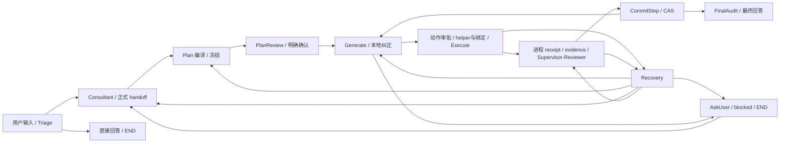

# BioMind 全执行链架构一致性审计 · A1

本轮完成安全源码/指定事故的只读审计、新隔离见证和统一修复设计。**生产尚未修复，当前集成只能判为部分通过。** 已有 S1—S3、Plan 资源/主动结束/取消、CLI/审批/输入修复保留；没有接续其他生产实施单，没有取消其他任务。

| 报告状态 | 结论 |
|---|---|
| AUDIT_STATUS | COMPLETE_WITH_EXPLICIT_LIMITS：活动接口与支持分支有覆盖状态，首因可复核，统一实施边界与验收已给出 |
| CURRENT_INTEGRATION_STATUS | PARTIAL：合法六步机制链和独立 snpEff prepare 已到真实 Commit/FinalAudit；当前事故 native/helper/纠正链仍有可复现缺陷 |
| PRODUCTION_FIX_STATUS | NOT_IMPLEMENTED_THIS_AUDIT |
| REAL_MODEL_VALIDATION | NOT_RUN，真实 provider/API 调用 0 |
| REAL_SCIENTIFIC_E2E | NOT_RUN，真实科学工具调用 0；不声称 snpEff 六科学操作已跑通 |

`witness PASS` 表示准确观察到当前行为，包括准确复现缺陷；它不是 `FIX PASS`。测试断言自身出错、外部 watchdog 超时、未触发 hook 的尝试均保留，未算生产通过。

## 材料入口与覆盖分母

| 文件 | 用途 |
|---|---|
| [interfaces.tsv](interfaces.tsv) | 58 个生产者—消费者接缝：字段/身份/权限/生命期、反馈、出口、正反证据与版本。不是新增运行时合同表 |
| [guards_and_exits.tsv](guards_and_exits.tsv) | 57 组现有拦截/退出条件，分类必要保护、可纠正格式、科学未决、内部缺口、条件可达旧路径；不是新增validator |
| [branches.tsv](branches.tsv) | 112 个已声明 typed outcome/resume/worker 分支的覆盖状态；额外payload分流见 route_source_index，枚举不等于动态通过 |
| [capability_families.tsv](capability_families.tsv) | 实际加载的 88 Skill / 96 normalized capability 及效果类型。科学能力安装/可用性另计 |
| [verification.json](verification.json) | 测试/加载/替身/限制/失败账本、W0—W11、保护检查和提交基线 |
| [fix_plan.md](fix_plan.md) | 按依赖排序的一份最小合并实施单，保留义务、持久兼容与完整组合验收 |
| [incident/findings.md](incident/findings.md) | 当前事故原始 request/response/parser/approved/wrapper/receipt/指纹的第一处偏差 |
| [downstream/findings.md](downstream/findings.md) | Execute、证据、Reviewer、Commit、Recovery、真实正常/受阻/结束见证及后段盲区 |
| [entry/findings.md](entry/findings.md) | 真实注册/入口、问答/审批、Plan正文、hook装配与故障边界 |
| [baseline/prior_evidence_reuse.json](baseline/prior_evidence_reuse.json) | 旧验收逐文件字节比较；237 文件全同，避免重做已实现部分 |

TSV 的源码行与 SHA-256 是当前安全工作树事实。新进程实际 import 路径/hash、Skill读取hash、测试依赖hash在各 run manifest/receipt；没有动态回执的条件明确 STATIC/NOT_RUN，不用 grep 命中冒充验证。完整合成运行证据压缩在 downstream/archives，关键回执另有不依赖 `/tmp` 的精简副本。原事故仅保存必要公开片段、路径、hash与JSON pointer，不导出私有reasoning。

## 到底审的是哪套字节

- 仓库：`/public/home/liusiqi/03.毕设/Biomind_v1`；分支 `refactor/consultant-controller-authority`。
- 测试基线 HEAD：`d146a479c437f190a19041d7ee0a7251aaeb9f4d`；tree：`25ff28413ba16553ad9f44d1a88956da48e2cd57`。提交父版本与测试基线分别记录在 verification 中。
- 五份保护源码 overlay：`node_context.py`、`planner_context.py`、`provider_message_safety.py`、`workflow/managed_stop.py`、`prompts/manager.py`。另 `agent_core/retriever.py` 的原始字节与 Git blob 不同，仅为 68 个 CRLF/LF 差异，LF规范化后相同；也按实际字节登记，没有误称第六份语义修改。
- 既有 dirty/staged/untracked、配置目录变动、旧文档移位均保留。敏感配置只登记 Git 元数据，不读其内容；隔离进程使用公开合成配置。新导出只包含安全生产源码、公开 Skill 源码/引用与明确测试依赖。
- 解释器：`/public/home/liusiqi/anaconda3/envs/biomind/bin/python`，历史记录 Python 3.12.12；新进程解释器hash、实际依赖入口hash/版本见 inventory-04。本轮没有换环境或安装。
- 新隔离 SkillManager 真正读取所有 88 个公开 SKILL.md，并逐 Skill 通过实际 registry API 得到 96 个能力（单次任务选择上限12未被绕开）。只有 snpEff prepare/build 两个能力有 workspace_mutations；合成双工作区不是第二个真实 Skill。主机 `.skill_runtime_registry.json` 只登记原文件hash，未把其安装状态带入隔离测试；能力可用性不能由空bindings/executables/versions推得。
- 原事故持久 routing schema=2，冻结 snpEff snapshot `skill-snapshot-01ccdd317817bf9532ad`，内容hash `1ce1295a59668778a08ee331280849deabfbacee242a7dffac5ca92a08650d44`，与当前 Skill 字节相同。原 identity 有部分 loaded callable marshal_v2 指纹与模块路径；其 `loaded_revision=UNKNOWN`、bio_agents loaded-module未捕获、skill_versions空。安全源码snapshot相同不补成完整历史加载证明；原 response archive 没有 finish_reason，completed也不等于未截断证明。
- 事故记录的关键 loaded module 位于上述仓库；没有获得外部 agent_shim 作为活动导入/分发路径的充分证明，未因横幅去扫描另一套源码。外层启动器与历史完整环境仍 UNKNOWN。业务项目根按用户声明为 `/public/home/liusiqi/03.毕设`，保留 `Part2.vairant_annotation` 字面，没有打开正式输入。

最新 Plan 实施回执的 237 个加载文件与当前全部同字节。复用其 184 passed 组合、15 passed独立CLI、两个独立reload检查及原9个旧fixture失败账本；较旧 S1—S3 export 有15个后来改变的文件，不能仅凭较旧HEAD认定当前集成通过。S1—S3组合已纳入最新Plan验收，因此不把 publisher、Generate持久额度、报告journal重新列成未实现。

## 实际架构与权威流

从 `bio_agents.main → run_terminal(_runtime_main) → BioAnalystAgent.__init__ → interactive_mode → _run_agent_interrupt_loop/go → _app_for_task` 反推。无TTY的interactive在构造前退出；demo为另一个支持入口，未运行。构造器会装配两张图，durable/state routing版本决定使用哪一张：schema2为当前事故；缺版本的旧任务仍可能进入legacy，不把整个旧目录都叫死代码。

schema2生产图注册14节点：triage、direct_response、consultant、planner、plan_review、ask_user、install_subagent、generate、step_worker、execute、supervisor、commit_step、recovery、final_audit。唯一条件边所有者是 `workflow/runtime_graph.py`；严格 typed outcome 禁止携带 next_node/goto/Controller 路由权。`build_schema2_runtime_graph` 只有独立段与空边界，不可冒充完整生产图。external_worker是条件后端，本轮不执行。



图外但活动的共同边界：持久StateContractStore/PlanState、取消/重载、phase上下文与archive、typed profiler、报告journal、终态summary、CLI输入owner。完整对象生命期详见接口表：

1. 用户事实、未决决策、选中Skill来自有来源的handoff；Planner不能靠一般批准确认科学参数。新资源模型只给local_ref与逐step/capability的role association，系统分配正式身份；required mutable状态按MUTATE证据覆盖，immutable文件仍需PRODUCE。
2. Plan批准冻结实例、版本、效果与resource mapping；Generate消费同一snapshot。模型只提动作，审批所有者确认冻结body/执行定义；runtime绑定和helper都须在批准前确定。
3. Execute产生真实attempt/rc/stdout/stderr/receipt。serializer只记录事实，evidence publisher落实scope，不拥有科学成功权。False、partial、blocked与无证据分别处理；旧文件不自动取得本次provenance。
4. Supervisor确定性核验与Reviewer语义决定独立；坏格式允许有界纠正，合法否决不重问到同意。CommitStep重新核对report/decision/token、scope、provenance、gate和CAS，只能它接纳binding/完成本步/推进后继；FinalAudit再次检查全部已提交步骤与最终义务。
5. Recovery沿正式packet/directive接回retry/revalidate/revision/reconsultation/ask_user/blocked所有者；消费过的packet只解释原因，不复活授权。终态区分原因果执行、当前未执行候选、停止原因、科学结果与报告交付。

## 当前事故的可复核首偏差

原始材料对照见 [incident/evidence.json](incident/evidence.json)。六步Plan已获批，不是旧Plan A/B循环。

| 问题 | 第一偏差与影响 | 当前证据 |
|---|---|---|
| IG-D1 helper物化漏argv | 0009是合法argv-only动作，marker在argv[2]；Generate只物化code，code为空，批准体仍调用未定义helper | 原approved.sh marker/调用、wrapper、attempt rc1/NameError；新native graph相同行为，code对照能展开 |
| IG-D2动作协议提示冲突 | 普通raw JSON规则与helper“可执行块+解释”冲突；Recovery seed缺同模式完整例子 | 原0009/0011/0012实际request与parser片段，三入口静态接线 |
| IG-D3 facts缺完整例子 | 原flat identity map不符合category→identity→fields；helper补上后会EFFECT_FIELD_UNDECLARED | 新Bash/Python真实serializer+parser：正确False保留，错误形状准确拒绝 |
| IG-D4误判无进展 | 两候选与错误指纹均不同；frozen binding分支用同一binding_env facts覆盖表示变化，remaining=3仍停 | 原两ledger；新严格表示纠正见证；不是空指纹，也不是仅凭错误码变化判进展 |
| IG-D5拒收时再异常 | 非法env列表已被parser准确识别，合法动作fingerprint却dict(env)抛ValueError，局部回执丢失 | 新隔离Generate真实异常；非法env不能因此被放行 |

0011 parser选中了Python集合推导式 `{norm(n)…}` 作为JSON片段，报JSON_DECODE_ERROR；0012可解码但错误套`action_json`外壳，顶层缺action_type。两个拒收应保留，下一次请求应提供准确可满足的协议。原两份脚本亦非逐字相同；这些脚本变化不能证明科学进展。准确的表示改进与必要的科学/权限保护必须分开。

原因果 `attempt_be39ca0c6335578331a1` 与rc/stderr已投影，三份report_publications均published。没有证据把本事故写成旧的报告拒写或原因果丢失。

## 当前事故以外的结论

- **进展口径冲突（G11）已复现**：非binding分支可记录progress_proven=true（候选或错误变化），generated-semantic policy却因候选相同停止；同事件重投不再扣额。修复必须统一原节点判据，不能把“错误改变”本身算实质修正。
- **AskUser回调异常出口（R01）已复现**：source抛错经typed wrapper产生不带semantic_state的harness_error，当前默认回Consultant且终止边界为空。缺答复回执使用另一生产器，实际正确END；最初静态怀疑被动态证据纠正并保留，不能修改这条正常保护。
- **Plan默认正文尚未实现**：当前compact只显示summary/F2；冻结ReviewDisplay/body hash与明确确认已存在。修复限在同一冻结显示对象接线，不重做Plan/审批，更不能另调模型替代正文。
- **后段有真实正例**：六个正式inspect步骤经过六次实际审批/新进程/Reviewer/Commit到FinalAudit；独立snpeff prepare由公开Plan、role association、request中可见handle/ID/path构造，真实写新layout并通过attester、两项binding接纳及Commit。没有塞ready/approved/succeeded。这两条不能拼成snpeff六科学操作E2E。
- **主动结束已部分正式支持**：Planner STOP_PLANNING与Generate完整blocked对象都有路径。新Generate在一次真实Commit后主动blocked，未消耗纠正预算，正式报告created。问题是协议投影一致性与部分兜底判据，不是所有节点都没有停止权。

## W0—W11 与实际验收盲区

| 组 | 覆盖结论 | 明确未覆盖/替身边界 |
|---|---|---|
| W0 | 原始request/业务response/选中parser片段/批准体/wrapper/receipt/指纹配对；当前缺陷见证 | 完整历史loaded_revision、原finish metadata UNKNOWN |
| W1 | 新六步机制链6次Commit→FinalAudit；独立snpeff prepare→真实attester/2 bindings→Commit | 六inspect不是snpeff六操作；正常六步只需最终回答，未要求/未写物理report |
| W2 | 复用当前字节已通过的B_success/B_last：rc7→Recovery→纠正→新审批→rc0/Commit | 固定provider；原事故特定native/helper/representation链仍失败 |
| W3 | 新False发射；复用A负面/partial/blocked、不运行依赖、报告保护 | 科学判断本身替身；各Skill全部负面语义未穷举 |
| W4 | 复用A/A_last/C/合法否决：Reviewer纠正/持久上限/revalidate不续额；新六链真实Reviewer parser | 无真实模型评审；不能据此认可真实科学质量 |
| W5 | 新表示误停/两层progress矛盾/Generate主动结束；复用Planner A/B/A、UUID、最后机会与STOP | 新修复尚未实施；Generate所有历史循环形式未全跑 |
| W6 | 新精确ledger重投不扣额；复用独立Plan/epoch重载、报告journal丢receipt恢复 | 本轮未新做完整进程失联/跨Commit崩溃窗口；不把无回执当未执行 |
| W7 | 新Generate await取消→stale→Planner取消终态END，无新审批/attempt；非语义generation正例 | 其他Generate/Execute/Commit取消窗口静态与既有保护；新完整OS子进程清理未验 |
| W8 | 新真实构造器/归档、summary transport、legacy compression回调10组件case；新stop报告created | enabled schema2 PhaseContextCompactor完整子图、完整finalizer全部故障组合NOT_RUN；生产真实flag UNKNOWN |
| W9 | 当前默认Plan正文缺失见证；同字节最新CLI/输入/审批检查复用，历史PTY只保留版本证据 | 本轮未新跑PTY；Plan直显改动需真实PTY组合，不称已实现UI |
| W10 | 88/96真实声明载入；共享serializer Bash/Python；中文空格/改名；新mutable/文件/binding | R及外部h5py/cooler/科学工具NOT_RUN；泛化按共享实现有限代表 |
| W11 | 无执行Consultant answer_ready/direct_response、真实问询/未决支持路径静态；缺问询/缺receipt/异常实际出口组件 | 新完整CLI无执行问答、所有ask/reconsultation模式未动态穷举 |

旧fixture边界也已核对：`test_schema2_production_graph.py`直造outcome仅是路由；`test_step_effect_runtime`直造EVIDENCE_COMMITTED是gate组件；旧workspace测试部分fake executor/FinalAudit；旧Plan Generate fixture先设done/ready只证明绑定请求。不能把这些拼成全链通过。新后段构造继续沿正式生产API，避免前段问题掩盖后段。

hook关键发现：session archive叶子丢弃/错误不改业务state；terminal summary transport的None会交最终consumer判错，取消与超时需清理；Recovery事件持久化sink异常是`RECOVERY_EVENT_PERSISTENCE_FAILED`的必需边界，不能一律吞掉；legacy memory的Exception/None进入正式fallback。schema2 compaction开关、memory/summary真实配置不读取，因此只声称新隔离配置下的真实装配。没有把当前事故归因为上下文丢失，也没有重构上下文系统。

## 安全与复现

未主动读取/执行启动.sh、密钥/.env/敏感配置、完整环境、正式科学输入、业务数据库或其他benchmark；原session未业务加载，原批准脚本未运行，无安装/真实API/真实科学调用。所有合成状态、脚本和结果位于新隔离根；源码/结果保全只收本轮目录。

**安全限制如实保留**：incident run03的新合成脚本使用嵌套`bash -lc`，读到了宿主登录profile并输出集群banner。Python父进程audit hook不能证明对子shell的所有间接读取生效；无法据此保证该次没有读取其他profile引入配置。该路径已停止，最终run04用非登录shell执行同一合成body，明确只是body/executor组件对照，不冒充完整native argv执行。原事故approved体本身也含bash -lc，但不能由本轮现象补造原事故具体环境事实。初期少量宿主shell工具调用也有登录横幅；后续全部显式login=false。此项不改变原材料定位和nonlogin复现，但禁止宣称整轮绝对零profile访问。

复现采用已知解释器和新增入口（必须是不存在的新/tmp目录）：

```bash
cd /public/home/liusiqi/03.毕设/Biomind_v1
/public/home/liusiqi/anaconda3/envs/biomind/bin/python tests/execution_architecture_audit_a1/export_and_run.py /tmp/biomind-a1-rerun-new --run -q tests/execution_architecture_audit_a1/test_incident_generate.py
```

其他测试组/额外依赖、guarded launcher及精确命令见 verification 与各分册回执。hook用 `run_entry_guarded.py` 分case诊断入口；原测试文件不变，新增fixture修正只改本轮文件。标准launcher外部180秒watchdog；hook早期selector/线程唤醒超时保留并用测试内loop pulse服务原回调，未改变生产close。watchdog停止不算生产合法出口。

独立审计提交只包含此目录和 `tests/execution_architecture_audit_a1/`；完整hash与逐文件范围以提交回执为准，未push。不要求工作区clean，不收编其他hunk。此提交依赖manifest中列出的既有dirty/untracked安全fixture，不宣称仅靠干净克隆即可独立发行。本轮已完成可审范围的接口定位与统一设计；后续只须对实际改变的共同接缝实施并做组合验收，不要求各节点重新开一轮审计。
