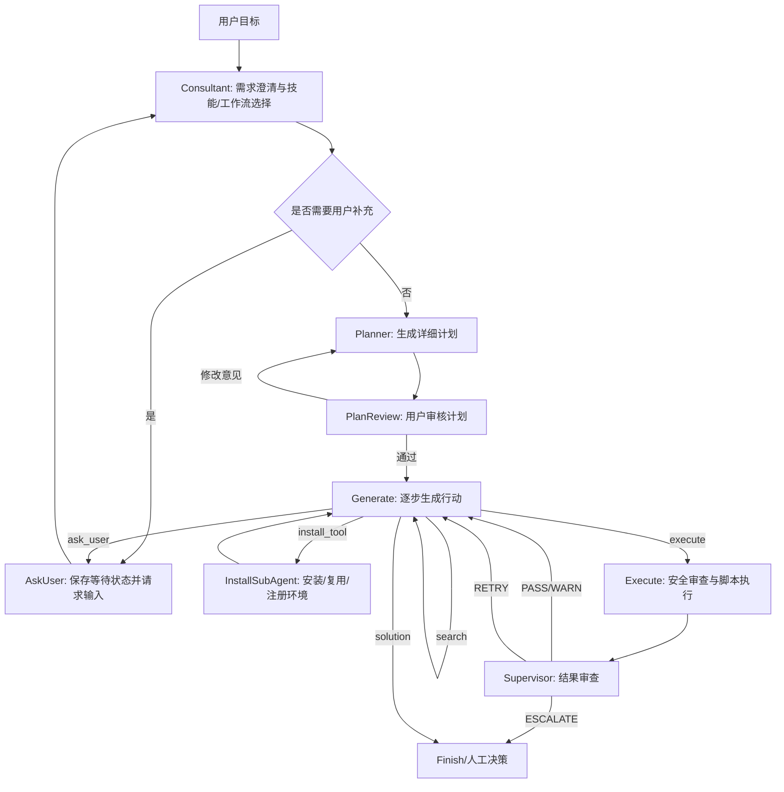

# 面向生物信息学长流程分析的 BioMind 智能体系统设计与实现

## 摘要

生物信息学分析任务通常具有流程长、工具链复杂、运行环境依赖强、参数与中间产物多、错误恢复频繁等特点。传统大语言模型虽然具备较强的自然语言理解和代码生成能力，但在真实科研计算场景中仍面临上下文遗忘、工具幻觉、执行不可控、结果缺乏证据链以及跨会话难以恢复等问题。针对上述问题，本文设计并实现了 BioMind 智能体系统。该系统以 LangGraph 状态机为主控框架，将需求咨询、任务规划、人工审核、代码生成、脚本执行、结果监督、环境安装和记忆归档组织为可追踪的闭环流程；以技能系统和工作流模板约束领域任务执行；以 RAGFlow 外部知识检索和项目级 Wiki 记忆增强上下文；以 Supervisor 节点、命令风险分析和人机协同机制降低错误执行风险。当前系统已形成 74 个 Python 文件、约 23924 行代码、26 个本地领域技能、3 个工作流模板和 16 个测试文件，初步覆盖单细胞转录组、三维基因组、表观基因组、序列检索和公共数据库访问等任务类型。测试结果显示，记忆相关模块 86 项单元测试全部通过；全量测试 153 项通过、3 项跳过，并暴露出 1 项 TAD 技能命名空间兼容性问题。总体而言，BioMind 的研究重点不是替代具体生物信息学算法，而是构建一个面向科研计算任务的可执行、可审计、可恢复的智能体基础设施。

关键词：生物信息学；智能体系统；大语言模型；LangGraph；检索增强生成；技能系统；智能体记忆；人机协同

## 1. 绪论

### 1.1 研究背景

随着高通量测序、单细胞组学、三维基因组和多组学整合分析的发展，生物信息学研究越来越依赖复杂的软件工具链。例如，单细胞 RNA 测序分析需要经历数据导入、质控、归一化、高变基因筛选、降维聚类、marker 基因识别、细胞类型注释和差异表达分析；Hi-C 或 Micro-C 数据分析需要完成矩阵检查、分辨率确认、TAD calling、边界变化统计和差异 TAD 评估。这些流程不仅涉及 R、Python、Bash、Conda、专用命令行工具和大量中间文件，还需要持续维护样本信息、参数阈值、软件环境和结果路径。

大语言模型为生物信息学自动化提供了新的可能。模型可以理解用户的自然语言目标，生成分析脚本，解释错误日志，并辅助编写报告。然而，如果直接将大语言模型作为一次性代码生成器用于科研计算，容易出现以下问题。第一，模型可能在没有确认文件存在或软件安装状态的情况下生成命令。第二，模型可能把多步流程一次性写出，导致前一步失败后后续命令继续基于错误假设执行。第三，长任务中的早期参数和中间产物容易被上下文窗口截断。第四，模型对工具参数和生物信息学结论的判断缺少可追溯证据。第五，工具安装和环境复用若缺乏统一管理，会造成重复安装、环境污染和运行不可复现。

因此，本研究将问题定义为：如何构建一个能够面向真实生物信息学长流程任务运行的智能体系统，使其不仅能生成代码，还能规划任务、使用领域技能、执行并验证脚本、管理运行环境、保存任务状态、进行错误恢复，并在跨会话场景下保持可追溯的项目记忆。

### 1.2 研究目标

BioMind 系统围绕以下目标展开设计：

1. 构建可执行的多节点智能体流程，而不是单轮问答式代码生成。
2. 将生物信息学流程知识沉淀为可发现、可加载、可验证的 Skill 和 Workflow。
3. 通过严格的执行协议、人机确认和安全规则控制脚本执行风险。
4. 在每次执行后引入 Supervisor 审查，发现静默失败、非进展命令和科学性风险。
5. 构建多层记忆系统，使长任务具备压缩、归档、检索和恢复能力。
6. 通过持久化状态、计划跟踪和运行性能记录支撑可复现与可审计。

## 2. 相关工作

现有研究为 BioMind 的设计提供了方法基础。检索增强生成（Retrieval-Augmented Generation, RAG）通过外部文档检索缓解模型参数知识静态和不可追溯的问题[1]。ReAct 框架提出将推理和行动交替组织，使模型能够在观察结果后继续决策[2]。Generative Agents 和 MemGPT 等工作进一步强调长期记忆、事件归档和状态管理对智能体连续行为的重要性[3][4]。LangGraph 等工程框架则提供了状态机式智能体编排能力，适合将复杂任务拆分为可路由、可中断和可恢复的节点流程[5]。

在生物信息学领域，Seurat、HiCExplorer 等工具已经形成较成熟的分析流程[6][7]，但其使用仍依赖研究者理解命令参数、输入输出格式和运行环境。BioMind 的定位不是重新实现这些领域算法，而是将已有生物信息学软件和工作流封装到智能体可调用的技能体系中，并通过可审计的执行闭环降低模型直接操作科研数据的风险。

与一般 RAG 问答系统相比，BioMind 更强调可执行性和任务状态。外部知识库只能回答“应该怎么做”，而智能体还需要知道“当前做到哪一步”“上一条命令是否真的成功”“生成了哪些文件”“某个结论来自哪条执行证据”。因此，BioMind 采用状态机、技能系统、执行监督和证据化记忆相结合的体系结构。

## 3. 系统需求分析

### 3.1 领域任务特征

生物信息学智能体面对的任务具有以下特征：

1. 长流程性：分析往往由多个阶段构成，后续阶段依赖前序阶段的文件和参数。
2. 异构工具链：同一任务可能同时调用 Bash、R、Python、Conda 环境和命令行软件。
3. 参数敏感性：基因组版本、分辨率、QC 阈值、聚类分辨率和比较设计会显著影响结果。
4. 结果多样性：输出包括表格、RDS 对象、BED 文件、图像、日志、报告和中间目录。
5. 错误复杂性：常见错误包括缺失软件、环境不匹配、路径错误、内存不足、空输出和工具静默失败。
6. 可追溯性要求高：科研计算不仅要求得到结果，还要求能够说明结果如何产生。

### 3.2 系统功能需求

BioMind 需要支持从用户自然语言输入到可执行分析结果的完整链路。系统首先需要通过 Consultant 节点理解需求、识别任务类型、选择工作流和技能；随后由 Planner 节点生成可审核的阶段性计划；计划经用户确认后，由 Generate 节点逐步生成单步执行命令；Execute 节点执行命令并记录结果；Supervisor 节点对执行结果进行规则检查和必要的 LLM 审查；如果缺少工具或环境，则委派 Installer 子智能体完成安装、验证与注册；任务过程中的消息、计划、执行记录、产物和错误需要进入持久化层和记忆层，以便后续恢复。

### 3.3 非功能需求

除功能完整性外，系统还需满足以下非功能需求：

1. 安全性：任何非白名单或高风险命令都应经过风险分析和人工确认。
2. 可恢复性：上下文压缩或会话中断后，系统应能恢复任务目标、计划、已完成步骤和关键产物。
3. 可审计性：计划、脚本、执行结果、监督结论和记忆写入均应有文件或数据库记录。
4. 领域一致性：执行命令必须优先遵循已加载 Skill 的 Quick Start、运行环境和输入输出约束。
5. 可扩展性：新增分析领域时，应优先添加 Skill 或 Workflow，而不是修改主智能体逻辑。

## 4. 总体架构

### 4.1 分层架构

BioMind 系统可划分为六个层次：

| 层次 | 主要模块 | 功能 |
| --- | --- | --- |
| 交互层 | `interactive_mode`、`human_io`、`HITLMiddleware` | 接收用户目标、计划审批、代码确认和中断恢复 |
| 编排层 | `bio_agents.py`、LangGraph `StateGraph` | 组织 Consultant、Planner、Generate、Execute、Supervisor、Installer 等节点 |
| 知识层 | `RAGFlowRetriever`、`SkillManager`、`WorkflowManager` | 检索外部知识，发现本地技能，加载工作流模板 |
| 执行层 | `executor.py`、`shell_safety.py`、`confirmation.py` | 运行 Bash/Python/R 代码，进行风险分析和安全拦截 |
| 监督层 | `supervisor.py`、`validator.py`、`monitoring.py` | 检查退出码、空输出、静默失败、非进展命令和领域工具结果 |
| 记忆与状态层 | `memory_manager.py`、`memory/`、`persistence.py`、`plan_tracker.py` | 管理上下文压缩、任务记忆、Wiki 记忆、会话归档、计划状态和执行记录 |

### 4.2 状态机流程

系统核心流程由 LangGraph 状态机实现。其节点集合可形式化表示为：

```text
V = {Consultant, AskUser, Planner, PlanReview, Generate, Execute, Supervisor, InstallSubAgent}
```

状态对象 `AgentState` 保存消息历史、任务编号、项目编号、稳定系统提示词、当前计划、计划进度、已选技能、工作流阶段、运行环境状态、RAG 历史、Wiki 上下文、Supervisor 判决等字段。节点之间通过 `next_step` 和路由函数决定跳转方向。



该流程体现了 BioMind 的核心思想：智能体不直接从用户目标跳到最终脚本，而是在计划、审批、单步执行、观察和监督之间形成闭环。每次只推进一个逻辑步骤，避免多步命令在错误前提上继续执行。

## 5. 关键模块设计

### 5.1 Consultant：需求澄清与任务路由

Consultant 节点负责读取用户输入、历史 RAG 结果、已安装工具、本地 Skill 目录、Workflow 目录和项目 Wiki 上下文，并输出结构化的需求摘要。它可以主动加载工作流模板、技能文档或参考资料，也可以在输入不完整时触发 `ASK` 流程。为避免模型在技能选择阶段陷入循环，系统实现了 loop guard：当多次重复加载技能或出现多次验证失败时，会基于请求文本进行确定性技能匹配，并将任务交给 Planner。

在领域任务中，Consultant 的作用相当于“计算分析前的方案确认”。例如，单细胞任务需要确认输入是 10x 矩阵、H5 文件还是已有 Seurat RDS；TAD 任务需要确认矩阵路径、分辨率和平衡状态；差异分析需要确认比较组设计。只有这些信息进入 `requirements_summary` 后，后续计划和执行才有稳定依据。

### 5.2 Planner：可审核计划生成与计划状态持久化

Planner 节点根据用户目标、Consultant 摘要、RAG 知识、Wiki 上下文、已安装工具和已选 Skill 文档生成详细计划。计划不是自由文本，而是后续执行的控制对象。系统会将计划保存到 `task_outputs/{task_id}/plan.md`，并通过 `plan_tracker.py` 解析 checklist、生成 `plan_state.json`、维护每一步的 `pending`、`running`、`done` 和 `blocked` 状态。

Planner 还会执行技能约束校验。若计划中的命令违反已选 Skill 的运行环境、脚本路径或输入输出约定，系统会要求模型重新生成计划，或在计划文件中追加验证警告。对于多阶段工作流，Planner 只激活当前 batch 的技能，将后续阶段技能放入 `future_skills`，以避免一次加载过多文档或越阶段执行。

### 5.3 SkillManager 与 WorkflowManager：领域知识的结构化封装

BioMind 将领域过程知识沉淀为本地 Skill。每个 Skill 以 `SKILL.md` 为入口，包含 YAML frontmatter、任务类型、阶段标签、输入输出、运行环境、依赖包、Quick Start 命令、适用与不适用场景，以及可选的脚本和参考文档。`SkillManager` 负责扫描技能目录、构建技能树、加载技能文档、规范化技能 ID、匹配用户请求、验证所选技能数量和运行环境。

截至当前版本，系统包含 26 个本地技能，覆盖：

1. 单细胞分析：数据导入、QC、预处理、聚类、marker 识别、注释、差异表达和环境引导。
2. 三维基因组：TAD calling、边界变化、差异 TAD、loop calling、loop 分类和 3D DNA 分析。
3. 表观组：modkit 开放染色质流程、甲基化基因区域绘图。
4. 序列分析：本地 BLAST、远程 BLAST 和序列相似性搜索。
5. 数据库访问：NCBI Entrez、GEO、Ensembl 等公共数据库技能。

`WorkflowManager` 进一步提供高层流程模板。目前已有 3 个工作流模板：`scrna_standard_analysis`、`scrna_ingest_qc` 和 `hic_tad_analysis`。工作流将复杂任务拆解为阶段，并为每个阶段声明默认 Skill、输入、输出、是否可选和可能阻塞的条件。这使 BioMind 能够先选择流程，再选择当前阶段技能，从而降低模型随意组合工具的风险。

### 5.4 Generate：步骤局部上下文与行动选择

Generate 节点是系统的行动决策中心。它在每轮调用模型前构造“稳定提示词 + 步骤局部上下文”的组合输入。稳定提示词包含系统身份、执行协议、工具环境、冻结 Core Memory 和本地规则；步骤局部上下文默认只包含刷新后的工具列表、当前 active skill、当前计划与计划进度、必要输入/产物路径、最近 observation、Supervisor 反馈和 Consultant 传下来的压缩记忆 packet。

BioMind 不再把 Markdown Task Memory、Wiki Memory 和 Session Archive 检索结果每轮都塞进 Generate。记忆注入采用分阶段策略：Consultant 在任务开始前做较宽的历史检索，查找相似任务、历史 workflow/skill 选择、可复用环境和常见失败点，并输出 `consultant_memory_packet`；Planner 将这些经验固化为计划约束、步骤注意事项和成功条件；Generate 普通 PASS 路径只按当前步骤执行。只有 Supervisor WARN/RETRY、最近 observation 失败、缺输入路径、进入新 workflow batch、resume 恢复任务或用户要求解释依据时，系统才按需检索 Task Summary、SessionArchive、artifact index、Wiki claims 或 RAG。

Generate 输出必须采用受控标签之一：

```text
<search>...</search>
<execute>...</execute>
<install_tool env="...">...</install_tool>
<activate_batch batch_id="..." />
<ask_user>...</ask_user>
<solution>...</solution>
```

该协议把模型的自由文本输出转化为可路由动作，减少解释歧义。Generate 同时遵循原子执行原则：每轮只能生成一个逻辑步骤，必须等待 Execute 的真实 observation 后才能继续下一步。

### 5.5 Execute：安全执行与产物记录

Execute 节点负责解析 `<execute>` 中的代码，识别 Bash 或 Python，剥离 Markdown code fence，检查安装命令是否应重定向到 Installer，检查是否误用 future skill，检查是否没有使用 Skill 指定的 `env_runner`。在代码真正执行前，`HITLMiddleware` 会调用 `RiskAnalyzer` 进行风险分级。只读白名单命令可以自动放行；未知、修改、安装、删除或系统级命令需要用户确认、修改或拒绝。

执行器支持 Bash 脚本、持久化 Python REPL 和 R 脚本。Bash 执行前会注入 shim 路径，使已注册工具可通过统一路径调用；Python REPL 维护持久命名空间，便于连续分析；所有执行都会记录脚本文件、stdout、stderr、returncode、耗时和运行状态。若 stdout 过长，`PersistentStateManager` 会保存输出引用并生成摘要，避免数据库和提示词被大输出淹没。

### 5.6 Supervisor：执行后科学审查

Supervisor 节点位于 `execute -> generate` 之间，是 BioMind 区别于普通代码生成器的重要模块。其规则引擎首先检查退出码、空输出、静默失败信号、OOM、非进展命令和常见生物信息学工具输出模式。对于存在错误或警告的步骤，系统可以调用 LLMReviewer 进行更深层的科学性审查，包括参数是否合理、结果是否可信、输出是否符合预期。Supervisor 最终给出四类判决：

| 判决 | 含义 | 后续动作 |
| --- | --- | --- |
| PASS | 执行结果可信 | 当前计划步骤标记完成，返回 Generate |
| WARN | 存在警告但可继续 | 注入警告，继续下一步 |
| RETRY | 需要修复后重试 | 将反馈注入上下文，由 Generate 重新生成命令 |
| ESCALATE | 多次失败或风险过高 | 标记任务阻塞，交由用户决策 |

该设计将“命令成功退出”与“科学分析步骤成功”区分开。例如，某些工具即使退出码为 0，也可能产生空文件、零比对率、NaN 指标或仅执行了 `--help`。Supervisor 的任务是捕捉这些普通执行器难以判断的问题。

### 5.7 Installer 子智能体与包管理

生物信息学工具常依赖复杂 Conda 环境。BioMind 将安装行为从主执行循环中分离出来。主智能体不得在 `<execute>` 中直接输出 `pip install`、`conda install`、`conda create` 或 `mamba install`，而必须通过 `<install_tool>` 委派 Installer 子智能体。

Installer 子智能体负责读取目标工具、目标环境、已选 Skill 的 runtime 要求和已有环境注册表。它会优先复用已注册且 healthcheck 通过的环境；若存在部分匹配环境，则倾向扩展该环境；只有在必要时才创建或修复环境。安装完成后，Installer 通过 `PackageManager` 注册工具或环境，包括环境名、语言、依赖包、能力、healthcheck、shim 路径和状态。这样后续任务可以直接复用环境，减少重复安装和路径不一致。

### 5.8 多层记忆系统

BioMind 的记忆系统由五类信息组成：

```text
M = {C, T, A, W, R}
```

其中，`C` 表示 Core Memory，保存用户偏好、智能体稳定操作经验和项目 Wiki 索引引用；`T` 表示 Markdown Task Memory，保存当前任务目标、状态、关键文件、命令结果、错误修复和产物；`A` 表示 Session Archive，使用 SQLite/FTS 保存跨会话事件；`W` 表示 Wiki Memory，保存带证据的项目级知识；`R` 表示外部 RAG 检索结果。

记忆系统遵循“观测先归档，事实后整理”的原则。执行热路径只记录可观察事件，不立即把事件改写为长期事实；离线 Dream 和 Wiki ingest 流程再将事件整理为任务摘要、核心索引或证据化 Wiki claims。Wiki claim 必须绑定 `raw:`、`session_archive:`、`task:` 或 `artifact:` 证据来源，缺少证据或存在冲突的 claim 会进入 review queue。上下文过长时，`MemoryManager` 会按 token 阈值压缩旧消息，保留稳定提示词、计划和最近上下文，并将旧消息归档为可检索摘要。

该模块已经形成独立中期材料，详见 `docs/agent_memory_system_midterm.md`。在整个 BioMind 系统中，记忆模块的作用是保证长流程任务可恢复、结果可追溯和提示词可控。

### 5.9 RAGFlow 外部知识检索

BioMind 通过 `RAGFlowRetriever` 接入外部知识库。系统配置中将知识库分为 SOP、TOOLS 和 ERRORS 等类别。Consultant 可检索任务方案和工具文档；Generate 仅在当前步骤缺少外部知识时主动检索；错误恢复中间件可根据错误指纹检索历史解决方案。RAG 的结果不会直接作为事实写入核心记忆，而是以步骤局部上下文形式注入，供当前决策参考。

### 5.10 人机协同与安全机制

BioMind 采用多处人机协同设计。首先，Planner 生成的计划必须经过 PlanReview，用户可以批准、拒绝或输入修改意见。其次，非安全命令执行前会触发代码审查中断，用户可批准、拒绝、退出或提供替换代码。第三，当缺少必要参数时，Generate 必须输出 `<ask_user>`，系统保存等待状态，避免模型凭空猜测。第四，当 Supervisor 多次 RETRY 后仍无法通过，会 ESCALATE 给用户。

安全机制还包括 shell startup 文件保护、禁止 `source ~/.bashrc`、禁止修改登录 shell 配置、禁止交互式 `input()` 或 `read` 阻塞执行、禁止危险 `stty` 模式、安装命令重定向、Skill runtime guard 和 future skill guard。这些规则使系统更适合在真实科研服务器或个人工作站上运行。

## 6. 实现情况

### 6.1 技术栈

BioMind 使用 Python 实现，核心依赖包括 LangGraph、LangChain、SQLite、YAML、Colorama、Requests，以及按任务需要调用的 R、Python 和命令行生物信息学工具。LLM 接口采用 OpenAI-compatible 形式，默认配置中使用 DashScope/Qwen 模型；外部知识检索通过 RAGFlow API；Embedding 功能为可选配置。

### 6.2 代码规模

截至 2026 年 5 月 19 日，当前仓库统计如下：

| 项目 | 数量 |
| --- | ---: |
| Python 文件 | 74 |
| Python 代码行数 | 23924 |
| 本地 Skill | 26 |
| Workflow 模板 | 3 |
| 测试文件 | 16 |
| 主要顶层模块 | `bio_agents.py`、`supervisor.py`、`memory_manager.py`、`package_manager.py` |

### 6.3 主要文件职责

| 文件或目录 | 作用 |
| --- | --- |
| `bio_agents.py` | 主智能体状态机，包含 Consultant、Planner、Generate、Execute、Supervisor 和 Installer 路由 |
| `agent_core/state.py` | 定义主智能体和安装子智能体状态结构 |
| `agent_core/skill_manager.py` | 发现、加载、匹配、验证 Skill，并维护技能运行时注册 |
| `agent_core/workflow_manager.py` | 加载工作流模板，解析和验证工作流 handoff |
| `execution/executor.py` | 识别语言并执行 Bash、Python、R 代码 |
| `execution/confirmation.py` | 命令风险分析和人工确认 |
| `execution/shell_safety.py` | 阻止危险 shell 行为和交互阻塞 |
| `supervisor.py` | 执行结果规则检查、LLM 审查和 PASS/WARN/RETRY/ESCALATE 判决 |
| `memory/` | Core、Markdown、Session Archive、Wiki 和 artifact index 等记忆模块 |
| `prompts/` | 稳定提示词、动态上下文、Planner、Consultant 和 Installer 模板 |
| `workflows/` | scRNA 和 Hi-C/TAD 工作流模板 |
| `skills/` | 生物信息学领域技能文档、脚本和参考资料 |

## 7. 验证与评价

### 7.1 单元测试

当前已运行两类测试。

第一类是记忆系统相关测试：

```text
pytest tests/test_memory_manager.py tests/test_md_memory.py tests/test_core_memory_store.py tests/test_wiki_memory.py tests/test_bio_agents_memory.py -q
结果：86 passed
```

这些测试覆盖上下文压缩、压缩审计、Core Memory 冻结、Core/Wiki 边界、Wiki raw event、claims 证据约束、digest 编译、Session Archive 检索和 Generate 阶段记忆注入。

第二类是全量测试：

```text
pytest -q
结果：153 passed, 3 skipped, 1 failed
```

失败项为 `tests/test_skill_manager.py::SkillManagerSelectionTests::test_match_tad_boundary_change_skill`。根因是当前 TAD 边界变化技能的真实路径为 `3d-dna/tad-boundary-change`，而测试和部分工作流历史命名仍期望 `genomics/chromatin/tad-boundary-change`。该问题属于技能 ID 命名空间兼容性问题，不影响单细胞流程和记忆系统测试，但需要在下一阶段通过统一 Skill canonical ID、增加迁移别名或更新工作流模板解决。

### 7.2 模块级验证覆盖

| 模块 | 已覆盖行为 |
| --- | --- |
| SkillManager | 技能发现、技能匹配、运行时注册、环境信息同步、技能选择上限 |
| WorkflowManager | 工作流加载、handoff 解析、阶段与 active skill 验证 |
| PlanTracker | 计划步骤解析、状态转换、Markdown 状态同步 |
| ShellSafety | shell startup 保护、交互命令拦截、危险终端模式检测 |
| Supervisor | 退出码检查、非进展命令检测、静默失败检测、判决路由 |
| PromptManager | 稳定提示词与动态上下文分离 |
| Memory | 压缩、任务记忆、核心记忆、Wiki 记忆、Session Archive |

### 7.3 后续评价指标设计

为了从单元测试进一步走向任务级评估，后续计划构建标准化 benchmark，包括：

1. 任务完成率：给定标准 scRNA 或 TAD 输入，系统能否完成从计划到产物的完整流程。
2. 恢复成功率：在中断后能否正确恢复当前计划步骤、输入路径、关键参数和最新产物。
3. 重复执行率：恢复后是否避免重复运行已成功完成的耗时步骤。
4. 证据完整率：Wiki claims 是否具备 raw、task、session_archive 或 artifact 证据。
5. 错误修复命中率：常见路径错误、缺包、环境缺失和 OOM 是否能被识别并给出有效修复。
6. 安全拦截率：高风险命令、交互阻塞命令和直接安装命令是否被正确拦截或重定向。
7. 提示词效率：上下文压缩前后 token 降低比例、动态上下文长度和检索耗时。

## 8. 创新点

第一，BioMind 将大语言模型智能体从“代码生成器”扩展为“科研计算执行系统”。系统通过 Consultant、Planner、Generate、Execute 和 Supervisor 的状态机闭环，使模型决策、真实执行和反馈观察持续交替。

第二，系统提出面向生物信息学任务的 Skill/Workflow 双层领域约束。Skill 约束具体命令、运行环境和输入输出；Workflow 约束阶段顺序、当前 batch 和后续技能，从而减少工具幻觉和越阶段执行。

第三，系统将执行安全和科学审查同时纳入智能体循环。命令执行前有风险分析和人机确认，执行后有 Supervisor 检查退出码、空输出、非进展命令和生物信息学工具特异性信号。

第四，系统实现了证据化多层记忆。不同于简单向量记忆，BioMind 将核心偏好、任务摘要、会话事件、项目 Wiki 和外部 RAG 分层管理，并要求项目事实绑定证据来源。

第五，系统将工具安装作为独立子智能体流程处理。Installer 负责环境复用、healthcheck、注册和 shim 管理，主智能体不得直接执行包管理命令，从工程上降低环境污染和重复安装风险。

## 9. 局限性与后续工作

当前系统仍处于中期阶段，存在以下局限。

1. 部分技能命名空间仍需统一。TAD 相关技能当前存在 `3d-dna` 与历史 `genomics/chromatin` 命名不一致问题，需要设计迁移策略。
2. 任务级真实数据 benchmark 尚未系统建立。现有测试以模块级单元测试为主，仍需对 scRNA、TAD 和工具安装等端到端任务进行量化评估。
3. Wiki ingest 依赖 LLM 输出结构化 JSON，虽然已有 validator 和 review queue，但仍需更严格 schema 校验和回归测试。
4. RAGFlow 和 embedding 依赖外部服务配置。未配置 API key 时，系统仍可执行本地技能，但外部知识召回能力下降。
5. Supervisor 的工具特异性规则仍需扩展。目前已覆盖部分常用生信工具和静默失败模式，后续应根据真实任务日志持续补充规则库。
6. 用户界面仍偏向终端交互。后续可增加 Web UI 或可视化任务面板，用于展示计划状态、执行产物、记忆证据链和审查队列。

下一阶段工作将围绕四个方向展开：一是统一技能 ID 和工作流模板，保证测试全量通过；二是构建端到端任务评估集，记录任务完成率、恢复成功率和错误修复效果；三是增强 Wiki claim 生命周期管理，支持 superseded、deprecated 和 conflict resolution；四是完善领域技能库，将高频分析流程沉淀为稳定 Skill，并为每个 Skill 建立最小示例数据和 smoke test。

## 10. 结论

本文围绕生物信息学长流程任务的自动化需求，设计并实现了 BioMind 智能体系统。该系统以状态机为主控，以 Skill 和 Workflow 约束领域流程，以 RAG 和多层记忆增强上下文，以安全执行和 Supervisor 审查降低运行风险，并通过持久化计划、执行记录和证据化 Wiki 支撑任务恢复与可追溯。当前实现已经具备完整的主控智能体、安装子智能体、技能系统、工作流系统、执行系统、监督系统和记忆系统，并通过多数单元测试验证了关键行为。后续工作将进一步修复技能命名兼容性问题，构建真实数据 benchmark，并强化端到端评估，使 BioMind 从工程原型走向稳定可复现的科研智能体平台。

## 参考文献

[1] Lewis P, Perez E, Piktus A, et al. Retrieval-Augmented Generation for Knowledge-Intensive NLP Tasks. NeurIPS, 2020. https://arxiv.org/abs/2005.11401

[2] Yao S, Zhao J, Yu D, et al. ReAct: Synergizing Reasoning and Acting in Language Models. ICLR, 2023. https://openreview.net/forum?id=WE_vluYUL-X

[3] Park J S, O'Brien J C, Cai C J, Morris M R, Liang P, Bernstein M S. Generative Agents: Interactive Simulacra of Human Behavior. UIST, 2023. https://doi.org/10.1145/3586183.3606763

[4] Packer C, Fang V, Patil S G, Lin K, Wooders S, Gonzalez J E. MemGPT: Towards LLMs as Operating Systems. arXiv, 2023. https://arxiv.org/abs/2310.08560

[5] LangChain. LangGraph Documentation. https://langchain-ai.github.io/langgraph/

[6] Hao Y, Hao S, Andersen-Nissen E, et al. Integrated analysis of multimodal single-cell data. Cell, 2021. https://doi.org/10.1016/j.cell.2021.04.048

[7] Wolff J, Bhardwaj V, Nothjunge S, et al. Galaxy HiCExplorer: a web server for reproducible Hi-C data analysis, quality control and visualization. Nucleic Acids Research, 2018. https://doi.org/10.1093/nar/gky504

[8] RAGFlow. RAGFlow: Open-source RAG engine based on deep document understanding. https://github.com/infiniflow/ragflow
