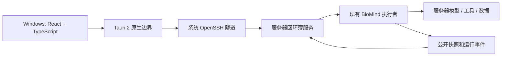

# 接入主线与下一阶段最小修改

本文件是草案，路由和类型均**未在 BioMind 中实现**。本轮只新增原型和文档。现有 BioMind 保留模型、流程编排、Recovery、审批与执行权威；不新增业务 Controller，不重建 TaskSpec，不增加语义 binder/normalizer，不采用 DeepSeek AgentLoop，也没有“App → 服务器 Codex → BioMind”链路。

## 一条推荐主线

正式客户端优先 Tauri 2：React 负责会话界面，Rust 负责系统 SSH 子进程、凭据边界和传输。服务推荐 Python FastAPI 单进程部署，每个获准工作区一个受托实例、首版每工作区至多一个活跃执行者；不使用多 worker 自动再启动 agent。FastAPI 的选择不意味着本轮已确认依赖版本或装好服务。对比 Electron，上游有成熟外壳，但携带本地 Node/插件/运行时不符合这里的远端 BioMind 边界；当前产品也没有需保留的 Electron 代码。

本轮环境中 Rust、Cargo、WebKit2GTK 4.1 不满足桌面构建条件；shell 的 npm/React 依赖下载不可用。为交付可直接打开的原型，用预装 Node 22.18.0、TypeScript 5.9.3 构建原生 DOM 组件。**本轮代码不是 React；Tauri 未构建。** 下一阶段把 `src/ui`/`main.ts` 改写为 React，保留纯 TS 类型、fixtures、服务测试；同步演示端口需升级为异步命令 + 缓存快照，不把它直接套 HTTP。Tauri 官方 [先决条件](https://v2.tauri.app/start/prerequisites/) 要求对应平台工具链；Windows 还需 MSVC/WebView2 等实机条件，Linux HTML 构建不能代替 Windows 验收。

## SSH、权限与生命周期

1. Windows 使用用户已有 SSH config alias 和系统 `ssh.exe`；选择目标主机和允许的远端工作区。检查 known_hosts，陌生或改变的主机密钥进入明确确认/失败状态，不传 `StrictHostKeyChecking=no`。私钥由系统 SSH/agent 管理，WebView 不读取密钥正文。
2. 原生边界建立仅本机回环的端口转发，远端服务也只监听 `127.0.0.1`。共享 Linux 主机的 loopback **不是用户鉴权**：服务须校验应用会话令牌与 workspace/session 授权。建议原生端经已认证 SSH 启动握手取得随机短期令牌；远端只存权限 0600 的令牌状态，UI 不持有令牌，不从用户 API 配置取值，日志不记录令牌。具体密钥存储与轮换在实现时验证。
3. 服务由获准的服务器用户级进程管理方式托管，生命周期独立于 SSH 隧道和浏览器。不是每次 App 连接都 fork 一个 agent。集群可能限制登录节点常驻/计算，须先确认运维规则再选驻留节点与启动方式。不能凭假设安装 systemd、tmux 或系统包。
4. 服务对工作区根和会话执行者取得全生命周期互斥；CLI 和服务都检查同一所有权门禁。检测到存活的其它 owner，只附着可用观察接口或返回 `OWNER_BUSY`，不能把心跳过期直接当作可抢占。PID+进程启动身份用于防 PID 复用，心跳用于观察，不能单独授权重执行。
5. 断开隧道/退出 App 只结束观察连接。活跃运行不被自动取消。若服务已退出，显示 owner lost / 状态待确认；先读持久事实，再由现有 runtime 判断恢复，不把自动重连转成业务 `/resume`。首版不承诺进程崩溃透明续跑。

## 请求、快照与事件草案

见 [protocol.draft.ts](protocol.draft.ts)。所有路由都在已认证工作区范围内；服务返回不透明 session/run/resource ID，不接受任意服务器路径作为下载目标。

| 草案路由（非现有 API） | 作用与关键限制 |
| --- | --- |
| `GET /v1/workspaces` | 获准工作区列表及能力；不枚举整个服务器文件系统 |
| `GET /v1/workspaces/{w}/sessions?cursor=…` | 分页会话元数据，不开始/恢复任务 |
| `POST /v1/workspaces/{w}/sessions` | 带 request_id 创建空会话，不调用 `go` |
| `GET /v1/workspaces/{w}/sessions/{s}/snapshot` | 只读公开投影，返回 revision、event cursor、run 身份、last_confirmed_at |
| `GET /v1/workspaces/{w}/sessions/{s}/events?after=…&epoch=…` | SSE 持久事实及限量观察流；经原生客户端转发给 UI，长连接令牌不进入 URL |
| `POST /v1/workspaces/{w}/sessions/{s}/messages` | 保留原文、远端资源引用；带 request_id 和期望 run/revision。繁忙时首版返回 `RUN_BUSY`，UI 保留待发送草稿，不私自改变当前脚本。原型演示队列不构成后端队列承诺 |
| `POST /v1/workspaces/{w}/sessions/{s}/approvals/{a}/decisions` | 区分 plan/script，回传版本和完整不透明 approval identity，交给原节点检查当前版本 |
| `POST /v1/workspaces/{w}/sessions/{s}/runs/{r}/stop` | 仅请求归属于该会话的运行停止；受理回执与最终停止事件分离 |
| `GET /v1/requests/{request_id}` | 查询超时/断线前操作是否受理；作用域限定为当前认证身份 |
| `GET /v1/workspaces/{w}/sessions/{s}/resources` | 输入、预期产物、已有中间文件、已核验交付项的元数据 |
| `GET /v1/workspaces/{w}/sessions/{s}/resources/{f}/content?offset=…&limit=…` | 按能力允许的限量预览/下载；也用于授权日志资源；返回 next_offset/truncated |

连接状态（connecting/online/disconnected/reconnecting）与运行状态分开存储。UI 显示最后确认时间；断线无法确认命令时显示“提交结果待确认”，重连先查询 receipt。用相同 request_id 和相同 payload 重试；相同 ID 不同内容返回冲突。服务保存 payload hash + receipt，并为审批建立原子状态转移。仅靠 UI 按钮禁用不解决重复审批。

审批保存必须调用现有计划/脚本校验，核对当前 run、submission、版本及身份；过期返回 `APPROVAL_STALE` 并附最新只读状态。request_id 去重不能取代 lineage 校验。服务进程在“权威状态已变化但回执未提交”之间崩溃时，按原审批记录对账，返回 `unknown` 直到能确定，不能盲目重复继续执行。任何无法保证 exactly-once 的地方明确限制为查询/对账，不承诺网络重试等价于业务幂等。

快照与游标需要同一串行归约/事务边界：先订阅准备，再取快照 `cursor=C`，只归约 `seq>C` 的事件；或者保证服务在返回快照时已将 C 后事件保留于 journal。服务重启用 epoch 防止把旧 cursor 用于新流，缺口或过期返回 `SNAPSHOT_REQUIRED`。重复序列忽略，乱序先补齐；不能把包含到 C 的完整快照和同一批 tail 再累计一次。原型 reconnect 同时返回快照和 tail 仅供观察，UI 使用快照覆盖，未再次折叠 tail。

关键事实（提交、审批、执行归属、状态变化、产物核验、命令回执）需要最小持久 journal；可在薄服务专用 SQLite 中保存公开投影与命令去重，不修改业务 TaskSpec。现有 SessionArchive 可复用任务关联，但目前不是完整 after_cursor 通道。工具 stdout/stderr 使用文件 offset 与有界摘要，不把巨量日志全部塞进快照。慢客户端有有界缓冲，丢弃纯进度时说明 gap；关键事件走持久回放。显示 sink 抛错、客户端关闭、未知观察事件都不能取消执行。未知协议状态不能推导成功，触发刷新或版本不兼容提示。

显示事件仅投影用户可见文本、模型等待/阶段、工具开始/结束、经清理的 stdout/stderr、审批/恢复及终态。原始思维链、提示词、凭据、完整 provider 请求/响应不发送；若当前 runtime 没有公开 token delta，就显示等待和最终公开消息，不模拟真实逐 token 输出。

## 文件与结果

前端只提交服务下发的资源 ID。服务器将 ID 映射到允许根下的 canonical 路径，每次访问检查 symlink、根边界与文件身份，避免 `../`、链接逃逸和检查后替换；不将禁读文件与凭据加入目录列表。限制文件大小、预览行数、内容类型、并发和 range；原始生信数据保持服务器侧，只有用户明确下载的分析产物才传输。

HTML 分析报告不在有应用权限的 WebView 中直接执行。首版返回文本/清理后的预览，富 HTML 使用无脚本、无网络、无父窗口权限的隔离视图；任何外部打开操作有明确文件和来源。完成状态来自原 runtime 的正式终态和交付核验结果，预期路径、已生成文件、核验通过三个事实分别显示。

## 下一阶段最小修改与验收

| 顺序 | 限定改动 | 验收门槛 |
| --- | --- | --- |
| 1 | 新增独立服务入口和生命周期托管；工作区/会话映射；CLI/服务共享 owner 门禁 | 两客户端附着同一 run；GUI 重连不调 `go`；CLI/GUI 同时启动只有一个执行者；另一活 owner 不被覆盖 |
| 2 | 在现有 human input/审批节点旁增加结构化输入端口，保留 CLI 默认实现 | 计划批准不授权脚本；旧版本/旧工作目录/旧身份拒绝；重复和超时决定可查询；Recovery 沿用原节点 |
| 3 | 给现有安全显示事件增加服务 sink；快照 + cursor/epoch + 最小 receipt/journal | 重连不漏关键事实、不重复归约；慢/坏观察者不影响运行；敏感字段无泄露；无公开文本时不伪造模型流 |
| 4 | 将停止请求绑定到 owned asyncio.Task/执行生命周期；增加授权资源读取 | 受理 != 停止确认；不会全局终止别的任务；路径/链接逃逸拒绝；下载不会被误判完成 |
| 5 | React 视图迁移、Tauri 原生 SSH 与异步适配器、Windows 构建 | 本地 HTML 功能回归；真实中文 IME/多行/高 DPI/键盘；known_hosts 与跳板机；断网重连、退出 App 后服务器运行；安装/卸载实测 |

每一步先用隔离工作区和 fake runtime/provider/executor 测试。只有下一阶段获得明确测试范围后才进行真实 SSH 与轻量任务接入；本轮不启动上述任何实施。

下一阶段最少还需确认：现有 SSH alias/跳板机策略（不需要私钥正文）、获准工作区根与脱离终端的服务驻留/调度器规则、允许使用的 BioMind 环境和启动入口（不需要任何 API 密钥）、Windows 测试机器版本与构建工具条件。当前前端交付不依赖这些信息。
