# Consultant FINALIZE Output Capacity and Truncation Recovery Specification

Status: Implemented locally; real-provider canary pending
Version: 1.1
Incident reference: `session_1786266235`
Amends: `consultant_finalize_format_repair_spec.md`
Primary audit: `session_1786266235_finalize_length_audit.md`
Target protocol state schema: `finalize_protocol.schema_version=4`
Target model wire schema: `wire_schema_version=3`

## 1. Executive decision

The first fatal event in `session_1786266235` is a known truncated FINALIZE
response. The audit also proves output-admission, provider-adapter, truncation
handling, and persistence defects; it does not attribute the lost completion's
exact token-by-token behavior to one cause. This is not a user ambiguity or a
scientific-tool failure.

This amendment makes seven architectural changes:

1. The controller classifies, deduplicates, and compiles every directive whose
   semantic identity is already controller-owned. The model no longer repeats
   full constraints for raw clauses that already have a semantic key,
   operator, value, strength, and provenance.
2. The controller performs canonical output-capacity admission before every
   model invocation.
   It sends only a response contract whose maximum canonical valid instance
   fits the effective provider output budget with safety headroom. It separately
   records whether the provider enforces a bounded wire grammar; DeepSeek
   `json_object` mode does not by itself provide that guarantee.
3. Provider settings distinguish requested semantic settings from the actual
   sanitized wire payload. DeepSeek Chat Completions must receive
   `max_tokens`; an adapter-side rewrite to `max_completion_tokens` is a
   preflight failure, not an implementation detail to ignore.
4. `finish_reason=length` is a known truncated provider response. It is not
   `provider_status=outcome_unknown`. The partial response, finish reason, and
   usage are protected before routing.
5. Any model-owned semantic work uses compact, bounded, hash-bound decision
   batches. A length recovery creates a materially different smaller request;
   the controller never blindly repeats the truncated request or treats a
   partial JSON object as a contract.
6. Outer lifecycle, result projection, metrics, and Wiki eligibility are bound
   to durable task state. A blocked FINALIZE cannot look completed, expose a
   healthcheck as the final result, or trigger Wiki ingestion.
7. Before any provider call, the controller freezes a run-level budget and
   persists a hash-bound worst-case recovery-closure preflight. Work that
   cannot fit the complete bounded retry/repair/repartition closure is rejected
   with durable evidence and zero provider calls.

This amendment explicitly supersedes the original specification's prohibition
on deterministic FINALIZE bypass. A bypass is now required when the coverage
artifact proves that no model-owned semantic decision remains.

## 2. Incident-derived requirements

The implementation must handle the following observed facts:

- the reconstructed context contains 57 directives, 44 coverage gaps, 12 base
  constraints, and 14 provenance entries;
- the exact HumanMessage is 71,280 characters;
- an auditable compact complete 44-row result is approximately 5,176 estimated
  tokens, above the declared 4,096-token cap;
- a pathological short-ID legal construction is approximately 4,004-4,012
  estimated tokens, so the abstract schema minimum is not proven above 4,096;
  however, the schema has no finite maximum or safety margin and therefore
  cannot pass a proof-based admission gate;
- BioMind records `max_output_tokens=4096`, while the installed
  `langchain-openai` adapter builds a Chat Completions payload containing
  `max_completion_tokens=4096`;
- DeepSeek's documented Chat Completions field is `max_tokens`;
- the provider returned HTTP 200 and `finish_reason=length` after 8,192 output
  tokens;
- the SDK exception retained a completion object, but BioMind persisted only
  an error string;
- run metrics recorded zero completion tokens for that failed call;
- durable routing ended in `blocked`, and no durable Wiki offer/ingest event is
  present; the reported UI Wiki offer is not represented in the audited
  artifacts and remains a separate terminal-projection issue to reproduce.

DeepSeek contract references:

- <https://api-docs.deepseek.com/api/create-chat-completion>
- <https://api-docs.deepseek.com/guides/json_mode/>

### 2.1 Amendment precedence

For newly initialized wire-v3 contexts, this document takes precedence over
the parent specification in these areas:

| Parent area | Amendment |
|---|---|
| Section 4 deterministic-bypass non-goal | superseded by coverage-proven controller compilation |
| Section 6 model-first state machine | replaced by coverage-first deterministic/batched state machine |
| Section 7.1 full FINALIZE context in HumanMessage | replaced by protected full context plus bounded decision view |
| Sections 7.2 and 9 full semantic-delta output | replaced by compact bounded decision batches |
| Section 7.4 protocol state schema v3 | replaced by Section 11 schema v4 and migration matrix |
| Section 8 provider/error taxonomy | extended with capacity, completion-integrity, and terminal-projection errors |
| Section 10 parse-after-return assumption | length responses are captured before ordinary parsing |
| Section 11 retry budget | adds capacity preflight and hash-distinct length repartition |
| Section 11 transport retry identity | retained: identical outbound content keeps its wire/protocol request hashes; a new attempt-lineage hash records the retry |
| Section 12 terminal table | replaced for wire-v3 contexts by Sections 12 and 14 here |
| Section 13 future fallback guardrail | requirements are fulfilled here and the transition is enabled |
| Sections 15-16 observability/tests | extended with wire settings, usage, partial artifacts, and Wiki gating |

Existing wire-v2 contexts remain pinned to their recorded protocol during
replay. They are not silently converted midway through an in-flight or
completed attempt. A fresh context may use wire v3 only through an explicit
schema migration or a new TaskSpec revision.

Migration is state-specific:

| Legacy state | Required handling |
|---|---|
| no FINALIZE context/attempt | initialize schema v4/wire v3 normally |
| ready to finalize, no provider intent | create a new v4 coverage/context artifact; never reuse a legacy request hash |
| provider call in flight | keep the legacy runner pinned and reconcile provider/artifacts before any migration |
| complete response or active wire/field repair | finish the legacy attempt/recovery under its recorded schema; never reinterpret a full-row response as a v3 batch |
| `needs_user` | remain pinned until a TaskSpec revision; that revision may create a child v4 context |
| compiled but Planner checkpoint missing | frozen legacy runner verifies the legacy compiled response/artifact and completes the legacy Planner handoff; it is not subjected to the new v4 compiled-artifact shape |
| Planner-started or completed | read-only legacy compatibility; no migration or provider reissue |
| terminal legacy length failure | remain terminal unless explicitly resumed into a child v4 context that references the legacy error/partial evidence, preserves any legacy request identity, and cannot resend the same scoped wire/protocol request |
| other blocked/failed state | require an explicit resume/revision and child context; no in-place schema rewrite |

## 3. Goals

The implementation MUST:

- prove that the canonical valid output contract fits before an outbound call,
  while distinguishing that from any provider raw-generation guarantee;
- avoid model expansion of controller-owned facts and provenance;
- preserve lossless coverage for every active user directive;
- separate structural text, typed-fact aliases, duplicates, deterministic
  constraints, and genuinely model-owned semantics;
- expose the exact effective provider token parameter without credentials;
- preserve partial provider content on length termination;
- classify provider delivery and BioMind protocol validity independently;
- support a bounded, materially different recovery from truncation;
- enter Planner only after one complete, hash-bound coverage proof and compiled
  contract exist;
- retain strict provenance and no-fabrication guarantees;
- keep blocked/failed sessions ineligible for Wiki;
- produce accurate token/cost metrics for successful and failed calls;
- replay `session_1786266235` without a one-shot 44-row model response.

## 4. Non-goals

This change does not:

- modify snpEff commands, database construction, Renderer, or scientific
  validation;
- weaken hard user constraints or provenance checks;
- accept truncated JSON as a valid contract;
- continue generation from an unvalidated partial object;
- ask the user to fix provider parameters or response length;
- solve generic TRIAGE context projection in the same patch;
- increase an output token constant as the sole repair;
- permit Planner to consume a partially compiled batch;
- treat stale target files as current-run outputs;
- restore the old generic Consultant retry loop.

## 5. Normative terminology and ownership

`MUST`, `MUST NOT`, `SHOULD`, and `MAY` are normative.

| Concern | Owner |
|---|---|
| Raw user directives and source spans | TaskSpec/controller |
| Typed inputs, outputs, parameters, prohibitions, and policies | TaskSpec/controller |
| Directive classification and deduplication | controller |
| Deterministic constraint construction | controller |
| Candidate semantic interpretations for unresolved clauses | controller |
| Selection among bounded semantic candidates | Consultant model |
| Output capacity plan | controller/provider adapter |
| Actual provider wire parameter mapping | provider adapter |
| Partial response persistence | context-lineage store |
| Schema, coverage, provenance, and merge validation | controller |
| Genuine unresolved user decision | user |
| Terminal task and Wiki eligibility | outer controller |

## 6. Required invariants

1. Every active directive has exactly one terminal coverage disposition.
2. No directive may be silently omitted merely to fit a prompt or output cap.
3. A structural heading is not a semantic constraint.
4. A path or artifact name already represented by a typed TaskSpec fact is not
   a second model-owned constraint.
5. A controller-owned semantic identity is compiled deterministically and is
   not echoed by the model.
6. A provider call is illegal unless the response schema has a finite computed
   maximum canonical instance and that canonical maximum fits the effective
   output cap with configured safety headroom. The exact minimum is also
   recorded as an early impossibility diagnostic, not as the admission
   criterion. Raw-wire boundedness is a separate provider capability.
7. Requested provider settings, client-bound settings, and effective wire
   settings are separately observable.
8. A provider-specific parameter-name mismatch blocks before network I/O.
9. `finish_reason=length` always means provider delivery succeeded and
   completion integrity is truncated; schema validation has not occurred.
10. A partial response, or a durable typed persistence-failure record when the
    partial cannot be stored, is committed before a repair or terminal
    transition.
11. A partial response is audit-only and never enters the contract merge.
12. A length repair has a new batch/capacity plan and different protocol/wire
    request hashes.
13. No successful or truncated `(replay_scope_id, wire_request_hash)` is blindly
    reinvoked.
14. No Planner route exists without a durable compiled artifact, coverage
    artifact, and matching hashes.
15. Internal capacity, adapter, truncation, and persistence failures never
    route to `ask_user`.
16. `task_status in {blocked,failed,cancelled}` is never Wiki eligible.
17. Blocked result projection presents the terminal diagnostic, not the last
    successful healthcheck stdout.
18. Selected skills resolved before FINALIZE remain visible in durable state
    and run metrics even when FINALIZE blocks.

## 7. Target processing pipeline

```mermaid
flowchart TD
    R["FinalizeReady"] --> N["Normalize and classify directives"]
    N --> A["Persist coverage artifact"]
    A --> D{"Model-owned resolutions remain?"}
    D -->|"no"| C["Controller deterministic compile"]
    C --> V["Coverage, schema, provenance validation"]
    D -->|"yes"| Q["Freeze budget and partition basis"]
    Q --> S["Persist stable partition"]
    S --> W["Persist worst-case recovery-closure preflight"]
    W -->|"global budget denied"| G["Typed global-budget block"]
    W -->|"admitted"| B["Per-batch output-capacity preflight"]
    B -->|"canonically inadmissible"| X["Repartition or internal capacity block"]
    B -->|"canonically admissible"| P["Provider adapter preflight"]
    P -->|"wire settings invalid"| Y["Internal adapter block"]
    P --> I["Invoke one compact batch"]
    I -->|"stop + valid"| M["Persist and merge batch decision"]
    I -->|"length"| T["Persist truncated partial response"]
    T --> Z["Create smaller materially different batch plan"]
    Z --> B
    M --> Q
    V --> PL["Planner"]
    G --> F
    X --> F["Finish blocked"]
    Y --> F
```



### 7.1 Directive normalization

The controller MUST create one `DirectiveCoverageArtifact` before model
invocation. Each active source-addressable directive receives exactly one of:

```text
covered_by_base
provenance_envelope
structural_only
typed_fact_alias
duplicate_of
deterministic_constraint
model_resolution_required
validated_user_ambiguity
```

Rules:

- headings and section labels may be `structural_only` only through explicit,
  tested rules and retain their source reference;
- a whole-request envelope may be `provenance_envelope` only when every
  semantic child span is independently represented; it remains hash-bound
  provenance and is never counted as an additional semantic constraint;
- artifact/path clauses may be `typed_fact_alias` only when they resolve to one
  active TaskSpec fact with the same source authority;
- `duplicate_of` must point to one active canonical directive/constraint
  identity, form an acyclic graph, and preserve the strongest condition,
  strength, and source authority from all members;
- a gap already containing `semantic_key`, `operator`, normalized value,
  strength, condition, and source IDs is eligible for
  `deterministic_constraint` only when those fields originate from a typed
  TaskSpec fact or closed controller ontology;
- synthetic fallback keys such as
  `required_behavior.user_directive_<hash>` never establish deterministic
  meaning by themselves; they must first pass heading removal, typed-fact
  linking, atomic clause splitting, polarity validation, and deduplication;
- a clause becomes `model_resolution_required` only when the controller cannot
  construct one unique semantic identity from current typed facts;
- compound clauses MUST be split at policy boundaries before polarity
  classification; a prohibition embedded after a required clause may not be
  inherited as `require`;
- a real user ambiguity must already be represented by a validated TaskSpec
  ambiguity ID.

The full raw request remains protected for provenance, but the model does not
receive it again when all relevant clauses have bounded typed projections.

### 7.2 Deterministic constraint construction

For each `deterministic_constraint`, the controller creates:

```json
{
  "constraint_id": "stable hash-bound ID",
  "semantic_key": "controller-owned semantic key",
  "operator": "controller-owned operator",
  "value": "controller-owned normalized value",
  "strength": "controller-owned strength",
  "confidence": 1.0,
  "provenance": [
    {
      "source_type": "resolved catalog type",
      "source_id": "resolved catalog ID"
    }
  ]
}
```

The constraint ID is stable over the directive ID plus canonical semantic
identity. The model cannot modify these rows.

If no `model_resolution_required` or unresolved ambiguity remains, the
controller MUST compile directly:

```text
compile_mode=controller_deterministic
provider_status=not_called
completion_integrity=not_called
protocol_status=valid
finalize_status=compiled
compile_outcome.status=compiled
compile_outcome.protocol_status=valid
next_step=planner
```

This is not a heuristic fallback. It is a coverage-proven deterministic state
transition. The controller creates no synthetic provider attempt; the valid
protocol summary is derived from the durable controller-owned
`compile_outcome`, as defined in Section 11.

### 7.3 Compact model resolution

When model work remains, the model receives only a bounded decision view:

```json
{
  "schema_version": 3,
  "finalize_context_id": "...",
  "base_contract_hash": "...",
  "coverage_artifact_hash": "...",
  "candidate_catalog_ref": "...",
  "candidate_catalog_hash": "sha256",
  "response_schema_ref": "...",
  "response_schema_hash": "sha256",
  "decision_batch_id": "...",
  "decision_batch_hash": "...",
  "items": [
    {
      "resolution_id": "...",
      "source_excerpt": "bounded quoted data",
      "candidates": [
        {
          "candidate_id": "candidate-a",
          "meaning": "bounded source-grounded interpretation",
          "normalized_value": "bounded canonical value projection"
        }
      ]
    }
  ]
}
```

The target response is reference-based rather than a full constraint echo:

```json
{
  "action_type": "resolve_batch",
  "finalize_context_id": "...",
  "base_contract_hash": "...",
  "coverage_artifact_hash": "...",
  "candidate_catalog_hash": "...",
  "decision_batch_id": "...",
  "decision_batch_hash": "...",
  "resolutions": [
    {
      "resolution_id": "...",
      "candidate_id": "candidate-a"
    }
  ]
}
```

The bounded candidate view gives the model enough source-grounded meaning to
choose; the full semantic keys, typed values, strength, conditions, and
provenance remain authoritative only in a protected controller-owned
`CandidateCatalogArtifact`. That artifact has a version, ref/hash, source and
coverage refs, generation-rule ID, and a finite candidate set for every
resolution item. The batch and protocol/wire request hashes bind the complete
catalog hash. The validator checks each `(resolution_id, candidate_id)` pair,
not merely global ID membership. Unknown IDs, missing items, duplicate
resolutions, invalid pairings, or extra properties invalidate the entire batch
atomically.

No item may be sent unless its candidate set is finite, non-empty,
source-bound, and complete under the controller's closed interpretation rule.
If such a set cannot be constructed, route to
`FINALIZE_COVERAGE_CLASSIFICATION_INCOMPLETE`, unless the uncertainty is an
already registered business ambiguity eligible for the `ask` branch. The model
never invents a candidate or a free-form constraint.

An `ask` branch may reference exactly one pre-existing validated ambiguity ID.
It cannot create new free-form semantic rows. It follows the parent spec's
TaskSpec revision/reset rules and cannot coexist with `resolve_batch` in one
response. After validating `ask`, the controller persists the complete response
and ambiguity decision, then atomically sets the batch/aggregate and
`compile_outcome` to `needs_user`, stores `pending_ambiguity_id`, and routes to
the existing user-question boundary. Internal capacity, parsing, provider, or
persistence errors can never manufacture this transition.

### 7.3.1 Frozen wire-v3 schema generator

The implementation MUST generate and persist one exact JSON Schema per batch;
an illustrative JSON object is not the wire contract. The schema is pinned to
JSON Schema Draft 2020-12 (`$schema` URI included), and the artifact records the
strict JSON decoder implementation/version, local validator
implementation/version, format-checker policy, and canonical JSON serializer
version. The schema generator is versioned and MUST enforce:

- a discriminated `oneOf` for `resolve_batch` versus `ask`;
- `required` and `additionalProperties=false` at every object level;
- `const` bindings for context, base-contract, catalog, batch IDs, and hashes;
- for `resolve_batch`, a canonical ordered resolution array with exactly the
  batch item count, each position binding its `resolution_id` by `const` and
  its allowed `candidate_id` by an item-specific `enum`;
- for `ask`, exactly one ambiguity ID drawn from the batch's pre-registered
  ambiguity enum and no resolution array;
- finite `maxItems`, `maxLength`, and enum sizes on every variable field;
- no model-generated selected-skill list or summary; both are inherited or
  generated deterministically by the controller.

The protected schema artifact records `wire_schema_version`, dialect, generator
and validator versions, canonical schema bytes, schema hash,
candidate-catalog hash, and exact minimum/maximum canonical-instance token
bounds. Validation uses the same artifact; field or wire repair uses the same
bounded discriminated schema and its own finite repair budget. Any schema that
cannot yield a finite canonical maximum is rejected before I/O.

Validation starts from the persisted raw assistant bytes. The strict decoder
MUST reject duplicate object keys at every depth, trailing non-whitespace data,
non-finite numbers (`NaN`/`Infinity`), invalid UTF-8/Unicode scalar sequences,
and any extension not allowed by RFC 8259 plus the pinned decoder policy. An
SDK-provided structured object is secondary evidence and is usable only when
its canonical form equals the strict raw parse. If raw bytes are unavailable,
the response is non-committable unless the capability record proves a
provider-enforced structured-object channel with equivalent lossless semantics.

### 7.4 Stable batching

The controller MUST first persist a `PartitionCapacityBasis` that is independent
of any future batch ID. It binds provider capability/context limits,
tokenizer/estimator, safety and global-budget policies, the bounded request
scaffold, response-schema generator, candidate catalog, and conservative
per-item input/output costs. The controller then batches when a one-shot compact
result cannot satisfy output headroom.

- item order is canonical by `resolution_id`;
- batch boundaries are deterministic for the same
  `partition_capacity_basis_hash`; a per-batch capacity profile is created only
  after partitioning and therefore cannot define its own partition;
- each batch has its own ID and hash bound to the parent context and coverage
  artifact;
- maximum batch size is constrained in the JSON schema;
- each successful batch is persisted but not exposed to Planner;
- the final merge is atomic after every batch succeeds;
- a failed or truncated batch cannot mutate the compiled contract;
- shrinking a batch after truncation produces new batch, protocol-request, and
  wire-request hashes.

The active batch set is the set of non-superseded leaf batches. Before atomic
merge, those leaves MUST resolve every expected `resolution_id` exactly once,
with no overlap or omission. A truncated parent becomes `superseded` only after
its child batch records are durable; its response remains audit-only and never
counts as a resolved item.

### 7.5 Global work budget

Per-batch bounds are not sufficient. Before the first provider call, the
controller MUST persist a finite run-level `finalize_work_budget` containing:

```json
{
  "budget_policy_id": "...",
  "budget_policy_hash": "sha256",
  "max_resolution_items": 0,
  "max_created_batches": 0,
  "max_provider_calls": 0,
  "max_repartition_depth": 0,
  "max_total_completion_tokens": 0,
  "max_total_estimated_cost_microusd": 0,
  "max_wall_time_ms": 0,
  "run_started_at": "...",
  "absolute_deadline_at": "...",
  "per_call_timeout_ms": 0
}
```

All numeric limit/timeout fields MUST be finite positive integers resolved from
a versioned runtime policy; timestamps MUST be valid UTC instants consistent
with those limits. Missing or unlimited limits block before network I/O.
Capacity planning
MUST prove that the worst-case number of batches, calls, completion tokens,
and estimated cost remain within this budget. Wall time is enforced, not
predicted: before each call, `now + per_call_timeout_ms` must not exceed the
absolute run deadline, and the adapter applies that hard timeout. The controller
reserves its worst-case token/cost/time allowance atomically. Actual
provider usage replaces the reservation during reconciliation. Once any limit
is exhausted or exceeded, no further call is legal and the session blocks with
`FINALIZE_GLOBAL_BUDGET_EXHAUSTED`. A provider reporting more usage than the
reservation does not erase the response artifact, but it prevents another
call.

Before admission, the controller MUST also persist a
`finalize_work_preflight` artifact bound to the work-budget policy, candidate
catalog, partition-capacity basis, and stable partition. Its componentwise
worst-case bound covers, for every admitted initial batch:

- the initial provider call;
- at most one same-wire transport retry, but only after durable proof that no
  completion was delivered;
- at most one bounded wire/field-repair child;
- every permitted recursive length-repartition child through the configured
  depth limit; and
- the legal repair-then-length ordering.

The artifact records the derived maxima for resolution items, created batches,
provider calls, completion tokens, estimated cost, and repartition depth; the
limit vector; `admitted`; and `exceeded_fields`. Every ref/hash and policy/rate
binding is reloaded and validated both when the artifact is persisted and when
it is consumed. A denied proof is itself durable and then transitions to
`FINALIZE_GLOBAL_BUDGET_EXHAUSTED` without provider I/O.

The configured 100,000-token per-call value is a ceiling, not a promise to
reserve or emit 100,000 tokens for every small batch. Likewise, the 200,000
global completion budget is a total recovery-closure limit, not two guaranteed
100,000-token attempts. With the current bounded schema and default policy,
the regression fixture with eight model-owned items is admitted, while its
sixteen-item form is rejected before I/O because its complete recovery closure
would exceed 200,000 completion tokens. This conservative rejection is
intentional; changing that scale requires an explicit budget/schema policy
revision rather than optimistic runtime accounting.

Budget accounting is ledger-based, not increment-only. The authoritative ledger
is owned by `ContextLineageStore`, not by an uncheckpointed LangGraph state. Its
CAS write is synchronously durable before network I/O; graph state stores only
refs/hashes and a rebuildable projection.

```json
{
  "record_type": "finalize_budget_reservation",
  "replay_scope_id": "stable root task lineage ID",
  "reservation_id": "",
  "reservation_hash": "",
  "attempt_id": "",
  "attempt_seed_hash": "",
  "attempt_lineage_hash": "",
  "batch_id": "",
  "protocol_request_hash": "",
  "wire_request_hash": "",
  "status": "held|dispatched|consumed|released|reconcile_required",
  "lease_owner": "",
  "lease_epoch": 0,
  "lease_expires_at": "",
  "call_started_at": null,
  "call_deadline_at": null,
  "timeout_ms": 0,
  "reserved_calls": 1,
  "reserved_completion_tokens": 0,
  "reserved_cost_microusd": 0,
  "reserved_wall_time_ms": 0,
  "retry_authorization_ref": null,
  "retry_authorization_hash": null,
  "actual_completion_tokens": null,
  "actual_cost_microusd": null,
  "actual_wall_time_ms": null,
  "reconciled_artifact_ref": null,
  "reconciled_at": null
}
```

At most one active (`held`, `dispatched`, or `reconcile_required`) reservation
may exist per `(replay_scope_id, wire_request_hash)`. Child/migrated FINALIZE
contexts share the root task-lineage replay scope; independent tasks do not.
Historical `consumed`/`released` records
may coexist, keyed by unique reservation ID and attempt-lineage hash. Legal
transitions are:

```text
held -> released | dispatched
dispatched -> consumed | reconcile_required
reconcile_required -> consumed
```

The `hold` CAS also scans historical attempts/artifacts for the scoped wire
tuple atomically. An existing complete response resumes validation/merge; an
existing truncated/filtered response resumes reconciliation or creates a
different repair request; an unresolved/outcome-unknown dispatch blocks pending
reconciliation; a fatal failure blocks. A same-hash transport retry is allowed
only after durable proof that no completion was returned, a typed retry-safe
transient outcome, and a bounded `retry_authorization_ref/hash`. A released
never-dispatched reservation may be replaced. Thus consumed history cannot be
ignored merely because no reservation is currently active.

A CAS creates `held` before dispatch; the adapter marks it `dispatched` before
crossing the network boundary. `held` may be released only with evidence that
dispatch never began. `dispatched` reconciles against complete/partial/provider
evidence. If outcome or usage remains unknown, the full reserved allowance is
conservatively consumed and the attempt follows `outcome_unknown`. JSON `null`,
not numeric zero, represents unknown actual usage. IDs/hashes make
reconciliation idempotent, and aggregate counters are derived from the ledger.
Lease epoch plus the scoped wire request hash prevents two workers from
reserving or dispatching the same call.

## 8. Output-capacity contract

Before every provider call, construct and persist:

```json
{
  "record_type": "finalize_capacity_profile",
  "profile_schema_version": 1,
  "profile_id": "...",
  "profile_hash": "sha256",
  "finalize_context_id": "...",
  "partition_capacity_basis_ref": "...",
  "partition_capacity_basis_hash": "sha256",
  "decision_batch_id": "...",
  "decision_batch_hash": "sha256",
  "response_schema_ref": "...",
  "response_schema_hash": "sha256",
  "provider_capability_hash": "sha256",
  "budget_policy_hash": "sha256",
  "tokenizer_id": "provider-native-or-conservative-bound-v1",
  "tokenizer_version": "...",
  "estimator_mode": "exact_provider|conservative_upper_bound",
  "estimator_margin_tokens": 0,
  "input_character_count": 0,
  "input_utf8_bytes": 0,
  "input_token_estimate": 0,
  "schema_token_estimate": 0,
  "minimum_canonical_output_tokens": 0,
  "maximum_canonical_output_tokens": 0,
  "requested_output_tokens": 0,
  "provider_output_cap": 0,
  "provider_context_limit": 0,
  "context_remaining_tokens": 0,
  "available_output_tokens": 0,
  "effective_output_tokens": 0,
  "safety_headroom_tokens": 0,
  "safety_policy_version": "...",
  "raw_wire_bound_mode": "provider_bounded_grammar|token_cap_only",
  "provider_bounded_grammar": false,
  "bounded_grammar_ref": null,
  "bounded_grammar_hash": null,
  "maximum_raw_wire_tokens": null,
  "effective_token_cap_verified": true,
  "canonical_admissible": true,
  "raw_completion_guaranteed": false,
  "strategy": "deterministic|single_batch|multi_batch|blocked"
}
```

### 8.1 Minimum canonical output

`minimum_canonical_output_tokens` is computed from an exact canonical
serialization of the smallest schema-valid parsed instance using the real
constants, IDs, and required item count. It is not a fixed per-row guess.

### 8.2 Maximum canonical output versus raw wire

Every model response schema MUST be bounded:

- `summary` is removed from batch responses and deterministically generated by
  the controller;
- arrays have `maxItems`;
- free strings have `maxLength`;
- IDs use enums/const values where possible;
- the response has `additionalProperties=false` at every object level.

`maximum_canonical_output_tokens` is the maximum canonical serialization of a
locally schema-valid parsed instance. If no finite canonical maximum can be
derived, the request is not admissible.

This bound does not automatically bound the provider's raw bytes. In
DeepSeek's `json_object` mode, whitespace, duplicate keys, escape spellings, or
other pre-parse text can be arbitrarily longer than the canonical parsed
instance. Only a provider capability that is explicitly tested to enforce the
persisted bounded grammar may set
`raw_wire_bound_mode=provider_bounded_grammar` and
`raw_completion_guaranteed=true`. That mode records the exact grammar
implementation/version/ref/hash and additionally requires
`maximum_raw_wire_tokens <= effective_output_tokens - safety_headroom_tokens`.
Otherwise the mode is `token_cap_only`: the
verified token cap bounds spend/length, but a model may still hit that cap
before producing a complete object. Typed truncation recovery therefore remains
mandatory and a schema bound is never described as a raw-generation proof.

The tokenizer/estimator MUST be reproducible from its recorded ID and version.
If a provider-native tokenizer is unavailable, the implementation MUST use a
documented conservative upper-bound algorithm plus an explicit margin. A
`cl100k` estimate alone is diagnostic for DeepSeek and cannot prove admission.

### 8.3 Canonical admission rule

A request is legal only when:

```text
maximum_canonical_output_tokens
  <= effective_output_tokens - safety_headroom_tokens
```

and the input plus effective output fit the provider context limit, where:

```text
available_output_tokens = min(
  requested_output_tokens,
  provider_output_cap,
  provider_context_limit - conservative_input_token_bound
)

effective_output_tokens = min(
  available_output_tokens,
  maximum_canonical_output_tokens + safety_headroom_tokens
)
```

`requested_output_tokens` is the configured semantic ceiling (100,000 by
default). The adapter emits the smaller proven-sufficient
`effective_output_tokens` for the actual batch, and the global work preflight
uses that emitted cap for the entire recovery closure. This prevents a small
bounded response from reserving the full ceiling while retaining the ability
to use more capacity for a genuinely larger admissible batch.

The effective token cap must also be verified at the wire boundary. The minimum
is still recorded because it proves immediate impossibility when already too
large. The finite canonical maximum proves that the requested protocol does not
intrinsically require more than the admitted cap; in `token_cap_only` mode it
does not prove that raw model generation will finish before the cap.

If canonical admission fails, the controller MUST choose, in order:

1. deterministic compile;
2. remove controller-owned/duplicate material from the model view;
3. split into smaller stable batches;
4. block with `FINALIZE_OUTPUT_CAPACITY_UNSATISFIED` before network I/O.

It MUST NOT silently raise a global limit, truncate required directives, or
send a canonically non-admissible request. If only the raw completion guarantee
is unavailable, the durable profile says so explicitly and the typed
finish-reason/recovery contract remains active.

## 9. Provider adapter contract

### 9.1 Capability resolution

The adapter maintains a tested capability record keyed by provider, endpoint
family, API surface, and model:

```json
{
  "provider_id": "deepseek",
  "endpoint_family": "openai_compatible",
  "api_surface": "chat_completions",
  "model": "deepseek-v4-pro",
  "adapter_package": "langchain-openai",
  "adapter_version": "1.1.7",
  "sdk_package": "openai",
  "sdk_version": "2.15.0",
  "stream_mode": "false",
  "parse_mode": "raw_message_plus_local_strict_decode",
  "typed_exception_abi_version": "...",
  "output_token_parameter": "max_tokens",
  "json_mode": "json_object",
  "json_schema_enforced_by_provider": false,
  "supports_bounded_output_grammar": false,
  "supports_idempotency_key": false,
  "supports_non_stream_usage": true,
  "supports_partial_completion_on_length": true
}
```

The capability key/hash includes every field above because token-field rewrite,
typed exception shape, partial-content availability, and usage reporting may
change with adapter/SDK/stream/parse mode. A version or mode change invalidates
the prior capability proof and requires a new payload spy/canary record.

The provider-specific adapter MUST emit DeepSeek's documented `max_tokens`
field. It MUST NOT rely on a generic client rewrite whose payload contains only
`max_completion_tokens`.

### 9.2 Requested, bound, and wire settings

Persist four credential-free projections:

```text
requested_provider_settings
client_bound_settings
effective_wire_settings
observed_provider_settings
```

`effective_wire_settings` records at least:

- API surface;
- provider/model identity digest;
- response format;
- thinking mode;
- token parameter key and value;
- streaming mode;
- idempotency capability;
- sanitized payload-key set and digest.

If the effective wire key/value cannot be inspected or differs from the
capability contract, block with `FINALIZE_PROVIDER_PARAMETER_UNSUPPORTED`
before sending the request.

`observed_provider_settings` records response-side evidence such as finish
reason, usage, response/model IDs, and any provider-echoed limits. Providers do
not necessarily echo an accepted cap, so absence is recorded as unknown rather
than filled from the requested setting.

### 9.3 Streaming

FINALIZE is machine-only and SHOULD use `stream=false`. If streaming remains
enabled, the adapter MUST journal chunks losslessly enough to reconstruct the
exact partial assistant content, finish reason, and usage before exposing an
exception to the orchestrator.

## 10. Length-termination contract

When the provider or SDK reports `finish_reason=length`:

```text
provider_status=succeeded
completion_integrity=truncated
protocol_status=not_validated
error_code=FINALIZE_RESPONSE_TRUNCATED
error_owner=derived_after_wire_and_capacity_reconciliation
user_action_required=false
```

The adapter MUST extract the completion object supplied by the typed SDK
exception when present. It persists a protected artifact before state commit:

```json
{
  "record_type": "finalize_partial_response",
  "attempt_id": "...",
  "call_id": "...",
  "request_intent_hash": "...",
  "protocol_request_hash": "...",
  "wire_request_hash": "...",
  "attempt_seed_hash": "...",
  "attempt_lineage_hash": "...",
  "finish_reason": "length",
  "content_available": true,
  "raw_partial_response": "exact SDK-exposed content",
  "response_content_hash": "sha256",
  "response_utf8_bytes": 0,
  "content_unavailable_reason": "",
  "partial": true,
  "committable": false,
  "usage": {
    "prompt_tokens": 25162,
    "completion_tokens": 8192,
    "total_tokens": 33354
  },
  "provider_metadata": {}
}
```

Missing usage fields are allowed when the streaming SDK does not supply them.
When exact content is unavailable, set `content_available=false`, content/hash
to JSON `null`, byte count to zero, and a typed
`content_unavailable_reason`; neither an exception string nor an empty-string
hash may impersonate partial content.

The partial artifact MUST NOT be parsed as a successful object, field-patched,
merged, or routed to Planner.

### 10.1 Length recovery

Length recovery is a protocol repair, not a transport retry.

1. preserve the partial artifact;
2. reconcile the effective wire key/value, response usage, capability record,
   and the persisted capacity proof;
3. if the field was rewritten/omitted or the observed output exceeded an
   accepted cap, classify `controller_provider` and block provider I/O pending
   adapter correction; batch shrinking is not a valid repair;
4. if the finite canonical maximum or conservative input bound was wrong,
   classify `controller_capacity` and block pending capacity-plan correction;
5. only when the wire setting and capacity calculation are verified may the
   controller remove residual controller-owned material and repartition the
   failing multi-item batch deterministically;
6. issue a new request with a different batch, protocol-request, and wire-request
   hash;
7. obey both the per-batch repartition depth and global work budget;
8. block internally if a one-item bounded response still truncates.

The recovery prompt MUST NOT include the complete partial JSON. It may include
only its hash, finish reason, usage, and a bounded redacted suffix for
diagnostics. It MUST NOT ask the model to continue a syntactically incomplete
object.

### 10.2 Finish-reason matrix

Finish reason is classified before ordinary JSON parsing:

| Evidence | Provider status | Completion integrity | Initial protocol status | Retry disposition/action |
|---|---|---|---|---|
| completion object + `stop` | `succeeded` | `complete` | `not_validated` | `no_retry`; persist complete response, then validate |
| completion object + `length` | `succeeded` | `truncated` | `not_validated` | `reconcile_first`; persist partial, then bounded repair/block |
| completion object + `content_filter` | `succeeded` | `content_filtered` | `not_validated` | `no_retry`; persist available partial, typed block |
| completion object + `tool_calls` | `succeeded` | `complete` | `wire_invalid` | bounded protocol repair/block |
| completion object + `insufficient_system_resource` | `succeeded` | `truncated` or `unknown` | `not_validated` | `reconcile_first`; persist partial/usage, then typed provider decision |
| no completion object + typed resource/transient error | `transient_failed` | `missing` | `not_validated` | reconcile, then bounded transport retry if proven safe |
| completion object + missing/unrecognized reason | `succeeded` | `unknown` | `not_validated` | `reconcile_first`; persist non-committable artifact and block |
| no completion object + fatal/unknown delivery evidence | `fatal_failed` or `outcome_unknown` | `missing` or `unknown` | `not_validated` | typed block/reconciliation; never ordinary parse |

Provider delivery is decided first by whether a completion object/artifact was
returned, not by whether the finish reason is retryable. Retry disposition is a
separate field and never changes a delivered response into a provider failure.

`protocol_status=valid` is legal only after a complete response validates, or
after a controller deterministic compile outcome validates. A filtered,
truncated, missing, or unknown completion cannot become `wire_invalid`,
`field_invalid`, or `valid` because there is no complete object to validate.

## 11. Protocol state schema v4

`consultation_state.finalize_protocol` adds:

```json
{
  "schema_version": 4,
  "replay_scope_id": "",
  "finalize_status": "collecting|resolving|needs_user|compiled|blocked",
  "compile_mode": "controller_deterministic|model_batched|null",
  "provider_status": "not_called|in_flight|succeeded|transient_failed|fatal_failed|outcome_unknown",
  "completion_integrity": "not_called|in_flight|complete|truncated|content_filtered|missing|unknown",
  "protocol_status": "not_validated|valid|wire_invalid|field_invalid|needs_user|blocked",
  "coverage_artifact_ref": "",
  "coverage_artifact_hash": "",
  "candidate_catalog_ref": "",
  "candidate_catalog_hash": "",
  "partition_capacity_basis_ref": "",
  "partition_capacity_basis_hash": "",
  "work_budget_ref": "",
  "work_budget_hash": "",
  "reservation_ledger_ref": "",
  "reservation_ledger_hash": "",
  "parent_finalize_context_id": "",
  "migration_reason": "",
  "source_protocol_schema_version": null,
  "source_wire_schema_version": null,
  "migration_artifact_ref": "",
  "migration_artifact_hash": "",
  "pending_ambiguity_id": "",
  "source_task_spec_revision": "",
  "supersession_link_ref": "",
  "supersession_link_hash": "",
  "compile_outcome": {
    "status": "not_started|needs_user|compiled|blocked",
    "mode": "controller_deterministic|model_batched|null",
    "protocol_status": "not_validated|needs_user|valid|blocked",
    "pending_ambiguity_id": "",
    "coverage_artifact_ref": "",
    "coverage_artifact_hash": "",
    "compiled_contract_ref": "",
    "compiled_contract_hash": "",
    "committed_at": ""
  },
  "aggregate": {
    "status": "not_started|resolving|needs_user|ready_to_compile|compiled|blocked",
    "expected_resolution_ids": [],
    "resolved_resolution_ids": [],
    "pending_resolution_ids": [],
    "created_batches": 0,
    "used_provider_calls": 0,
    "used_completion_tokens": 0,
    "used_estimated_cost_microusd": 0
  },
  "batches": [
    {
      "batch_id": "",
      "batch_hash": "",
      "parent_batch_id": "",
      "repartition_depth": 0,
      "derivation_kind": "initial|length_repartition|wire_repair|field_repair",
      "status": "pending|in_flight|retrying|needs_user|resolved|truncated|protocol_invalid|transient_failed|superseded|blocked|failed",
      "item_ids": [],
      "response_schema_ref": "",
      "response_schema_hash": "",
      "capacity_profile_ref": "",
      "capacity_profile_hash": "",
      "active_attempt_id": "",
      "decision_artifact_ref": "",
      "decision_artifact_hash": "",
      "response_artifact_ref": "",
      "response_artifact_hash": "",
      "partial_response_artifact_ref": "",
      "partial_response_artifact_hash": "",
      "error_artifact_ref": "",
      "error_artifact_hash": "",
      "superseded_by_batch_ids": []
    }
  ],
  "attempts": [
    {
      "attempt_id": "",
      "call_id": "",
      "replay_scope_id": "",
      "decision_batch_id": "",
      "decision_batch_hash": "",
      "parent_attempt_id": "",
      "repartition_depth": 0,
      "call_kind": "initial|decision_batch|length_repair|wire_repair|field_repair|transport_retry",
      "request_intent_ref": "",
      "request_intent_hash": "",
      "protocol_request_hash": "",
      "wire_request_hash": "",
      "idempotency_preimage_hash": "",
      "attempt_seed_hash": "",
      "attempt_lineage_hash": "",
      "capacity_profile_ref": "",
      "capacity_profile_hash": "",
      "response_schema_ref": "",
      "response_schema_hash": "",
      "reservation_id": "",
      "reservation_hash": "",
      "provider_status": "not_called|in_flight|succeeded|transient_failed|fatal_failed|outcome_unknown",
      "completion_integrity": "not_called|in_flight|complete|truncated|content_filtered|missing|unknown",
      "protocol_status": "not_validated|valid|wire_invalid|field_invalid|needs_user|blocked",
      "finish_reason": "",
      "retry_disposition": "no_retry|reconcile_first|bounded_protocol_repair|bounded_transport_retry",
      "artifact_persistence_status": "not_applicable|pending|persisted|failed",
      "usage": {},
      "effective_wire_settings_ref": "",
      "effective_wire_settings_hash": "",
      "response_artifact_ref": "",
      "response_artifact_hash": "",
      "partial_response_artifact_ref": "",
      "partial_response_artifact_hash": "",
      "retry_safe": false
    }
  ],
  "reservation_projections": [
    {
      "reservation_id": "",
      "reservation_hash": "",
      "replay_scope_id": "",
      "attempt_id": "",
      "batch_id": "",
      "protocol_request_hash": "",
      "wire_request_hash": "",
      "status": "held|dispatched|consumed|released|reconcile_required"
    }
  ]
}
```

`aggregate.status` and batch status are independent of provider status; values
such as `mixed` are never stored in a provider enum. Summary derivation is:

1. If `compile_outcome.status=compiled`, top-level protocol/finalize status is
   `valid/compiled`. Provider/completion summaries come from the latest attempt
   when attempts exist, otherwise they are `not_called/not_called` for the
   deterministic zero-call path.
2. If `compile_outcome.status=needs_user`, top-level protocol/finalize status is
   `needs_user/needs_user`, `pending_ambiguity_id` must resolve to one validated
   TaskSpec ambiguity, and durable business task state becomes waiting. The
   summary MUST come from the same validated `ask` attempt with
   `provider_status=succeeded`, `completion_integrity=complete`,
   `protocol_status=needs_user`, and matching complete-response/ambiguity
   decision artifacts; a failed or partial latest attempt cannot yield this
   state. A user answer creates a new TaskSpec revision and child FINALIZE
   context; the parent remains immutable. A separate monotonic supersession-link artifact binds
   parent/child context IDs, revisions, and hashes; lookup projects its ref/hash
   without rewriting the parent's identity artifact.
3. If `compile_outcome.status=blocked`, top-level protocol/finalize status is
   `blocked/blocked`; provider/completion summaries remain the latest attempt's
   legal values, or `not_called/not_called` for a pre-call block.
4. Otherwise all three summaries come atomically from the active/latest attempt,
   or default to `not_called/not_called/not_validated` when no attempt exists.

Provider delivery, completion integrity, and BioMind protocol validation are
independent dimensions but not arbitrary cross-products:

| Situation | Provider | Integrity | Legal protocol states | Required artifact |
|---|---|---|---|---|
| pre-send/controller reject | `not_called` | `not_called` | `not_validated` or `blocked` | controller error record |
| active request | `in_flight` | `in_flight` | `not_validated` | request intent/lease |
| full completion returned | `succeeded` | `complete` | `not_validated`, `wire_invalid`, `field_invalid`, `needs_user`, or `valid` | complete response |
| length/filter return | `succeeded` | `truncated` or `content_filtered` | `not_validated` or `blocked` | partial response, or durable storage-failure record when persistence itself failed |
| delivered resource/unrecognized terminal | `succeeded` | `unknown` | `not_validated` or `blocked` | non-committable response evidence |
| transport/provider failure | `transient_failed`, `fatal_failed`, or `outcome_unknown` | `missing` or `unknown` | `not_validated` or `blocked` | failure/reconciliation record |
| deterministic zero-call compile | `not_called` | `not_called` | `valid` from `compile_outcome` only | compiled contract |

A truncated attempt is therefore `succeeded/truncated/not_validated`, never
`outcome_unknown`. `provider_status=succeeded` plus a partial artifact is not a
completed response and MUST NOT satisfy existing complete-response lookup APIs.

### 11.1 Batch transitions and exactly-once merge

Legal transitions are monotonic:

```text
pending -> blocked
        -> in_flight -> resolved
                     -> needs_user
                     -> truncated -> superseded
                     -> protocol_invalid -> superseded
                     -> transient_failed -> retrying
                     -> failed
retrying -> resolved | needs_user | truncated | protocol_invalid | failed
```

Capacity, adapter, budget, or persistence rejection before dispatch transitions
the pending batch to `blocked`, stores the typed error ref/hash, blocks the
aggregate/compile outcome, and removes it from the schedulable set. A blocked
batch has no provider attempt and cannot later return to `pending`.

A truncated parent is superseded by non-overlapping length-repartition children
whose item union equals the parent. A `protocol_invalid` parent is superseded by
one bounded `wire_repair` or `field_repair` child over the same item set. A
known retry-safe `transient_failed` attempt may enter `retrying` on the same
batch with a new attempt/lineage hash and reservation but the same protocol and
wire request hashes. An `outcome_unknown` attempt is reconciled and is not
automatically retried. The parent batch becomes `superseded` only for
length/wire/field repair, after all child records, schemas, profiles, and budget
reservations are durable. Repair children have new IDs/hashes, parent refs,
derivation kinds, and obey both local and global budgets.

A `needs_user` batch is terminal within its immutable context and contributes
no resolution. The answer revises TaskSpec and starts a superseding child
FINALIZE context plus the external supersession-link artifact rather than
reopening or mutating that batch.

Only active leaf batches with `status=resolved`, a complete response, and a
validated decision artifact contribute to `resolved_resolution_ids`. The
aggregate becomes `ready_to_compile` only when resolved and expected ID sets
are exactly equal. Compiled-artifact creation plus `compile_outcome` commit is
one compare-and-swap transition; partial batch state is never visible as a final
contract. Planner/graph publication is a later idempotent checkpoint bound to
that compiled hash, so a crash between the two resumes publication without
recompiling or reinvoking the provider.

### 11.2 Artifact-first commit and crash reconciliation

The durable write order is:

1. coverage and candidate-catalog artifacts;
2. partition-capacity basis and global work-budget artifacts;
3. stable-partition and worst-case work-preflight artifacts; a denied proof is
   committed before the typed terminal transition;
4. decision-batch record and its exact response-schema artifact;
5. per-batch capacity-profile artifact;
6. request intent, effective-wire projection, budget reservation, and call
   lease;
7. complete response, partial-response, or durable artifact-persistence-failure
   record;
8. reservation reconciliation and attempt outcome;
9. batch outcome or durable parent-to-child supersession;
10. aggregate compiled-contract artifact and `compile_outcome`;
11. graph/Planner checkpoint pointer.

On restart, protected artifacts take precedence over lagging mutable state. A
complete-response lookup requires `provider_status=succeeded`,
`completion_integrity=complete`, a committable complete artifact, and matching
hashes. Partial lookup is a separate API and returns only non-committable
truncated/filtered evidence. An in-flight attempt with a durable complete
artifact resumes validation without provider I/O; one with a durable partial
artifact resumes reconciliation/repartition without provider I/O. A durable
resolved batch resumes aggregate merge. A compiled artifact resumes Planner
publication. An expired lease with neither response nor provider
reconciliation evidence becomes `outcome_unknown` and follows the existing
no-blind-retry policy. Concurrent workers acquire one compare-and-swap lease per
wire request hash.

### 11.3 Hash DAG

Every artifact schema defines an immutable identity projection. Its SHA-256 is
computed over canonical bytes with the artifact's own hash field and volatile
timestamps/status counters excluded. In particular, `batch_hash` covers the
context/coverage/catalog, ordered item set, parent, repartition depth, and
derivation kind, but not later capacity/outcome refs; the capacity profile then
binds that already-computed batch hash. This ordering forbids self-referential
or mutable hashes.

`wire_request_hash` represents exact outbound request identity. It covers the
resolved endpoint/API surface and method, semantics-affecting non-secret
headers, and the exact final serialized request-body bytes presented to the HTTP
client. Credentials and volatile transport headers are excluded; their
exclusion rules are versioned. Success/truncation replay protection,
reservation uniqueness, and provider-call CAS use the scoped tuple
`(replay_scope_id, wire_request_hash)`, so child contexts deduplicate within one
task lineage while independent tasks remain independent.

For a provider that supports an idempotency header, compute
`idempotency_preimage_hash` first from the replay scope, endpoint/method,
semantics-affecting headers excluding both authorization and the idempotency
header, and final body bytes. Derive the deterministic header value from that
preimage, then compute `wire_request_hash` over the final request including the
derived header. Deriving the header from `wire_request_hash` is forbidden
because it is self-referential. A transport retry reuses the same preimage,
header, and wire hash.

`protocol_request_hash` represents the richer controller protocol identity. It
binds the `wire_request_hash` plus canonical bytes for:

- TaskSpec/finalize context and full coverage artifact hashes;
- candidate-catalog and response-schema hashes;
- decision batch ID/hash, ordered item IDs, parent ID, and repartition depth;
- capacity-profile hash, capacity/safety policy versions, tokenizer/estimator
  ID and version, global budget hash, and worst-case work-preflight hash;
- provider/model/API-surface capability hash;
- sanitized effective wire settings, including the actual token key/value;
- the exact request messages/body and response-format/schema projection.

The final compiled semantic artifact does not absorb volatile runtime deadline
or ledger counters. For `model_batched`, however, it MUST bind the candidate
catalog and enumerate every active resolved-leaf decision ref/hash. Its
protected loader reloads those artifacts, verifies catalog/context bindings,
requires each resolution ID exactly once, and compares the complete set of
domain decision hashes before Planner may consume the contract.

Neither request hash binds retry-only metadata such as attempt ID, call kind,
parent attempt, lease, or reservation. A transport retry that sends identical
content and effective wire settings therefore keeps both hashes. A length,
wire, or field repair changes request content/batch/schema and therefore gets a
new wire and protocol request hash. The separate `attempt_lineage_hash` binds
both request hashes without introducing a hash cycle:

```text
attempt_seed_hash = H(
  protocol_request_hash, wire_request_hash, attempt_id, call_id,
  request_intent_hash, call_kind, parent_attempt_id
)
reservation_id, lease_epoch = durable_CAS_hold(attempt_seed_hash)
attempt_lineage_hash = H(attempt_seed_hash, reservation_id, lease_epoch)
reservation_hash = H(reservation_identity_projection_including_lineage)
```

`attempt_lineage_hash` binds the reservation ID and lease epoch but MUST NOT
bind `reservation_hash`; the reservation may bind the already-computed lineage.
`request_intent_hash` is a pre-reservation identity and excludes reservation,
lease, and lineage fields. `ContextLineageStore.durable_CAS_hold(...)` performs
ID/epoch allocation, lineage derivation, reservation-hash derivation, and the
`held` record commit atomically before returning; the pseudocode shows logical
dependencies, not separate crash windows.

A transport retry MUST reuse the exact frozen batch, response-schema artifact,
capacity profile, and effective wire settings. The capacity-profile identity
projection excludes profile ID and timestamps but includes every semantic limit,
policy, tokenizer, capability, and schema/batch hash. If any of those values
changes, the operation is a protocol/adapter repair with new protocol and wire
request hashes, not a transport retry.

Complete/partial responses and validated decision artifacts bind `attempt_id`,
`call_id`, `attempt_lineage_hash`, request-intent hash, and both request hashes;
lookup/reconciliation verifies every binding. The compiled-contract hash binds
TaskSpec, coverage, candidate catalog, every active resolved-leaf decision
artifact, and selected-skill set. Planner verifies this hash DAG before loading
the immutable contract.

## 12. Typed errors and routing

| Error code | Owner | Error-record provider status | Error-record completion integrity | Error-record protocol status | Route |
|---|---|---|---|---|---|
| `FINALIZE_COVERAGE_CLASSIFICATION_INCOMPLETE` | `controller` | `not_called` | `not_called` | `blocked` | finish blocked |
| `FINALIZE_OUTPUT_CAPACITY_UNSATISFIED` | `controller` | `not_called` | `not_called` | `blocked` | finish blocked |
| `FINALIZE_GLOBAL_BUDGET_EXHAUSTED` | `controller` | `not_called` | `not_called` | `blocked` | finish blocked |
| `FINALIZE_PROVIDER_PARAMETER_UNSUPPORTED` | `controller_provider` | `not_called` | `not_called` | `not_validated` | finish blocked |
| `FINALIZE_RESPONSE_TRUNCATED` | `controller_provider`, `controller_capacity`, or `controller_model_protocol` after reconciliation | `succeeded` | `truncated` | `not_validated` | adapter/capacity block or bounded length repair |
| `FINALIZE_RESPONSE_CONTENT_FILTERED` | `controller_model_protocol` | `succeeded` | `content_filtered` | `blocked` | finish blocked |
| `FINALIZE_PROVIDER_RESOURCE_TRUNCATED` | `provider` | `succeeded` | `truncated` | `not_validated` | persist/reconcile; typed block |
| `FINALIZE_PROVIDER_RESOURCE_UNKNOWN` | `provider` | `succeeded` | `unknown` | `not_validated` | persist/reconcile; typed block |
| `FINALIZE_PROVIDER_RESOURCE_UNAVAILABLE` | `provider` | `transient_failed` | `missing` | `not_validated` | reconcile; bounded transport retry/block |
| `FINALIZE_PARTIAL_RESPONSE_PERSISTENCE_FAILED` | `controller_storage` | `succeeded` | `truncated` | `blocked` | finish blocked |
| `FINALIZE_BATCH_PROTOCOL_INVALID` | `controller_model_protocol` | `succeeded` | `complete` | `field_invalid` | bounded batch repair |
| `FINALIZE_BATCH_INCOMPLETE` | `controller` | `not_called` | `not_called` | `blocked` | finish blocked |
| `FINALIZE_TERMINAL_PROJECTION_CONFLICT` | `controller_storage` | `not_called` | `not_called` | `blocked` | finish blocked; Wiki denied |

These are dimensions of the error record that raises the transition. Top-level
provider/completion summaries still follow the derivation in Section 11 and
preserve the latest real attempt's legal enum values; aggregate failures never
serialize pseudo-values such as `mixed` or `unchanged`.

`FINALIZE_PROVIDER_OUTCOME_UNKNOWN` remains reserved for cases where the
controller cannot establish whether a completion was returned, such as an
interrupted request with no completion object, no protected artifact, and no
provider reconciliation result.

## 13. Contract compilation and Planner gate

The final compiler merges, in this order:

1. deterministic base constraints;
2. deterministic constraints from the coverage artifact;
3. constraints selected through validated decision candidates;
4. controller-owned required-skill constraints.

The coverage audit then proves:

- every active directive has one disposition;
- every semantic directive maps to exactly one compiled constraint;
- every typed-fact alias resolves to an active TaskSpec fact;
- every structural/non-semantic classification is explicit and source-bound;
- no duplicate constraint identity remains;
- all provenance IDs resolve;
- selected skills equal the resolved controller set;
- no critical ambiguity remains;
- compiled artifact/context/coverage hashes agree.

Only then may the controller commit:

```text
contract_status=semantic_contract_compiled
task_status=running
next_step=planner
```

Planner MUST read the immutable compiled artifact by ref/hash rather than a
partially accumulated batch projection.

## 14. Outer lifecycle, result, and Wiki contract

### 14.1 Durable selected skills

Resolved selected skill IDs MUST be projected to durable task state and run
metrics before the first FINALIZE call. A blocked FINALIZE must still report
`genomics/snpeff-annotation` as selected.

### 14.2 Blocked result projection

For `blocked` or `failed` runs, `run_metrics.final_result` MUST contain the
terminal diagnostic and evidence refs. The last successful command stdout may
appear under `evidence`, but MUST NOT be labelled as the final result.

### 14.3 Wiki offer and ingestion eligibility

The same eligibility gate MUST protect both `_maybe_offer_wiki_ingest()` and
automatic/manual ingestion. Eligibility requires all of:

```text
task_status == completed
terminal_status == completed
compiled contract exists
Planner was committed for managed tasks
no active finalize/recovery internal error
no waiting business question
```

Every gate evaluation persists a `wiki_offer_decision` or
`wiki_ingest_decision` with `eligible`, typed `reason`, task/terminal snapshot
hashes, Planner/compiled-contract refs, and evidence refs. A blocked, failed,
cancelled, paused, or waiting task is ineligible. Optional Wiki prompts never
mutate business task state.

The decision is committed before side effects. The UI may render an offer only
after an eligible `wiki_offer_decision` is durable; decision persistence failure
fails closed and renders nothing. Ingestion never reuses a prior eligible offer
decision: it re-evaluates and compare-and-swaps against the current terminal
snapshot hash, persists the new `wiki_ingest_decision`, then performs ingestion.
Any state revision invalidates an older decision. This ordering makes both an
unpersisted offer and a stale-snapshot ingest testable lifecycle violations.

Eligible ingestion uses a durable outbox keyed by terminal-snapshot hash,
compiled-contract hash, Wiki target/operation, and content hash. Its states are
`prepared|dispatched|succeeded|failed|outcome_unknown`. The outbox is `prepared`
before the external write, marked `dispatched` before crossing that boundary,
and marked `succeeded` only from an acknowledged destination result. Recovery
queries the destination by idempotency key when supported; otherwise a crash
after dispatch remains `outcome_unknown` and blocks blind duplicate ingestion.
The eligibility decision and outbox record are separate, hash-bound artifacts.

Graph `END` and `next_step=finish` are not completion evidence. Terminal
projection MUST fail closed: missing, unrecognized, stale, or mutually
conflicting plan/snapshot/state-manager evidence produces a terminal-evidence
verdict of `unknown` or `FINALIZE_TERMINAL_PROJECTION_CONFLICT`, never implicit
`completed`. `unknown` is not a new task-status enum: durable `task_status`
becomes `blocked` with the typed evidence reason. Both outcomes are Wiki-offer
and Wiki-ingest ineligible. A conflict artifact stores all competing statuses
and evidence refs without selecting the most optimistic value.

After each terminal transition, the state manager, run metrics, per-session
memory summary, and task index are reconciled from the same durable snapshot.
Projection lag such as `blocked` in `plan_state.json` but `not_started/0 events`
in a task summary is recorded and repaired; it may never be used as optimistic
Wiki eligibility evidence.

## 15. Observability requirements

Every FINALIZE attempt records:

- full context and coverage hashes;
- candidate-catalog, response-schema, capacity-profile, global-budget, batch,
  protocol-request, wire-request, attempt-lineage, and wire-settings hashes;
- directive/base/gap/model-resolution counts;
- exact system/human character counts;
- input token estimate and provider-reported prompt tokens;
- canonical minimum/maximum estimates and raw-wire guarantee mode/bounds;
- requested, bound, effective wire, and provider-observed token settings;
- response format and streaming mode;
- finish reason;
- provider status, completion integrity, and protocol status as independent
  fields;
- exact/partial response artifact refs and hashes;
- provider-reported prompt/completion/total usage even when the callback ends in
  error;
- retry/repartition reason and parent attempt;
- batch/aggregate status and reserved/actual calls, tokens, cost, and wall time;
- compile mode;
- selected skill IDs;
- terminal task status and Wiki eligibility reason.

Diagnostic request excerpts remain bounded, but their manifest MUST use exact
pre-excerpt character/token counts and include explicit truncation entries.

No metric may report `completion_tokens=0` when a typed exception supplies a
non-zero completion usage.

## 16. Implementation map

### 16.1 `bio_agents.py`

- dispatch FINALIZE by the persisted protocol/wire schema pair before any
  parse, migration, or invocation;
- retain a frozen legacy schema-v3/wire-v2 runner for pinned in-flight/repair
  contexts and add a separate schema-v4/wire-v3 runner; never feed one runner's
  response to the other;
- add directive coverage classification before FINALIZE invocation;
- add deterministic compile path and Planner transition;
- remove full controller-owned context from the model decision view;
- add capacity preflight and stable batching orchestration;
- freeze the durable global budget/deadline and persist a strict recovery-
  closure work preflight before provider I/O;
- gate Planner through immutable compiled-artifact load/hash verification and
  block on missing catalog, active-leaf decision, or conflicting lineage;
- resolve provider-specific token parameter capability;
- add typed `LengthFinishReasonError` handling before generic exception
  classification;
- preserve resolved skills in terminal updates;
- pass terminal diagnostics to result profiling.

### 16.2 `agent_core/consultant_finalize.py`

- add pure `classify_directive_coverage(...)`;
- add `compile_deterministic_coverage(...)`;
- add `build_finalize_capacity_profile(...)`;
- add `build_finalize_work_preflight(...)`;
- add compact decision-batch context/schema/message builders;
- add batch validation and atomic merge;
- extend coverage audit to validate all dispositions;
- add `FINALIZE_RESPONSE_TRUNCATED` typed decisions.

### 16.3 `agent_core/consultation_state.py`

- retain frozen schema-v3 validation/transitions for legacy pinned contexts and
  add independent schema-v4 validation/transitions;
- implement the Section 2.1 dispatcher/migration matrix: eligible states create
  a v4 child context with parent context, migration-reason, and source-revision
  refs; no checkpoint changes schema version in place;
- own coverage/capacity refs, compile mode, batches, finish reason, usage, and
  partial refs;
- add atomic transitions for deterministic compile, batch success, truncated
  response, repartition, and final merge;
- prevent partial batch state from appearing compiled.

### 16.4 `agent_core/context_lineage.py`

- own the authoritative reservation ledger outside graph checkpoints and expose
  synchronously durable CAS APIs for hold, dispatch, consume, release,
  reconcile-required, lookup, and aggregate reconstruction;
- enforce one active reservation per `(replay_scope_id, wire_request_hash)` and
  idempotent reconciliation by reservation/attempt-lineage hash;
- persist coverage and capacity artifacts;
- persist/reload the work-budget, stable-partition, and work-preflight DAG with
  strict context, policy, rate, limit, and ref/hash validation;
- persist sanitized effective wire settings;
- persist typed partial-response artifacts from SDK exceptions;
- reconcile partial/success artifacts monotonically on resume;
- expose distinct complete-response, partial-response, resolved-batch, and
  compiled-contract lookup APIs with the Section 11.2 precedence rules;
- expose an immutable compiled-contract loader/verifier used by Planner that
  reloads the candidate catalog and every active resolved-leaf decision;
- make diagnostic token accounting use exact pre-excerpt sizes.

### 16.5 Provider adapter

- implement a capability-aware DeepSeek Chat Completions request builder;
- verify that the emitted token key is `max_tokens`;
- prefer non-stream FINALIZE responses or implement a lossless stream journal;
- return raw/partial completion, finish reason, usage, and parsed object as
  separate fields;
- never collapse `finish_reason=length` into a generic exception-only result.

### 16.6 `prompts/templates.py` and `prompts/manager.py`

- replace the full semantic-constraint response with bounded ID decisions;
- set `maxItems`, `maxLength`, enums, and const bindings;
- remove model-generated summary from decision batches;
- include exactly one bounded schema per request;
- keep evidence explicitly untrusted.

### 16.7 `execution/profiling.py`

- inspect typed provider exceptions for usage and finish reason;
- count failed/truncated completion tokens accurately;
- project terminal diagnostics separately from command evidence;
- preserve selected skills on pre-Planner blocks.

### 16.8 `agent_core/task_spec.py`

- add a source-aware merge API that distinguishes controller-owned compiled
  constraints from model-selected candidate decisions;
- preserve each constraint's real source authority/provenance rather than
  labelling every row `consultant_inferred`;
- define canonical TaskSpec/compiled-contract serialization and exclude
  volatile runtime fields such as `compiled_at` from identity hashes while
  retaining them as non-identity metadata.

### 16.9 Task summaries and Wiki controller

- gate both Wiki offer and Wiki ingestion on the same fail-closed terminal
  decision;
- persist every offer/ingest eligibility decision, including denials;
- expose UI/ingest side effects only after the corresponding snapshot-bound
  decision commit, and re-evaluate ingestion with compare-and-swap;
- persist and reconcile the snapshot/content-keyed Wiki ingestion outbox before
  and after external side effects;
- reconcile task summary/index status and event counts from durable terminal
  state rather than UI-local state.

## 17. Required tests

### 17.1 Unit tests

1. Headings such as `禁止：` and `预期产物：` classify as structural,
   not model constraints.
2. Explicit input/output paths resolve to typed-fact aliases.
3. The request envelope is recorded as provenance while every semantic child
   remains independently accounted for.
4. Duplicate raw clauses form an acyclic graph and resolve to one active
   canonical constraint without weakening authority, condition, or strength.
5. A typed/ontology-owned complete semantic identity compiles deterministically.
6. A synthetic generic fallback key alone cannot authorize deterministic
   compilation.
7. Every active directive has exactly one disposition.
8. A deterministic-only context makes zero finalizer provider calls and obtains
   protocol validity from `compile_outcome`.
9. Exact minimum and finite maximum canonical-output sizes are reproducibly
   computed from the persisted schema/tokenizer profile.
10. A request whose canonical minimum fits but canonical maximum plus headroom
    does not fit is rejected before provider I/O.
11. A request with no finite canonical schema maximum is rejected before
    provider I/O.
12. A conservative non-native tokenizer bound, not a raw `cl100k` estimate,
    controls DeepSeek admission.
13. DeepSeek `json_object` records `raw_completion_guaranteed=false`; only a
    verified bounded provider grammar may set it true.
14. Schema-valid parsed JSON with arbitrarily expanded raw whitespace/duplicate
    keys does not alter the canonical bound and is handled as a raw model
    protocol/truncation risk, not a false proof.
15. Identical `partition_capacity_basis_hash` and resolution items produce
    identical partitions and batch IDs.
16. Candidate views are bounded and every selected
    `(resolution_id,candidate_id)` pair resolves against the protected catalog.
17. Global batch/call/token/cost/time exhaustion blocks before another call.
18. DeepSeek effective payload contains `max_tokens` with the requested value.
19. DeepSeek effective payload does not rely on `max_completion_tokens`.
20. Requested and effective wire settings disagreeing blocks before I/O.
21. A synthetic `LengthFinishReasonError` becomes
    `FINALIZE_RESPONSE_TRUNCATED`.
22. A normal return with `finish_reason=length` has the same typed outcome.
23. Its partial content, request/lineage hashes, finish reason, and usage are
    persisted.
24. A partial artifact is never returned by complete-response lookup or merged
    as a valid result.
25. Verified-capacity length repair uses a smaller/different batch and new
    protocol/wire request hashes.
26. An ignored/miswired provider cap blocks adapter I/O rather than shrinking
    the batch.
27. Repeated one-item truncation blocks without an identical retry.
28. `content_filter`, `tool_calls`, `insufficient_system_resource`, and unknown
    finish reasons follow the typed matrix and never enter Planner directly.
29. Illegal provider/integrity/protocol cross-products are rejected.
30. Failed/truncated callbacks preserve non-zero provider usage.
31. Diagnostic manifest token counts use exact pre-excerpt content.
32. Resolved skills survive a FINALIZE block in plan state and metrics.
33. Blocked final result is a diagnostic, not healthcheck stdout.
34. Blocked/failed/waiting tasks are Wiki-offer and Wiki-ingest ineligible.
35. Every Wiki offer/ingest decision, including denial, is durable.
36. Missing or conflicting terminal evidence becomes a blocked task with an
    unknown/conflict evidence verdict, never implicit completion.
37. Compiled deterministic/batched artifacts must match the complete hash DAG
    before Planner.
38. A validated `ask` response creates one durable `needs_user` batch/aggregate
    outcome and a TaskSpec-revision child context after the answer.
39. A complete but wire/field-invalid batch can create one bounded repair child;
    the invalid parent never contributes a resolution.
40. Reservation-ledger CAS prevents duplicate budget allocation and reconciles
    held/dispatched/consumed states idempotently across crashes; consumed
    complete/truncated/unknown history denies a new hold, while only a durable
    retry-safe no-completion authorization permits same-hash transport retry.
41. Protocol/wire dispatcher tests cover every Section 2.1 legacy state and
    never parse or invoke it with the wrong versioned runner.
42. Wiki-decision persistence failure renders no offer, and a terminal-state
    revision between offer and ingest forces a fresh denial/re-evaluation.
43. Wiki outbox crashes before dispatch, after dispatch, and after destination
    acknowledgement reconcile idempotently without a duplicate page/write.
44. Worst-case work preflight covers the bounded transport retry, protocol
    repair, length-repartition, and repair-then-length closure; an over-budget
    proof is durable and makes zero provider calls.
45. A small batch emits its proven-sufficient dynamic output cap rather than
    the full 100,000-token ceiling, while retaining the ceiling in its capacity
    artifact.
46. Removing or substituting any active resolved-leaf decision artifact makes
    compiled-contract replay and Planner entry fail closed.

### 17.2 Incident replay: `session_1786266235`

Replay the persisted TaskSpec, input audit, and consultation evidence.

Assertions:

- one healthcheck command succeeds and is not rerun;
- the replay initially reproduces 57 directives, 44 raw gaps, 12 base
  constraints, and 14 provenance entries;
- all 57 directives receive exactly one explicit disposition, including the 12
  base-covered records and the full-request provenance envelope;
- all 44 raw gaps receive explicit coverage dispositions;
- headings are structural and typed paths/artifacts are aliases;
- controller-owned policies compile without model echo;
- no one-shot 44-row response is requested;
- `model_resolution_required` count MUST be zero; any non-zero count is an
  incident-replay regression because this TaskSpec contains no unresolved
  business ambiguity;
- the compiled contract retains `-gtf22`, all formal inputs/outputs,
  no-public-DB guessing, no-demo/toy, chromosome compatibility, blocked failure
  policies, and no fake ANN;
- contract reaches Planner;
- selected skill is `genomics/snpeff-annotation`;
- no user question is created;
- a durable Wiki-offer decision denies eligibility before genuine task
  completion, and no ingest event occurs;
- old `session_1785396504` outputs are not counted as replay outputs.

### 17.3 Length integration test

Mock one bounded batch whose provider returns a typed completion with
`finish_reason=length` and non-zero usage.

Assertions:

- provider status is `succeeded`;
- completion integrity is `truncated`;
- protocol status is `not_validated`;
- partial response artifact exists before the graph transition;
- metrics include the actual completion usage;
- after wire/capacity reconciliation succeeds, the next request is a smaller
  deterministic batch with a different hash;
- the partial object is not patched or merged;
- no user question or eligible Wiki offer/ingest decision is created.

A paired integration case rewrites or drops the effective `max_tokens` field.
It MUST block at the adapter boundary after preserving evidence and MUST NOT
attempt batch repartition.

### 17.4 Checkpoint, crash, and concurrency tests

Inject a crash at each artifact-first boundary:

- partition basis/work budget, stable partition, and admitted-or-denied
  work-preflight proof persisted before batch/schema or provider I/O;
- decision batch/schema persisted before capacity profile;
- capacity profile persisted before request intent/reservation;
- request intent/effective wire/held reservation/lease persisted before
  dispatch;
- dispatched reservation persisted before provider return;
- partial artifact or artifact-persistence-failure record persisted before
  reservation/attempt update;
- complete response persisted before validation;
- reservation reconciled before attempt/batch update;
- attempt outcome persisted before batch outcome;
- resolved/superseded batch persisted before aggregate merge;
- compiled contract persisted before Planner checkpoint.

On resume, assert that no completed or truncated wire request is sent again, a
proven-safe transport retry preserves protocol/wire request hashes but gets a
new attempt-lineage hash, partial data never satisfies complete lookup, budget
reservations reconcile exactly once, resolved batches merge once, and the
compiled artifact is published to Planner once. Two workers racing for the same
batch must yield one provider call and one durable outcome.

### 17.5 Regression incidents

- `session_1786243169`: observation echo still enters bounded wire repair and
  never `ask_user`;
- `session_1786257762`: active parameter facts remain an array and internal
  blocked state cannot trigger Wiki;
- `session_1786266235`: full coverage compiles deterministically and reaches
  Planner without a finalizer provider call.

### 17.6 Real provider canaries

Use three separate canaries:

1. The `session_1786266235` deterministic replay reaches Planner with zero
   finalizer calls and matching coverage/compiled hashes.
2. A synthetic genuine model-resolution case sends one bounded batch and
   verifies provider/model/API capability, the effective DeepSeek token key
   `max_tokens` and value, `system,human` roles, capacity/schema/catalog hashes,
   exact usage, validated merge, and Planner entry.
3. A low-cap genuine model-resolution case returns `finish_reason=length` and
   verifies protected partial evidence, typed status, budget accounting, and a
   hash-distinct bounded recovery or typed block.

Across the canaries, record and verify:

- provider/model/API-surface capability record;
- effective wire token key `max_tokens` and value;
- `system,human` roles;
- input and output capacity profile;
- compile mode;
- protected response/partial refs;
- finish reason and exact usage;
- selected skill projection;
- Planner entry with compiled contract hash;
- durable denial/absence of premature Wiki offers and ingests;
- current-run manifest/session IDs for any scientific output.

## 18. Rollout plan

### Phase 0: observability prerequisite

- persist effective wire settings, finish reason, usage, and partial response;
- fix error-path metrics and final-result projection;
- add incident replay without changing success routing.

### Phase 1: provider adapter correctness

- enable provider capability resolution;
- verify DeepSeek `max_tokens` on a payload spy and real canary;
- block on unsupported/mismatched fields;
- disable streaming for FINALIZE unless lossless stream journaling is ready.

### Phase 2: deterministic coverage compile

- enable directive classification/deduplication;
- persist coverage artifact;
- enable `controller_deterministic -> Planner` only when full coverage proof
  passes;
- for new schema-v4/wire-v3 sessions, use the existing v2 path only as an
  offline comparison/shadow calculation: it sends no provider request, writes
  no business state, and consumes no retry or work budget. Already persisted
  pinned v2 contexts remain executable by the frozen legacy runner strictly
  under the Section 2.1 migration matrix.

### Phase 3: compact batched model resolution

- enable bounded ID-based decision schema;
- enable capacity preflight and stable batching;
- enable typed truncation repartition;
- remove the unbounded full-constraint response path for new contexts.

### Phase 4: migration and cleanup

- apply the Section 2.1 migration matrix only to eligible checkpoints by
  creating child contexts; keep in-flight, repair, compiled, and terminal
  legacy contexts pinned/read-only as specified;
- retain read-only compatibility for old response artifacts;
- remove obsolete one-shot coverage-gap prompting only after canary acceptance
  and an inventory proves that no nonterminal pinned legacy context still needs
  its runner; otherwise retain the frozen runner without enabling it for new
  sessions;
- update the parent FINALIZE specification status only after all Definition of
  Done conditions pass.

## 19. Rollback boundaries

Safe rollback MAY disable deterministic fast-path routing or compact batching
for new sessions, but MUST NOT disable:

- typed length classification;
- partial-response persistence;
- provider wire-parameter verification;
- output-capacity preflight;
- exact blocked terminal propagation;
- no-user routing for internal failures;
- completed-only Wiki eligibility;
- checkpoint protection against duplicate successful/truncated requests.

A session is pinned to its protocol schema and compile mode once its first
coverage artifact is persisted.

## 20. Definition of Done

The modification is complete only when:

- `session_1786266235` no longer sends the unbounded, non-capacity-admitted
  one-shot response contract;
- all 44 source clauses remain accounted for without 44 model-owned verbose
  rows;
- the effective DeepSeek request demonstrably contains the correct output-token
  field/value;
- every model request has a persisted canonical-admissibility profile and an
  explicit raw-wire guarantee mode;
- `finish_reason=length` preserves the partial response and non-zero usage;
- length termination is never reported as outcome unknown;
- a truncated response never reaches Planner;
- any length recovery is smaller, bounded, and hash-distinct;
- deterministic-only coverage reaches Planner with zero finalizer calls;
- compact model batches merge atomically when genuinely needed;
- selected skills remain observable on every terminal path;
- blocked final results show the terminal diagnostic rather than healthcheck
  stdout;
- blocked/failed sessions remain Wiki-ineligible;
- prior FINALIZE incident replays remain green;
- real provider canary reaches Planner with matching context, coverage, and
  compiled-contract hashes;
- full-suite testing reports no new failures attributable to this change.
