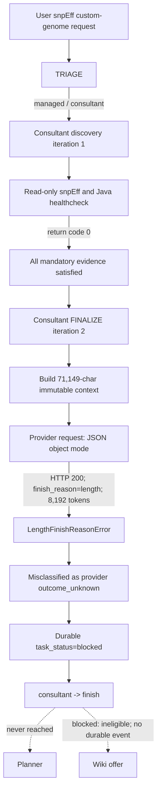

# Session 1786266235 Consultant FINALIZE Length Audit

Status: Complete evidence-bounded audit
Date: 2026-08-09
Primary incident: `session_1786266235`
Related specification: `consultant_finalize_format_repair_spec.md`
Proposed amendment: `consultant_finalize_output_capacity_spec.md`

## 1. Executive conclusion

The first fatal fault in this session was not snpEff, input discovery, graph
routing, Planner, or Wiki. The Consultant reached FINALIZE with all mandatory
evidence satisfied and sent a real structured-output request. The endpoint
opened an HTTP 200 response/stream; when the SDK assembled the result, it
reported `finish_reason=length` and raised `LengthFinishReasonError` after 8,192
completion tokens.

The current controller then lost the partial completion, classified the known
length termination as `FINALIZE_PROVIDER_OUTCOME_UNKNOWN`, marked the task
`blocked`, and routed `consultant -> finish`. Planner was never invoked. The
durable artifacts and supplied transcript contain no Wiki offer/ingest record.
That absence does not prove that the UI never displayed an unpersisted Wiki
offer; if it did, that is a second terminal-projection/persistence defect.

The absence of a safe output-capacity guarantee was detectable before the call:

- reconstructed finalize context: 71,149 compact JSON characters;
- actual HumanMessage: 71,280 characters;
- source-addressable directives: 57;
- deterministic base constraints: 12;
- uncovered directives (`coverage_gaps`): 44;
- compact controller construction using the current auditable directive IDs:
  approximately 15,396 characters / 5,176 estimated tokens;
- declared `max_output_tokens`: 4,096.

This request was not capacity-admissible: the practical canonical construction
already exceeded the advertised cap, the schema had no finite maximum, and no
safety headroom or output-capacity proof existed. This is not a mathematical
claim that every possible legal serialization exceeds 4,096 tokens: a
pathologically shortened-ID construction is approximately 4,012 tokens. It
instead shows that the controller had no basis for asserting that a complete,
auditable response would fit, which the observed length termination confirmed.

## 2. Evidence boundary

Authoritative session artifacts are under:

```text
/public/home/liusiqi/03.毕设/task_outputs/session_1786266235/
```

The matching process log is:

```text
/public/home/liusiqi/03.毕设/Biomind_v1/logs/biomind_20260809_170338.log
```

The evidence hierarchy used by this audit is:

1. protected FINALIZE attempt records and provider-reported usage;
2. graph route events and durable `plan_state.json`;
3. context-trace request/response projections;
4. run metrics and process logs;
5. deterministic replay from the persisted TaskSpec, input audit, and
   consultation state;
6. code-level inference, explicitly labelled as inference.

No existing target output is treated as current-run success without matching
its manifest task/session identity and mtime.

### 2.1 Reconstruction environment

This audit was reconstructed on 2026-08-09 from a dirty worktree. Persisted
session artifacts, not current source-file mtimes, are authoritative for the
historical route. Audit-time source hashes are recorded so later readers can
detect replay drift:

| File | Audit-time SHA-256 |
|---|---|
| `bio_agents.py` | `65f4cd66af78b91c2450a90726d6b07efaf988f0dc66aad0bedf97ef5b5dda8d` |
| `agent_core/consultant_finalize.py` | `fe46e1e862c77f4e50c5f550dde95334d665b045930ede1ea21c34fde01a810f` |
| `agent_core/consultation_state.py` | `5f6224821b74a8e36a24ccd508dc07905125bace6cef6f103477e3178ef46e1b` |
| `agent_core/context_lineage.py` | `0e4b82e9f40ba21050120befe5ea4c08217d1ccba0d8ed781d828093b1824827` |
| `execution/profiling.py` | `e4ca557de261c1ec036a44d7d60bcc90a56028043c276d9ce81b9e7c506540f0` |

Relevant installed versions are `langchain-openai 1.1.7`, `openai 2.15.0`, and
`langchain 1.2.7`. Token figures labelled `cl100k` are diagnostic estimates,
not a claim that DeepSeek uses that tokenizer. Read-only replay imports created
ordinary post-incident startup log files; those logs are explicitly excluded
from session evidence.

## 3. Complete agent execution chain



### 3.1 Task initialization and TRIAGE

- The run starts at 17:04:23 and receives the strict
  `BM-REMAIN-ANNOT-007` request.
- TRIAGE makes one LLM call and returns `task_mode=managed`,
  `retrieval_mode=kb`, confidence `0.95`.
- `context_trace/events.jsonl:1` records `triage -> consultant` with
  `task_status=running`.
- The router request contains an
  `EFFECTIVE USER FACTS` projection marked
  `TRIAGE_CONTEXT_BUDGET_UNSATISFIED` and `projection_truncated=true`.
  This is an upstream observability/coverage warning, but it is not causal in
  this incident: the complete user request remains in the router message and
  the route is correct.

### 3.2 Consultant discovery

- The initial Consultant prompt is 42,880 characters. The trace's simple
  character/4 estimate is approximately 10,720 tokens; its tokenizer-aware
  estimate is 11,723, while provider-reported prompt usage is 12,309. None is
  presented as interchangeable with another.
- The model returns one read-only `execute` action whose only purpose is to
  resolve the snpEff environment, JAR, and Java paths.
- `events.jsonl:2-6` records REQUESTED, APPROVED, SPAWN_STARTED,
  PROCESS_STARTED, and PROCESS_COMPLETED.
- The command exits zero and reports:

```text
RESOLVED_ENV_PREFIX=/public/home/liusiqi/anaconda3/envs/bio_gatk
RESOLVED_SNPEFF_JAR=/public/home/liusiqi/anaconda3/envs/bio_gatk/share/snpeff-5.3.0a-0/snpEff.jar
RESOLVED_JAVA_HOME=/public/home/liusiqi/03.毕设/source_tools/temurin-21
```

- Formal VCF, FASTA, and GTF inputs were already verified as present,
  non-empty, and readable. FASTA/GTF compatibility records two shared contigs.
- `events.jsonl:7` records all three mandatory requirements as satisfied and
  changes the consultation decision to `ready_to_finalize`.
- `events.jsonl:8` routes Consultant back to Consultant for the isolated
  FINALIZE iteration. No scientific snpEff annotation has run at this point.

### 3.3 FINALIZE request construction

The reconstructed immutable context has this size profile:

| Component | Compact JSON characters |
|---|---:|
| complete finalize context | 71,149 |
| `effective_task_contract` | 36,490 |
| `source_addressable_directives` alone | 23,846 |
| `coverage_gaps` | 15,847 |
| deterministic base constraints | 10,706 |
| input audit | 3,679 |
| runtime evidence | 1,347 |
| consultation requirements | 1,191 |
| provenance catalog | 1,166 |

The exact request roles are correctly isolated as `system,human`. The
diagnostic request projection reports:

| Message | Exact character count | Stored diagnostic excerpt |
|---|---:|---:|
| system | 4,057 | 2,048 |
| human | 71,280 | 2,048 |

The projection is intentionally excerpt-only, but its manifest incorrectly
reports `input_token_estimate=1024` and an empty `truncation_manifest`. The
provider later reports 25,162 prompt tokens.

### 3.4 Why 44 model-generated constraints were required

`_consultant_finalize_contract_projection()` first produces 12 deterministic
base directives. It then retains the complete raw request as one envelope and
splits the same request into 44 source-addressable clauses. Those 44 clauses do
not exactly match the base-constraint identities, so every one becomes a
`coverage_gap`.

The 44 gaps include:

- real policies such as prohibiting public database guessing and fabricated
  ANN output;
- already typed inputs and outputs such as the FASTA path and `report.md`;
- structural headings such as `输入文件或数据位置：`, `禁止：`, and
  `预期产物：`;
- a bare skill ID;
- duplicated formulations of the same output and failure policies.

At least nine gaps are section headings, and six gap values exactly equal
existing deterministic output values but evade deduplication because their
distinct hash-derived generic semantic keys differ. A compound sentence containing
`不要猜物种数据库` is also classified as `require` because prohibition
detection only recognizes a negative token at the beginning of a segment.
This is therefore a polarity/atomicity defect as well as a size defect.

The final response schema and coverage audit require exactly one verbose
semantic-constraint row for every gap, including constraint ID, semantic key,
operator, value, strength, confidence, and provenance. This turns lossless
coverage into unbounded model-owned expansion even when the controller already
possesses every value needed to compile the row.

An exact compact controller construction using existing auditable directive
IDs, a one-character summary, and only the seven required constraint fields is
about 15,396 characters / 5,176 `cl100k` estimated tokens. A pathological
short-ID construction is about 4,012 tokens, leaving only 84 tokens below the
advertised cap for all natural model variation. Therefore the evidence proves
that the current canonical/auditable representation does not fit and that the
schema lacks a safe finite admission bound; it does not prove that the abstract
minimum over every schema-valid encoding is greater than 4,096. This is a
capacity-risk witness, not a reconstruction of the lost model response.

### 3.5 Provider call and first fatal fault

The request intent records:

```text
provider=deepseek
model=deepseek-v4-pro
structured_output_mode=json_object
max_output_tokens=4096
thinking=disabled
```

At 17:05:08 the endpoint returns HTTP 200. At 17:06:14 the SDK raises:

```text
LengthFinishReasonError
prompt_tokens=25162
completion_tokens=8192
total_tokens=33354
```

This is the first fatal fault. Because the partial content was discarded, the
artifacts cannot determine whether the exact generation exhausted the budget
because of the 44-row representation, optional verbosity, repeated/blank JSON
mode output, or another generation behavior. The unbounded schema and adapter
mismatch are verified defects and strong contributing conditions, not proof of
one unique token-by-token cause.

There is also a provider-adapter parameter mismatch:

1. BioMind records the semantic setting `max_output_tokens=4096`.
2. BioMind binds LangChain with `max_tokens=4096`.
3. The installed `langchain-openai` `ChatOpenAI` adapter rewrites that field to
   `max_completion_tokens=4096` in the generated Chat Completions payload.
4. DeepSeek's Chat Completions contract documents `max_tokens`, not
   `max_completion_tokens`.
5. The observed completion reaches 8,192 rather than the recorded 4,096.

The local payload transformation and API contract mismatch are confirmed. The
current trace does not persist the sanitized outbound wire payload, so whether
the service ignored the unknown field or another gateway default intervened is
an evidence-backed inference rather than a directly recorded server decision.

### 3.6 Failure classification and persistence

`LengthFinishReasonError` contains a provider completion object, including the
partial message, finish reason, and usage. Current BioMind has no typed branch
for this exception. It falls through the generic exception classifier to:

```text
provider_status=outcome_unknown
protocol_status=not_validated
error_code=FINALIZE_PROVIDER_OUTCOME_UNKNOWN
retry_safe=false
response_artifact_ref=""
response_content_hash=""
```

This classification is incorrect at two levels:

- delivery outcome is known: the provider returned a completion;
- protocol outcome is known: the completion is truncated and cannot be a
  complete FINALIZE object.

The exception's partial completion is not persisted. Only the exception class
and message survive. Consequently the exact attempted JSON, finish reason,
response hash, and partial-response lineage are unavailable after the process
returns.

### 3.7 Terminal routing

The previous terminal-routing repair behaves correctly in this session:

- `plan_state.json` records `phase=blocked`,
  `completion_reason=FINALIZE_PROVIDER_OUTCOME_UNKNOWN`, and
  `finalize_protocol.status=blocked_internal_provider`;
- `task_state.status=blocked` is durable;
- `events.jsonl:9` records `consultant -> finish` with
  `task_status=blocked`;
- no Planner LLM call or plan step exists;
- no durable Wiki offer or Wiki ingest event exists in the session artifacts or
  supplied transcript.

If a Wiki offer was nevertheless rendered in the UI, it was not persisted in
the audited lifecycle. That would violate the required blocked-task Wiki gate
and must be reproduced at the UI/outer-controller boundary; this session's
durable trace alone cannot confirm or refute that presentation-layer event.

The `finish` graph edge is a generic terminal edge, not evidence that the task
completed successfully.

### 3.8 Outputs and stale-artifact check

This session generated no scientific output. `run_metrics.md` reports no output
artifacts, and there is no session `plan.md`.

The files already present under
`benchmarks/biomind_agent_benchmark/runs/remaining/BM-REMAIN-ANNOT-007/strict`
belong to `session_1785396504` and predate this run. They are not evidence of
success for `session_1786266235`.

## 4. Root-cause ranking

### P1-RC1: unbounded, non-capacity-admissible one-shot output contract

The protocol requires 44 full constraint rows while claiming a 4,096-token
output budget. Its canonical auditable construction exceeds the cap, its schema
has no finite maximum, and no output-capacity preflight exists. Only
input-window capacity is checked. Although an artificially shortened encoding
can fall just below 4,096, the controller cannot prove a complete schema-valid
response fits with safety headroom.

### P1-RC2: duplicated raw-directive expansion

The same request is represented as typed TaskSpec facts, deterministic base
constraints, one raw envelope, and 44 raw segments. Headings, paths, and
already-typed artifacts become model-owned semantic gaps.

### P1-RC3: provider parameter is not verified at the wire boundary

The durable request intent stores the requested semantic value, not the actual
provider payload key/value. The installed OpenAI-compatible adapter rewrites
the token field to a name not documented by DeepSeek.

### P1-RC4: known truncation is misclassified as unknown delivery

The generic provider exception classifier cannot distinguish a completed
`finish_reason=length` response from a timeout or interrupted call.

### P1-RC5: partial completion is discarded

The SDK exception carries the partial completion, but BioMind persists only an
error string. This prevents audit, safe compaction repair, and accurate usage
accounting.

### P1-RC6: no typed length-recovery transition

Wire repair assumes a protected response artifact produced by an ordinary
successful invocation. Because truncation is stored as an unknown provider
failure with no artifact, the only legal current transition is an internal
block.

### P2-RC7: metrics and trace under-report the failed call

- run metrics record finalizer completion tokens as zero instead of 8,192;
- summary completion tokens therefore exclude the expensive failed output;
- the diagnostic request manifest estimates only the stored excerpts;
- no `finish_reason`, partial-content size/hash, effective wire token field, or
  output-feasibility estimate is recorded.

### P2-RC8: selected-skill projection is lost on the blocked path

The request intent and consultation ledger resolve
`genomics/snpeff-annotation`, but top-level plan/metrics projections remain
empty because terminal updates do not promote the resolved IDs. This makes a
pre-Planner failure look as if no skill was selected.

### P2-RC9: blocked final result is the healthcheck stdout

Run profiling falls back to the last successful command output, so the
`RESOLVED_*` healthcheck is labelled as the Final Result even though the task
is blocked. The terminal diagnostic should be the result; healthcheck stdout
should remain evidence only.

### P2-RC10: archive/task-summary projection is stale

The durable plan/graph state is blocked, but
`memorydata/memory/tasks/session_1786266235.md` still reports
`Status: not_started` and `Event count: 0`; the corresponding `TASKS.md` row
does the same. These caches are not the source of truth, but their failure to
reconcile explains why outer/UI lifecycle decisions cannot safely rely on one
projection alone and materially complicates the reported Wiki-offer audit.

## 5. Explicit non-causes

- The three formal input files were not missing.
- snpEff.jar and Java were not missing.
- The healthcheck did not fail.
- The `-gtf22` parameter-list projection bug from the prior session did not
  recur; FINALIZE initialized and called the provider.
- Planner did not reject a plan; Planner was never called.
- The durable graph did not route through Wiki. The reported UI Wiki offer is
  not represented in the durable artifacts and remains a separate lifecycle
  issue to reproduce, not a cause of the FINALIZE length failure.
- Old target outputs did not cause the controller to declare success.
- The configured 200,000-token controller input limit was not exhausted; this
  is not asserted as the provider/model's independently verified native limit.

## 6. Required remediation boundary

A complete correction must address all of the following together:

1. deterministic directive classification and deduplication;
2. deterministic compilation for controller-owned gaps;
3. bounded model-only resolution for genuinely unresolved semantics;
4. pre-call output-capacity proof;
5. provider-specific effective wire parameter verification;
6. typed length termination and protected partial-response persistence;
7. materially different bounded recovery, never blind identical retry;
8. accurate provider usage and truncation telemetry;
9. Planner and Wiki gates tied to durable compiled/completed state.

Merely increasing a token constant would leave the protocol unbounded, the
adapter mismatch unaudited, and the partial-response/metrics defects intact.
