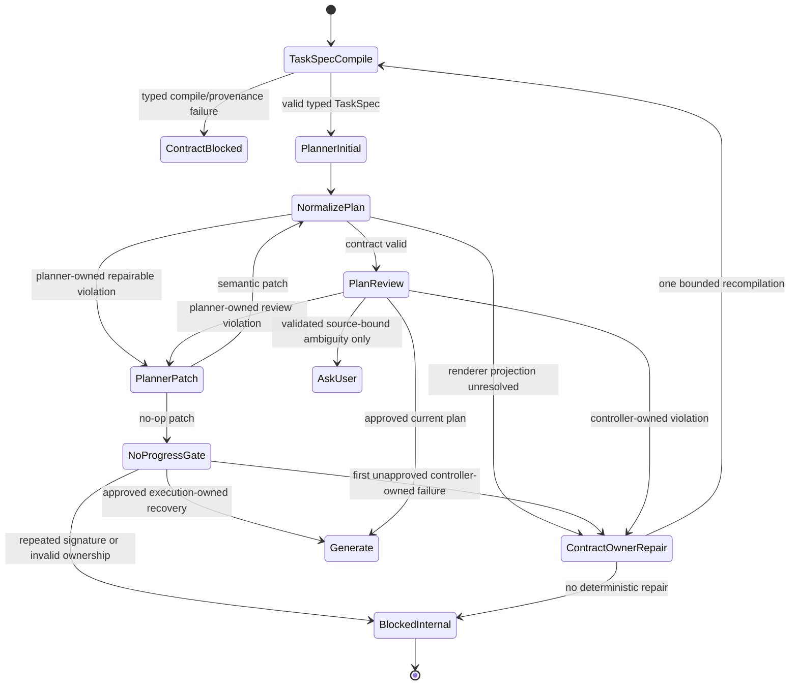

# snpEff Plan Contract and Convergence Repair Specification

Status: Proposed
Incident reference: `session_1786283343`
Target: BioMind TaskSpec -> Planner -> Renderer -> Plan Review pipeline
Primary implementation: `agent_core/task_spec.py`,
`agent_core/consultant_finalize.py`, `agent_core/plan_tracker.py`,
`prompts/manager.py`, `bio_agents.py`, and focused regression tests

## 1. Executive Decision

`session_1786283343` failed before snpEff annotation execution. The selected
skill healthcheck resolved a usable snpEff JAR and Java runtime, but the
controller could not construct and approve a complete renderer invocation.
The visible Planner/Plan Review loop was produced by several contract defects
acting together:

1. the compiled TaskSpec did not represent the custom database request as the
   typed constraint `required_behavior.database_source = custom_genome`;
2. requirement normalization used values such as `gtf22` as selector roles,
   preventing deterministic renderer argument projection;
3. an incomplete renderer projection was silently discarded, so downstream
   validation reported generic uncovered outputs instead of the missing
   `genome_version` binding;
4. Planner semantic claims were under-specified by the prompt, rejected by the
   validator, and then silently replaced with an empty list;
5. H1 validation checklist items were parsed as executable plan steps;
6. an intermediate `annotated.vcf` was classified as a new task input by file
   extension, creating a false conflict with the original input VCF; and
7. a no-op plan patch cleared active violations and requested Generate, while
   the Planner graph router discarded the Generate route and returned to Plan
   Review.

The repair MUST fix the complete causal chain. Adding only a `generate` branch
to `planner_router` is insufficient and unsafe because an unapproved,
contract-invalid plan could then be sent toward execution.

## 2. Security and Operational Boundary

This specification and its implementation have the following mandatory
boundary:

1. The workspace startup script is outside the scope of investigation and
   implementation. Its contents MUST NOT be opened, read, sourced into the
   current shell, copied, searched, printed, or included in test fixtures.
2. The single permitted exception is opaque interactive acceptance execution
   with the exact command
   `bash /public/home/liusiqi/03.毕设/启动.sh`. The script may be used as the
   user-authorized application entrypoint, but its contents remain protected.
3. Opaque execution MUST NOT use `bash -x`, `set -x`, shell-debugging flags,
   environment dumps, process-environment inspection, or any wrapper that
   exposes exported values. Testing may interact only with the application's
   normal terminal interface and normal application output.
4. API keys and other credentials MUST NOT be read, printed, logged, added to
   traces, or used as test data. If normal application output unexpectedly
   exposes a credential-like value, testing MUST stop and the value MUST NOT be
   repeated in reports.
5. Unit and integration tests SHOULD use mocks or the repository's
   already-configured test interfaces. The opaque interactive entrypoint is
   reserved for final end-to-end acceptance after focused automated tests pass.
6. This repair does not change process startup, provider authentication, shell
   initialization, or secret management.
7. Review commands MUST be scoped to the BioMind repository and the incident
   artifacts required by this specification.

## 3. Incident Boundary and Confirmed Evidence

The incident boundary is:

```text
selected snpEff skill healthcheck succeeds
  -> Consultant compiles TaskSpec
  -> TaskSpec lacks typed database_source selector
  -> renderer projection misses genome_version
  -> renderer invocation is not attached to the composite step
  -> renderer-owned outputs have no deterministic bound producer
  -> semantic/output coverage validation fails
  -> Planner patch cannot repair controller-owned bindings
  -> patch becomes no-op
  -> Planner asks for Generate
  -> planner_router maps the result back to Plan Review
  -> Plan Review detects the same failures/conflict
  -> Planner receives the same repair problem again
```

The first blocking failure is therefore a TaskSpec/renderer contract failure.
Later semantic coverage errors, output coverage errors, conflict reports, and
the repeated Plan Review route are downstream symptoms.

The following observations are normative regression facts:

- the runtime healthcheck completed successfully;
- the renderer requires `genome_version` for the custom-database route;
- renderer projection had VCF, FASTA, GTF, and output directory bindings but
  was incomplete because `genome_version` was missing;
- the compiled TaskSpec contained
  `required_behavior.annotation_format = gtf22`, but its normalized requirement
  role was `gtf22` rather than `annotation_format`;
- the custom database instruction remained a synthetic
  `required_behavior.directive_*` constraint rather than becoming
  `required_behavior.database_source = custom_genome`;
- the final plan contained no valid step semantic claims and no renderer
  invocation contract;
- the patch log contains repeated semantic no-op repairs;
- no current snpEff annotation command ran in this session; and
- files already present in the target output location cannot be treated as
  evidence of this session's success.

## 4. Goals

The implementation MUST:

1. preserve typed TaskSpec selector roles independently from selector values;
2. compile an explicit custom-database request into the closed TaskSpec
   ontology with source-bound provenance;
3. deterministically derive the renderer `genome_version` for a custom genome;
4. expose incomplete renderer projections as typed, owner-aware violations;
5. prevent Planner from editing or guessing controller-owned renderer
   bindings;
6. make Planner semantic-claim references schema-valid and lossless;
7. parse only executable checklist items as plan steps;
8. distinguish task-root inputs from intermediate or final outputs;
9. guarantee convergence when a plan repair produces no semantic change;
10. preserve the intended same-step Generate recovery for an already-approved
    execution plan;
11. prevent an unapproved plan from reaching Generate;
12. produce sufficient durable diagnostics to reconstruct every repair and
    route decision; and
13. replay the incident without an infinite Planner/Plan Review cycle.

## 5. Non-Goals

This change does not:

- modify snpEff commands, scientific annotation logic, database contents, or
  Java selection;
- weaken output coverage, semantic coverage, provenance, or plan approval;
- accept arbitrary synthetic `required_behavior.directive_*` values as
  renderer selectors;
- infer missing scientific choices from filename extensions;
- ask the user to repair an internal schema, projection, parser, or routing
  failure;
- hand-edit or resume the corrupted state of `session_1786283343`;
- delete or overwrite pre-existing output artifacts;
- introduce a second PlanTracker or recovery state machine; or
- make the LLM authoritative for renderer arguments, output ownership, plan
  approval, retry budgets, or graph routing.

## 6. Ownership Model

| Concern | Authoritative owner |
|---|---|
| User facts and source provenance | TaskSpec/controller |
| Closed semantic ontology | TaskSpec compiler |
| Requirement role and value | TaskSpec normalizer |
| Renderer argument schema | Renderer skill record |
| Renderer argument projection | Controller |
| Renderer output materialization | Controller + renderer contract |
| Step-to-constraint selection | Planner proposal |
| Materialized semantic claim rows | Controller |
| Markdown section parsing | Plan parser |
| Artifact lineage | PlanTracker/controller |
| Plan validation and approval | PlanTracker/Plan Review |
| Repair/no-progress budget | Durable controller state |
| Graph transition | Controller router |
| Genuine unresolved scientific choice | User |

The Planner MUST NOT repair a missing controller-owned renderer binding by
inventing an argument, output path, constraint ID, or semantic row.

## 7. Required Invariants

1. For every normalized semantic requirement with key `category.slot`, its
   default selector role is `slot`, never its value.
2. Requirement identity and selector role are distinct. `constraint_id` may be
   the durable identity while `role` remains a stable ontology selector.
3. Distinct hard values for the same selector role produce an explicit
   projection conflict; dictionary last-write-wins behavior is prohibited.
4. `database_source = custom_genome` plus a TaskSpec-bound task ID is sufficient
   for deterministic `genome_version` derivation.
5. Raw task prose is not reparsed inside renderer projection.
6. An incomplete renderer projection always produces one typed violation with
   exact missing bindings and conflicts.
7. Renderer prose outputs and capability declarations are not producer
   evidence. Only deterministic `bound_outputs` establish renderer ownership.
8. Invalid Planner semantic claims are never silently converted to `[]`.
9. A Planner-supplied constraint reference must resolve exactly once to the
   current TaskSpec revision.
10. Composite renderer-step collapse preserves every valid semantic constraint
    reference from merged steps.
11. Validation checklist items never become executable steps.
12. A plan input that resolves to a TaskSpec output or an upstream step output
    is an artifact dependency, not a new task-root input.
13. A no-op patch does not consume a plan revision, but it does consume a
    dedicated no-progress budget for its validation signature.
14. No-op handling never clears unresolved violations.
15. Same-step Generate recovery is allowed only for a currently approved plan
    and an execution-owned recovery request.
16. Initial plan validation and plan approval cannot be bypassed by a no-op
    repair.
17. Every graph route returned by a node has an explicit conditional edge.
18. Internal contract failures never route to `ask_user` unless TaskSpec
    contains a validated, source-bound ambiguity requiring a user decision.

## 8. Target Data Contracts

### 8.1 Normalized semantic requirement

The target normalized representation is:

```json
{
  "requirement_id": "constraint:<stable-hash>",
  "role": "annotation_format",
  "semantic_key": "required_behavior.annotation_format",
  "operator": "eq",
  "value": "gtf22",
  "strength": "hard",
  "confidence": 1.0,
  "provenance": [
    {
      "source_type": "current_task_user_explicit",
      "source_id": "fact-or-message-id"
    }
  ]
}
```

For the custom database selector:

```json
{
  "requirement_id": "constraint:<stable-hash>",
  "role": "database_source",
  "semantic_key": "required_behavior.database_source",
  "operator": "eq",
  "value": "custom_genome",
  "strength": "hard",
  "confidence": 1.0,
  "provenance": [
    {
      "source_type": "user_explicit",
      "source_id": "source-directive-id"
    }
  ]
}
```

`role=gtf22` and `role=custom_genome` are invalid because those strings are
values, not selectors.

### 8.2 Planner semantic references

The target Planner wire format uses controller-resolvable IDs:

```json
{
  "step_id": "step-2",
  "semantic_constraint_ids": [
    "constraint:<annotation-format-id>",
    "constraint:<database-source-id>"
  ]
}
```

The durable step may retain a materialized compatibility view:

```json
{
  "semantic_constraint_ids": ["constraint:<id>"],
  "semantic_claims": [
    {
      "constraint_id": "constraint:<id>",
      "semantic_key": "required_behavior.database_source",
      "operator": "eq",
      "value": "custom_genome",
      "strength": "hard",
      "confidence": 1.0,
      "provenance": [
        {
          "source_type": "user_explicit",
          "source_id": "source-directive-id"
        }
      ]
    }
  ]
}
```

The controller materializes `semantic_claims` from the current TaskSpec. The
Planner does not recreate provenance or constraint IDs.

During migration, a legacy full-row `semantic_claims` input MAY be accepted
only when every row validates and resolves to the exact current TaskSpec
semantic identity. Invalid rows MUST generate a typed violation and MUST NOT be
discarded silently.

### 8.3 Renderer projection result

Successful projection:

```json
{
  "complete": true,
  "arguments": {
    "vcf": "/absolute/input.vcf",
    "reference_fasta": "/absolute/genome.fasta",
    "annotation_gtf": "/absolute/genome.gtf",
    "genome_version": "biomind_session_1786283343"
  },
  "outdir": "/absolute/output-dir",
  "binding_sources": {},
  "missing_bindings": [],
  "conflicts": []
}
```

Failed projection MUST be preserved as:

```json
{
  "violation_code": "RENDERER_INVOCATION_BINDING_UNRESOLVED",
  "step_id": "step-2",
  "renderer_id": "genomics.snpeff_annotation",
  "missing_bindings": ["genome_version"],
  "conflicts": [],
  "repair_owner": "task_contract",
  "llm_repair_allowed": false,
  "reason": "Renderer invocation could not be projected from the approved TaskSpec."
}
```

This violation is distinct from
`RENDERER_OUTPUT_BINDING_UNRESOLVED`: invocation construction precedes output
materialization.

### 8.4 Plan validation no-progress record

```json
{
  "schema_version": 1,
  "signature": "sha256",
  "base_plan_hash": "sha256",
  "violation_fingerprint": "sha256",
  "allowed_step_ids": ["step-2"],
  "plan_approved": false,
  "recovery_owner": "PLAN_CONTRACT",
  "attempt_count": 1,
  "last_patch_no_op": true,
  "recorded_at": "RFC3339"
}
```

The violation fingerprint is computed from normalized, sorted violation
records. It MUST exclude timestamps and presentation-only text.

## 9. Normative Functional Requirements

### R1. Normalize requirement roles from the ontology key

`agent_core/task_spec.py::normalize_requirement()` MUST normalize
`semantic_key` before selecting fallback role and requirement identity.

Required order:

1. validate/normalize `semantic_key`;
2. read explicit `role` or `name`;
3. if role is absent and semantic key is valid, use the key suffix;
4. assign `requirement_id` from explicit ID, `constraint_id`, or role;
5. retain value independently;
6. retain source-bound provenance.

`project_task_spec_to_renderer()` MUST index requirements by normalized role.
If more than one active hard requirement exists for a role, it MUST compare
semantic identities and report a conflict when values differ.

### R2. Compile custom database intent into typed atomic constraints

The Consultant finalize/compiler path MUST represent the incident directive as
typed atomic constraints rather than one hard synthetic directive.

For the snpEff custom-genome request, the compiled contract MUST contain:

- `required_input.reference_fasta = <exact bound path>`;
- `required_input.annotation_gtf = <exact bound path>`;
- `required_behavior.annotation_format = gtf22`; and
- `required_behavior.database_source = custom_genome`.

The compiler MUST preserve the original source IDs for every generated row.
The compound source directive may remain as a provenance envelope, but it MUST
NOT also remain as an uncovered hard synthetic behavior after all of its atomic
meaning has been represented.

This mapping belongs in the typed directive/fact resolution stage, including
`classify_directive_coverage()` and its typed-alias inputs. Renderer projection
MUST NOT search Chinese or English raw prompt text for phrases such as “local
database” or “custom genome”.

### R3. Derive custom `genome_version` deterministically

When the renderer schema requests `genome_version`, `database_id`, or
`genome_id`, and TaskSpec contains the active hard selector
`database_source = custom_genome`, the controller MUST derive the value using
the existing task-ID-based custom genome naming rule.

The derived binding source MUST be recorded as controller-derived and linked to
the database-source constraint ID. The Planner and Generate nodes MUST NOT
choose or rewrite this value.

### R4. Make renderer projection failure explicit

`bind_renderer_invocation_contracts()` MUST NOT silently continue when
projection is incomplete or conflicted.

It MUST:

1. preserve the projection result in normalization audit data;
2. append a `RENDERER_INVOCATION_BINDING_UNRESOLVED` violation;
3. include exact missing argument names and conflicts;
4. assign a repair owner;
5. mark controller-owned missing bindings as not LLM-repairable; and
6. avoid creating `renderer_invocation_contract` or `bound_outputs` until the
   projection is complete.

`normalize_plan_contracts()` MUST return this violation before generic output
coverage violations. Output validation MAY suppress redundant
`REQUIRED_OUTPUT_UNCOVERED` messages for the same renderer step while the
invocation-binding violation is active.

### R5. Use controller-materialized semantic claims

The initial Planner prompt and PlanPatch prompt MUST describe the same semantic
reference contract.

The implementation MUST:

1. provide the Planner with allowed TaskSpec constraint IDs and concise
   immutable identities;
2. require `semantic_constraint_ids` on every executable step, allowing `[]`
   only when the step implements no TaskSpec semantic constraint;
3. resolve each ID against the TaskSpec revision bound to the plan;
4. materialize exact claim rows controller-side;
5. reject unknown, duplicate-with-conflicting-content, stale, or out-of-scope
   IDs;
6. include semantic constraint IDs in `build_plan_repair_request()`;
7. include the field in the PlanPatch `new_step` schema; and
8. preserve the field when renderer composite steps are collapsed.

The existing full-row parser MUST return structured validation information. A
whole list must not disappear because one row is malformed.

### R6. Parse Markdown sections deterministically

Named-section recognition MUST support Markdown heading levels H1 through H6.

The parser MUST distinguish:

- section not present;
- section present but empty; and
- section present with executable checklist records.

If an Execution Checklist section is present, the parser MUST inspect only that
section for canonical checkbox steps. It MUST NOT fall back to checkbox lines
inside Validation Checklist or other sections.

If Execution Checklist is present but contains no valid executable record, the
parser MUST emit `EXECUTION_CHECKLIST_EMPTY_OR_INVALID` rather than silently
constructing steps from another section.

Legacy fallback parsing remains allowed only when no Execution Checklist
heading exists. Validation Checklist must still be excluded at every supported
heading level.

### R7. Preserve output and intermediate-artifact lineage

Knowledge registration for plan bindings MUST resolve a value in this order:

1. exact canonical TaskSpec input binding;
2. exact canonical TaskSpec output binding;
3. exact upstream step output or renderer `bound_output`;
4. explicit renderer argument role/source;
5. limited filename/extension inference for unresolved task-root bindings only.

If `annotated.vcf` is a required output or upstream artifact, a downstream
step input using that path MUST register an artifact dependency. It MUST NOT
register `required_input.variant_vcf = annotated.vcf`.

Extension-based input-role inference MUST never override an exact output or
upstream-artifact match.

### R8. Make no-op plan repair convergent

When `apply_plan_patch()` reports `no_op=true`, the controller MUST retain all
active violations and evaluate the plan state before selecting a route.

The routing rules are:

| Plan state | Recovery ownership | Required result |
|---|---|---|
| Approved/current | execution action | one `same_step_generate` transition |
| Approved/current | plan contract | typed internal block or one owner-specific repair, never Generate by default |
| Unapproved | any | never Generate |
| Unapproved + controller-owned binding failure | typed internal block or one TaskSpec recompilation transition |
| Same validation signature already no-op | terminal `PLAN_CONTRACT_REPAIR_NO_PROGRESS` |

A no-op patch MUST consume the dedicated validation no-progress budget even
though it does not consume plan revision or normal plan-patch budget.

The durable signature MUST include:

- base semantic plan hash;
- normalized violation fingerprint;
- allowed step IDs;
- plan approval state; and
- recovery owner.

The same signature MUST NOT trigger another Planner LLM call after its no-op
result has been persisted.

### R9. Honor explicit graph routes

`planner_router` MUST explicitly handle `generate`, and the Planner conditional
edge declaration MUST list `generate` as a possible destination.

Before returning `generate`, the Planner node MUST prove that:

- `plan_approval_is_current(...)` is true;
- `validate_plan_for_generate(...)` succeeds; and
- the recovery owner is execution/action repair rather than initial plan
  contract validation.

Unknown Planner `next_step` values MUST produce a typed internal routing error;
they MUST NOT default silently to Plan Review.

### R10. Preserve current-run artifact identity

Successful acceptance MUST be based on a new session and a new or confirmed
empty output target.

Output success requires:

- manifest task/session identity matches the new run;
- artifact modification times follow the new run start;
- required outputs are linked to execution evidence from the new run; and
- no stale artifact is accepted only because a path exists.

The incident session is a read-only regression source and MUST NOT be resumed as
the acceptance run.

## 10. Target State Machine



## 11. Implementation Map

### 11.1 `agent_core/task_spec.py`

- reorder `normalize_requirement()` so `semantic_key` can provide the fallback
  role;
- keep `constraint_id`, `requirement_id`, role, and value separate;
- detect multiple hard values for one requirement role;
- retain source-bound provenance;
- ensure `project_task_spec_to_renderer()` indexes selectors by role;
- link derived `genome_version` to the database-source constraint; and
- add focused tests for `annotation_format` and `database_source` projection.

### 11.2 `agent_core/consultant_finalize.py`

- extend typed directive/fact resolution for explicit custom-database intent;
- atomize the compound incident directive into existing closed ontology rows;
- preserve source IDs and coverage proof;
- avoid emitting a duplicate hard synthetic directive after typed coverage;
  and
- add compilation tests using Chinese and equivalent English source wording at
  the directive-classification boundary, not in renderer projection.

### 11.3 `agent_core/plan_tracker.py`

- preserve structured semantic-claim validation failures;
- support `semantic_constraint_ids` and controller materialization;
- merge constraint IDs/claims during renderer composite collapse;
- recognize H1 through H6 named sections;
- distinguish missing and empty Execution Checklist sections;
- store renderer invocation projection violations;
- suppress redundant uncovered-output noise while the renderer invocation is
  unresolved; and
- include the new violations in `normalize_plan_contracts()`.

### 11.4 `prompts/manager.py`

- replace the incomplete Planner semantic-claim example;
- require TaskSpec constraint IDs rather than model-created full rows;
- update the initial checklist contract;
- update the PlanPatch `new_step` schema;
- state that renderer/controller-owned bindings cannot be changed by PlanPatch;
  and
- include exact allowed constraint IDs in the repair request.

### 11.5 `bio_agents.py`

- resolve plan inputs against task outputs/upstream outputs before extension
  inference;
- classify renderer invocation binding failures as deterministic and
  controller-owned;
- retain violations on no-op;
- persist and enforce the validation no-progress signature;
- gate same-step Generate on current plan approval and recovery ownership;
- make unknown Planner routes explicit internal errors;
- add the Planner -> Generate graph edge; and
- keep internal contract failures out of `ask_user`.

### 11.6 Tests and fixtures

Preferred test locations:

- `tests/test_task_spec_semantic_ambiguity.py` or a focused TaskSpec projection
  test for typed selectors;
- `tests/test_semantic_constraint_protocol.py` for materialized semantic
  references and renderer projection;
- `tests/test_plan_tracker.py` for section parsing, collapse preservation, and
  projection violations;
- `tests/test_knowledge_conflicts.py` for intermediate VCF lineage;
- `tests/test_plan_lifecycle.py` for no-op convergence and route ownership;
- `tests/test_plan_contract_canary.py` for complete custom snpEff projection;
  and
- one new incident replay fixture/test derived from `session_1786283343`.

## 12. Test Matrix

### 12.1 TaskSpec normalization tests

1. A constraint with semantic key
   `required_behavior.annotation_format` and value `gtf22` normalizes to
   `role=annotation_format`.
2. A constraint with semantic key
   `required_behavior.database_source` and value `custom_genome` normalizes to
   `role=database_source`.
3. Requirement identity remains the supplied constraint ID.
4. Provenance remains unchanged.
5. Two hard `database_source` constraints with different values produce an
   explicit conflict.

### 12.2 Consultant compiler tests

1. The incident custom-database directive produces a typed database-source
   constraint.
2. `-gtf22` produces `annotation_format=gtf22`.
3. Exact FASTA/GTF inputs remain typed input constraints.
4. Every generated constraint resolves to its source catalog entry.
5. No uncovered hard synthetic directive remains for already-atomized content.
6. A genuinely ambiguous database source remains an ambiguity and is not
   forced to `custom_genome`.

### 12.3 Renderer projection tests

1. VCF + FASTA + GTF + custom database + output directory produces
   `complete=true`.
2. `genome_version` is deterministic for a fixed task ID.
3. `annotation_format` routes to the renderer's `gtf22` branch.
4. Missing database source produces
   `RENDERER_INVOCATION_BINDING_UNRESOLVED` with
   `missing_bindings=[genome_version]`.
5. An incomplete projection creates no invocation contract and no bound
   outputs.
6. A complete projection binds every renderer-owned required output exactly
   once.

### 12.4 Planner semantic reference tests

1. Valid constraint IDs materialize exact TaskSpec rows.
2. Unknown IDs are rejected.
3. IDs from an older TaskSpec revision are rejected.
4. A malformed legacy row produces a typed violation and does not erase valid
   sibling rows.
5. Composite renderer collapse preserves all distinct constraint IDs.
6. PlanPatch cannot change the content behind a constraint ID.

### 12.5 Markdown parser tests

1. H1 `# Execution Checklist` is recognized.
2. H1 `# Section 4: Validation Checklist` is excluded.
3. Checkbox items under Validation Checklist never become steps.
4. Present-but-empty Execution Checklist produces
   `EXECUTION_CHECKLIST_EMPTY_OR_INVALID`.
5. Legacy checklist fallback still works when no execution heading is present.

### 12.6 Artifact-lineage conflict tests

1. Original `input.vcf` is registered as `required_input.variant_vcf`.
2. Renderer output `annotated.vcf` is registered as
   `required_output.annotated_vcf`.
3. A downstream input reference to `annotated.vcf` becomes an artifact
   dependency.
4. No `USER_PLAN_CONFLICT` is created between `input.vcf` and
   `annotated.vcf`.
5. A real pair of contradictory task-root VCF bindings still produces a
   conflict.

### 12.7 No-progress and routing tests

1. A no-op patch preserves all active violations.
2. A no-op patch does not increment plan revision.
3. A no-op patch increments validation no-progress budget.
4. An unapproved plan never routes to Generate.
5. An approved execution-owned no-op routes to same-step Generate once.
6. Repeating the same signature terminates with
   `PLAN_CONTRACT_REPAIR_NO_PROGRESS` without another Planner call.
7. `planner_router(next_step=generate)` returns Generate and the graph contains
   the edge.
8. An unknown Planner next step becomes a typed internal routing error.
9. No internal schema/projection/no-progress case routes to `ask_user`.

### 12.8 Incident replay test

The replay fixture MUST preserve the minimum incident features:

- selected skill `genomics/snpeff-annotation`;
- VCF, reference FASTA, annotation GTF, and output directory;
- explicit custom/local database intent;
- annotation format `gtf22`;
- required renderer outputs;
- an H1 Execution Checklist;
- an H1 Validation Checklist containing checkbox records;
- a downstream step consuming `annotated.vcf`; and
- a PlanPatch response that is semantically unchanged.

Expected replay result after the repair:

1. TaskSpec contains typed `database_source` and `annotation_format` roles.
2. Renderer projection is complete.
3. The renderer composite step owns all declared renderer outputs through
   `bound_outputs`.
4. Only Execution Checklist records become executable steps.
5. Semantic coverage has no uncovered hard constraint caused by parser loss.
6. Output coverage has no uncovered renderer-owned output.
7. Knowledge conflict detection reports no false VCF conflict.
8. The graph does not issue a second identical Planner repair call.
9. The plan either reaches review/approval normally or terminates with one
   typed internal failure; it never loops.

## 13. Acceptance Criteria

The change is accepted only when all of the following are true:

- [ ] `normalize_requirement()` produces ontology roles rather than value
      roles for the incident constraints.
- [ ] The compiled TaskSpec contains
      `required_behavior.database_source = custom_genome`.
- [ ] The hard synthetic custom-database directive is removed or represented
      only as a non-blocking provenance envelope after atomic coverage.
- [ ] `project_task_spec_to_renderer()` returns `complete=true` for the incident
      TaskSpec.
- [ ] The renderer invocation contains deterministic `genome_version`.
- [ ] All required renderer-owned outputs have exactly one `bound_outputs`
      producer.
- [ ] Planner semantic constraint references are resolved controller-side.
- [ ] Invalid semantic claims generate violations instead of becoming `[]`.
- [ ] H1 Validation Checklist items are not parsed as steps.
- [ ] `annotated.vcf` does not conflict with the original input VCF.
- [ ] An unapproved no-op repair cannot reach Generate.
- [ ] An approved execution-recovery no-op can reach Generate exactly once.
- [ ] The same plan/violation signature cannot invoke Planner repair twice.
- [ ] Planner has an explicit Generate edge and no unknown-route fallback.
- [ ] No internal contract failure asks the user for clarification.
- [ ] The focused unit and integration test matrix passes.
- [ ] A new-session replay produces a current manifest and current evidence,
      without trusting stale artifacts.
- [ ] No startup-script content or credential value was inspected during
      implementation or verification; if interactive acceptance used the
      authorized launcher, it was executed only as the opaque entrypoint
      defined in Section 2.

## 14. Recommended Delivery Order

### Phase A: Safety and convergence

1. Preserve violations on no-op.
2. Add approval/ownership gating for same-step Generate.
3. Add the no-progress validation signature and terminal guard.
4. Add the explicit Planner -> Generate edge and unknown-route failure.
5. Add graph-level convergence tests.

This phase prevents further infinite loops but does not by itself make the
incident plan valid.

### Phase B: TaskSpec and renderer correctness

1. Fix requirement-role normalization.
2. Compile typed custom-database intent.
3. Expose renderer invocation projection violations.
4. Complete and bind the renderer invocation and outputs.
5. Add TaskSpec/renderer projection tests.

### Phase C: Planner contract and parser correctness

1. Introduce controller-resolved semantic constraint IDs.
2. Update initial and repair prompts together.
3. Preserve semantic references during composite collapse.
4. Fix H1 section parsing and empty-section behavior.
5. Add semantic and parser tests.

### Phase D: Knowledge lineage and incident replay

1. Resolve task outputs/upstream artifacts before extension inference.
2. Add intermediate VCF conflict tests.
3. Add the incident replay fixture.
4. Run the new-session acceptance workflow against a new output directory.

## 15. Verification Commands

Focused automated verification:

```bash
pytest -q \
  tests/test_task_spec_semantic_ambiguity.py \
  tests/test_semantic_constraint_protocol.py \
  tests/test_plan_tracker.py \
  tests/test_knowledge_conflicts.py \
  tests/test_plan_lifecycle.py \
  tests/test_plan_contract_canary.py
```

Before implementation is considered complete, the new incident replay test
MUST be added to this focused command set.

Repository-wide tests should run only after the focused suite passes. Test
execution MUST use the repository's already-configured environment or mocks and
must respect the security boundary in Section 2.

After automated tests pass, interactive acceptance MAY launch the application
with this exact opaque command:

```bash
bash /public/home/liusiqi/03.毕设/启动.sh
```

The acceptance operator MUST NOT inspect the launcher, enable shell tracing,
or print the environment. The interactive session should submit only the
incident replay prompt, observe normal application output, verify convergence,
and terminate cleanly after the manifest and execution evidence are recorded.

## 16. Rollback and Compatibility

1. The new semantic ID field is additive during migration. Existing valid
   full-row semantic claims remain readable until all stored plans are migrated.
2. Existing approved plans are not rewritten merely because the new field is
   introduced.
3. Any automatic migration must preserve plan revision, approval lineage,
   evidence, renderer invocation data, and status.
4. If an old plan cannot resolve a semantic row to one current constraint ID,
   it becomes review-required; it is not silently accepted or dropped.
5. The no-progress budget is separate from plan revision and normal patch
   budget, preserving current no-op revision semantics.
6. The Planner -> Generate edge can be reverted independently, but Generate
   gating and no-progress protection MUST remain paired with it.

## 17. Definition of Done

The repair is complete when:

1. every functional requirement R1-R10 is implemented;
2. every acceptance checkbox is satisfied;
3. focused tests and the incident replay pass;
4. a new run demonstrates current-session renderer and execution evidence;
5. no repeated Plan Review/Planner signature appears in its trace;
6. failure routing remains typed and owner-aware under negative tests;
7. implementation notes identify the exact commits/files for each requirement
   without including secrets or startup-script contents; and
8. any interactive acceptance run used the authorized launcher only as an
   opaque executable entrypoint.
